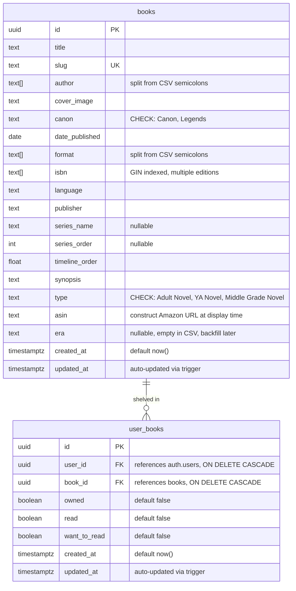

# Star Wars Book Tracker Mobile App

## Overview

A mobile app (iOS + Android) for cataloging and tracking Star Wars books. Users sign in with Google or Apple, browse a curated catalog of ~200 Star Wars books, maintain personal shelves (owned / read / want-to-read), and scan ISBN barcodes to quickly find and shelve books from the catalog. Book covers are rendered as 3D skeuomorphic objects with scroll-triggered animations and an interactive full-screen inspection mode.

The catalog is managed on the backend only (Supabase Studio). The scanner matches existing catalog books — it does not add new books.

**Stack:** Expo (managed) + Supabase (Postgres, Auth) — flat project structure, no monorepo.

## Problem Statement

Star Wars has 200+ novels across Canon and Legends continuities with no good purpose-built tracking app. Readers want to track what they own, what they've read, and what's on their list — organized by timeline, series, and canon vs. Legends.

## Proposed Solution

The Expo app talks directly to Supabase for catalog reads and shelf writes (RLS-enforced). The catalog is managed via Supabase Studio — no Edge Functions needed for V1. The scanner is read-only: it matches ISBNs against the existing catalog.

---

## Technical Approach

### Architecture

```
                    +-------------------+
                    |   Expo App (RN)   |
                    +--------+----------+
                             |
                    Direct Supabase Client
                    (catalog reads, shelf
                     writes, auth)
                             |
                             v
                    +--------+----------+
                    |  Supabase Postgres |
                    |  + Auth + RLS      |
                    +--------------------+
                             ^
                             |
                    Supabase Studio (admin)
                    (add/edit/remove books)
```

### Project Structure

```
ossus-archives/
├─ app/                         # Expo Router file-based routes
│  ├─ _layout.tsx               # Root Stack layout
│  ├─ (auth)/
│  │  ├─ _layout.tsx
│  │  └─ login.tsx
│  ├─ (tabs)/
│  │  ├─ _layout.tsx            # Tab bar config
│  │  ├─ index.tsx              # Catalog tab (home)
│  │  ├─ shelf.tsx              # Bookshelf tab
│  │  ├─ scan.tsx               # Scanner tab
│  │  └─ profile.tsx            # Profile/settings tab
│  └─ book/
│     └─ [id].tsx               # Book detail (pushed from any tab)
├─ components/
├─ hooks/
├─ lib/
│  ├─ supabase.ts               # Supabase client config
│  └─ types.ts                  # Generated Supabase types + domain aliases
├─ scripts/
│  └─ seed.ts                   # One-time CSV import script
├─ supabase/
│  ├─ config.toml
│  ├─ migrations/
│  └─ seed.sql
├─ data/
│  └─ books.csv                 # Seed CSV (moved from docs/)
├─ app.json
├─ metro.config.js
├─ tsconfig.json
├─ biome.json                   # Linting/formatting (per user convention)
├─ package.json
├─ CLAUDE.md
└─ .gitignore                   # Expo + Supabase patterns
```

No monorepo, no workspaces, no turbo. One Expo app, one `supabase/` directory. Types live in `lib/types.ts`. Seed script in `scripts/`. If a web admin app is ever needed, restructure then.

### Database Schema

**2 tables.** Everything denormalized onto `books`. No separate authors, series, or profiles tables. Column names match the CSV headers.



### CSV Column → Schema Mapping

| CSV Column | DB Column | Type | Transform |
|---|---|---|---|
| `title` | `title` | `text NOT NULL` | Direct |
| `id` | — | Dropped | Use UUID instead |
| `slug` | `slug` | `text UNIQUE NOT NULL` | Direct (used for seed dedup) |
| `author` | `author` | `text[] NOT NULL` | Split on `;`, trim each |
| `cover_image` | `cover_image` | `text` | Direct (external URL) |
| `canon` | `canon` | `text NOT NULL` | Direct (`"Canon"` / `"Legends"`) |
| `characters` | — | Dropped | Always empty in CSV, not used in V1 |
| `date_published` | `date_published` | `date` | Parse `"January 5, 2021"` → `2021-01-05` |
| `format` | `format` | `text[]` | Split on `;` and `,`, deduplicate, trim |
| `isbn` | `isbn` | `text[]` | Wrapped in array (e.g., `["9780345541932"]`). Additional edition ISBNs can be appended via Supabase Studio. GIN indexed. |
| `language` | `language` | `text` | Direct (always `"English"`) |
| `publisher` | `publisher` | `text` | Direct |
| `series` | — | Dropped | Redundant with `series_name` ("Yes"/"No" flag) |
| `series_name` | `series_name` | `text` | Direct (nullable, empty when not a series) |
| `series_order` | `series_order` | `int` | Direct (nullable) |
| `timeline_order` | `timeline_order` | `float` | Direct |
| `synopsis` | `synopsis` | `text` | Direct |
| `type` | `type` | `text NOT NULL` | Direct (`"Adult Novel"`, `"YA Novel"`, `"Middle Grade Novel"`) |
| `asin` | `asin` | `text` | Direct (construct Amazon URL at display time, drop affiliate link) |
| `era` | `era` | `text` | Direct (always empty, backfill in V2) |
| `amazon_affiliate_link` | — | Dropped | Construct from ASIN instead: `https://www.amazon.com/dp/{asin}` |

### Schema SQL

```sql
-- books table
CREATE TABLE books (
  id uuid PRIMARY KEY DEFAULT gen_random_uuid(),
  title text NOT NULL,
  slug text UNIQUE NOT NULL,
  author text[] NOT NULL DEFAULT '{}',
  cover_image text,
  canon text NOT NULL CHECK (canon IN ('Canon', 'Legends')),
  date_published date,
  format text[] DEFAULT '{}',
  isbn text,
  language text DEFAULT 'English',
  publisher text,
  series_name text,
  series_order int,
  timeline_order float,
  synopsis text,
  type text NOT NULL CHECK (type IN ('Adult Novel', 'YA Novel', 'Middle Grade Novel')),
  asin text,
  era text,
  created_at timestamptz DEFAULT now(),
  updated_at timestamptz DEFAULT now()
);

CREATE INDEX idx_books_isbn ON books (isbn);
CREATE INDEX idx_books_canon ON books (canon);
CREATE INDEX idx_books_series_name ON books (series_name) WHERE series_name IS NOT NULL;

-- user_books table
CREATE TABLE user_books (
  id uuid PRIMARY KEY DEFAULT gen_random_uuid(),
  user_id uuid NOT NULL REFERENCES auth.users ON DELETE CASCADE,
  book_id uuid NOT NULL REFERENCES books ON DELETE CASCADE,
  owned boolean NOT NULL DEFAULT false,
  read boolean NOT NULL DEFAULT false,
  want_to_read boolean NOT NULL DEFAULT false,
  created_at timestamptz DEFAULT now(),
  updated_at timestamptz DEFAULT now(),
  UNIQUE (user_id, book_id)
);

CREATE INDEX idx_user_books_user_id ON user_books (user_id);

-- Auto-update updated_at on both tables
CREATE OR REPLACE FUNCTION update_updated_at()
RETURNS trigger AS $$
BEGIN
  NEW.updated_at = now();
  RETURN NEW;
END;
$$ LANGUAGE plpgsql;

CREATE TRIGGER books_updated_at
  BEFORE UPDATE ON books
  FOR EACH ROW EXECUTE FUNCTION update_updated_at();

CREATE TRIGGER user_books_updated_at
  BEFORE UPDATE ON user_books
  FOR EACH ROW EXECUTE FUNCTION update_updated_at();
```

### RLS Policies

```sql
-- Enable RLS on both tables
ALTER TABLE books ENABLE ROW LEVEL SECURITY;
ALTER TABLE user_books ENABLE ROW LEVEL SECURITY;

-- BOOKS: all authenticated users can read the full catalog.
-- No client-side INSERT/UPDATE/DELETE.
-- Edge Function uses service_role key (bypasses RLS).
CREATE POLICY "authenticated_read_books" ON books
  FOR SELECT TO authenticated
  USING (true);

-- USER_BOOKS: fully user-scoped (CRUD own rows only)
CREATE POLICY "own_books_select" ON user_books
  FOR SELECT TO authenticated
  USING ((SELECT auth.uid()) = user_id);

CREATE POLICY "own_books_insert" ON user_books
  FOR INSERT TO authenticated
  WITH CHECK ((SELECT auth.uid()) = user_id);

CREATE POLICY "own_books_update" ON user_books
  FOR UPDATE TO authenticated
  USING ((SELECT auth.uid()) = user_id);

CREATE POLICY "own_books_delete" ON user_books
  FOR DELETE TO authenticated
  USING ((SELECT auth.uid()) = user_id);

-- No policies grant access to the anon role. All tables require authentication.
```

### Auth Flow

**Google (iOS + Android):**
1. `@react-native-google-signin/google-signin` native SDK
2. User signs in natively → receives `idToken`
3. `supabase.auth.signInWithIdToken({ provider: 'google', token: idToken })`
4. Supabase verifies token server-side, creates/links user

**Apple (iOS only; Android shows Google only):**
1. `expo-apple-authentication` native SDK
2. User signs in → receives `identityToken` + `fullName` (first sign-in only)
3. `supabase.auth.signInWithIdToken({ provider: 'apple', token: identityToken })`
4. Immediately capture `fullName` and persist via `supabase.auth.updateUser({ data: { full_name } })` — Apple only sends the name once

**No `profiles` table.** User display name and avatar come from `supabase.auth.getUser()` metadata (populated by OAuth providers). Add a `profiles` table in V2 if social features need it.

**Session management:** Auth state managed via `supabase.auth.onAuthStateChange` in a React context. Handles `TOKEN_REFRESHED` events automatically. Session persisted in AsyncStorage.

### ISBN Scanner Flow

The scanner is **read-only** — it matches ISBNs against the existing catalog. It does not add new books. Catalog management happens via Supabase Studio.

```
User taps Scanner tab
  |
  v
Camera permission check (useCameraPermissions hook)
  |
  +-- Denied -> "Camera access needed" + Settings button
  |
  +-- Granted -> CameraView with barcodeScannerSettings: ['ean13', 'upc_a']
       |
       v
  onBarcodeScanned fires with { data: isbn }
       |
       v
  Convert ISBN-10 to ISBN-13 if needed (prepend "978", recalculate check digit)
       |
       v
  Validate ISBN-13 (13 digits, valid check digit)
       |
       v
  Query books table: SELECT * FROM books WHERE isbn = {isbn13}
       |
       +-- Found -> Show book detail bottom sheet with shelf toggles
       |
       +-- Not found -> "This book isn't in our catalog yet."
```

After dismissing a result, camera resumes for the next scan. Scans are debounced (2-second cooldown after each scan).


### Navigation Architecture

**Bottom tab bar with 4 tabs:**

| Tab | Screen | Purpose |
|---|---|---|
| Catalog | `(tabs)/index.tsx` | Browse/search all books. Default sort: timeline_order. Canon/Legends toggle filter on `canon` column. |
| Bookshelf | `(tabs)/shelf.tsx` | User's personal books. Filter tabs: All / Owned / Read / Want to Read. Shows counts. |
| Scan | `(tabs)/scan.tsx` | ISBN barcode scanner. Results shown as bottom sheet overlay on paused camera. |
| Profile | `(tabs)/profile.tsx` | Display name (from auth), sign out, app info. Account deletion added pre-App Store. |

**Pushed screens (Stack on top of tabs):**
- `book/[id].tsx` — Book detail with cover, metadata, synopsis, shelf toggles.

---

## Implementation Phases

### Phase 1: Foundation + Auth + Catalog + Shelves

**Goal:** Working app where users can sign in, browse the catalog, and save books to shelves.

**Foundation:**
- [x] Scaffold Expo app: `npx create-expo-app ossus-archives --template default`
- [x] Add `biome.json` at root
- [x] Write `CLAUDE.md` with project conventions
- [x] Update `.gitignore` for Expo + Supabase (remove Next.js entries)
- [x] Move CSV from `docs/Star Wars Books API.csv` to `data/books.csv`
- [x] Initialize Supabase: `supabase init`
- [x] Write migration: `books` table + `user_books` table + RLS policies + `updated_at` triggers + CHECK constraints
- [x] Write `scripts/seed.ts` — CSV import (BOM strip, date parse, author split on `;`, format split on `;`/`,`, drop affiliate links)
- [x] **Fix CSV data issues:** deduplicate 3 true duplicate rows (skipped by slug dedup), 14 ISBN collisions left as-is (not unique in schema)
- [x] Generate Supabase types: `supabase gen types typescript --local > lib/types.ts`
- [x] Verify: `supabase start` + seed succeeds, 184 books in local DB

**Auth:**
- [x] Install `@supabase/supabase-js`, `@react-native-async-storage/async-storage`, `react-native-url-polyfill`
- [x] Configure Supabase client in `lib/supabase.ts` (`detectSessionInUrl: false`, AsyncStorage)
- [x] Set env vars: `EXPO_PUBLIC_SUPABASE_URL`, `EXPO_PUBLIC_SUPABASE_ANON_KEY`
- [ ] Install + configure `@react-native-google-signin/google-signin` (config plugin, Google Cloud Console)
- [ ] Configure Supabase Auth: enable Google provider (Web Client ID + Secret)
- [ ] Implement Google Sign-In using `signInWithIdToken`
- [ ] Install + configure `expo-apple-authentication`
- [ ] Configure Supabase Auth: enable Apple provider
- [ ] Implement Apple Sign-In (iOS only, hidden on Android via `Platform.OS`)
- [ ] Capture Apple `fullName` on first sign-in, persist to auth metadata
- [ ] Build auth context using `supabase.auth.onAuthStateChange` (handle `TOKEN_REFRESHED`)
- [ ] Root layout auth gate: `(auth)/login` if no session, `(tabs)` if authenticated
- [ ] Sign-out in Profile tab

**Catalog + Shelves:**
- [x] Fetch all books on app load (single query: `SELECT * FROM books ORDER BY timeline_order`)
- [x] Build catalog list screen with FlatList: cover image, title, author(s), series badge, canon/legends indicator
- [x] Client-side search: filter loaded books by title, author, or series_name with 300ms debounce
- [x] Canon/Legends toggle filter (client-side)
- [x] Book detail screen: cover, title, author(s), synopsis, series + order, publisher, date, format, canon/legends
- [x] Shelf toggles on book detail: Owned / Read / Want to Read (non-exclusive, optimistic UI)
  - [x] First toggle → INSERT into `user_books`
  - [x] All false → DELETE the row
- [x] Bookshelf screen with filter tabs: All / Owned / Read / Want to Read + counts per tab
- [x] Empty bookshelf state: CTAs to "Browse catalog" / "Scan a barcode"
- [x] Cover image loading: placeholder on load, fallback for broken URLs (`Image.onError`)
- [x] Pull-to-refresh on catalog and bookshelf

**Success criteria:**
- [ ] Google Sign-In works on iOS and Android
- [ ] Apple Sign-In works on iOS
- [ ] Session persists across app restarts
- [ ] All ~200 books visible in catalog with search and canon/legends filter
- [ ] Shelf toggles persist to DB, bookshelf shows correct books per tab
- [ ] Empty states render correctly

### Phase 2: ISBN Scanner + 3D Book Covers

**Goal:** Users can scan barcodes to find catalog books. Book covers are rendered as 3D skeuomorphic objects.

**Scanner:**
- [x] Install `expo-camera` with config plugin (`barcodeScannerEnabled: true` in `app.json`)
- [x] Build scanner screen (`(tabs)/scan.tsx`):
  - [x] Camera permission flow (request → granted / denied + settings link)
  - [x] `CameraView` with `barcodeScannerSettings: { barcodeTypes: ['ean13', 'upc_a'] }`
  - [x] Scanning overlay/viewfinder
  - [x] 2-second debounce between scans
- [x] ISBN-10 to ISBN-13 conversion utility (prepend "978", recalculate check digit)
- [x] ISBN-13 validation (13 digits, valid check digit) — reject malformed barcodes before DB query
- [x] On scan: query `books` table by ISBN
  - [x] Found → show book card with "View Book" button
  - [x] Not found → "This book isn't in our catalog yet." dismissible message
- [x] After dismissing, camera resumes

**3D Book Covers** (see separate plan: `2026-04-10-feat-3d-book-covers-plan.md`):
- [ ] `Book3D` component with Reanimated perspective transforms for catalog list
- [ ] Scroll-triggered rotation animation when books enter viewport
- [ ] Interactive full-screen 3D book view with gesture-driven rotation
- [ ] Lighting simulation via gradient overlays (list) and Three.js PBR (detail)

**Success criteria:**
- [ ] Scanner reads EAN-13 and ISBN-10 barcodes
- [ ] Known catalog books matched instantly with 3D cover display
- [ ] Unknown ISBNs show "not in catalog" message
- [ ] Book covers render with 3D depth effect in catalog list
- [ ] Tapping a cover opens interactive full-screen 3D view

### Phase 3: Polish + Ship

**Goal:** Production-ready, App Store submission.

- [ ] Loading states on all data-fetching screens (skeleton placeholders)
- [ ] Error states with retry buttons
- [ ] Offline behavior: "You're offline" banner, disable scanner and writes
- [ ] App icon and splash screen
- [ ] `app.json` metadata: name, slug, version, iOS bundle ID, Android package
- [ ] EAS Build config (`eas.json`: development, preview, production profiles)
- [ ] **Account deletion** (Apple App Store requirement):
  - [ ] Call `supabase.auth.admin.deleteUser(uid)` via a Supabase Edge Function (only function needed)
  - [ ] `user_books` rows cascade-deleted via FK
  - [ ] Confirmation dialog in Profile tab
- [ ] Privacy policy page (required for apps with sign-in)
- [ ] Test on physical iOS and Android devices
- [ ] TestFlight / internal testing distribution
- [ ] App Store metadata: screenshots, description

**Success criteria:**
- [ ] No crashes on happy paths
- [ ] All empty/loading/error states handled
- [ ] Account deletion works end-to-end
- [ ] Builds on both platforms via EAS
- [ ] Privacy policy accessible

---

## CSV Data Issues to Resolve Before Seeding

| Issue | Details | Resolution |
|---|---|---|
| **UTF-8 BOM** | First byte is `\uFEFF` | Strip in seed script: `raw.replace(/^\uFEFF/, '')` |
| **3 true duplicate rows** | Kenobi, Razor's Edge, Honor Among Thieves appear twice with same ISBN | Deduplicate in CSV — keep one, delete the other |
| **14 ISBN collisions** | Different books sharing the same ISBN (data entry errors) | Research correct ISBNs, fix in CSV before seeding |
| **Mixed format separators** | One row uses both `,` and `;` ("Mission to Disaster") | Normalize: split on both, trim, deduplicate |
| **Empty `era` column** | All 188 rows have empty `era` | Import as NULL, backfill in V2 |
| **Empty `characters` column** | All rows empty | Drop from schema entirely |
| **Date format** | Human-readable ("January 5, 2021") | Parse with `new Date()`, convert to ISO date |
| **`canon` values** | String "Canon" / "Legends" | Direct — keep original casing, matches CHECK constraint |
| **`series` column** | "Yes"/"No" boolean flag | Drop — redundant with `series_name` |
| **`amazon_affiliate_link`** | Full affiliate URLs | Drop — construct from `asin` at display time |

---

## Alternative Approaches Considered

| Alternative | Why Rejected |
|---|---|
| **SurrealDB** | Younger ecosystem, no built-in OAuth, less RN tooling. Supabase covers all needs. |
| **pnpm/turbo monorepo** | Premature for one app. Adds build config overhead for a hypothetical admin app. Restructure if/when needed. |
| **Separate `authors`, `series` tables** | Over-normalized for ~200 books. `text[]` and `text` columns are simpler, eliminate joins, and work fine at this scale. |
| **`profiles` table** | Auth metadata from Google/Apple has display name + avatar. Separate table only needed for V2 social features. |
| **`isbn_lookups` cache table** | Not needed — scanner is read-only against existing catalog. |
| **Edge Function for ISBN lookup** | Removed — catalog is managed via Supabase Studio only. Scanner just queries the `books` table. |
| **Star Wars detection heuristic** | Removed — no user-facing book addition. Admin adds books directly. |
| **Postgres full-text search (`tsvector`)** | 200 books. Client-side `.filter()` on the already-loaded array is instant. Add tsvector when catalog exceeds ~1000. |
| **Three-tier confidence heuristic** | Nearly every SW book has "Star Wars" in the title or subjects. Boolean check handles 95%+ of cases. |
| **Firebase** | More complex setup, no Postgres, vendor lock-in on data model. |

---

## Acceptance Criteria

### Functional Requirements

- [ ] Users can sign in with Google (iOS + Android) and Apple (iOS only)
- [ ] Users can browse the full Star Wars book catalog with search and canon/legends filter
- [ ] Users can view book details including cover, synopsis, series, and metadata
- [ ] Users can toggle books as owned / read / want-to-read (non-exclusive)
- [ ] Users can view their personal bookshelf filtered by shelf state
- [ ] Users can scan ISBN barcodes (EAN-13 and ISBN-10)
- [ ] Scanning a known book shows it immediately with shelf controls
- [ ] Scanning an unknown ISBN shows "not in our catalog" message
- [ ] Book covers render as 3D objects with scroll-triggered rotation
- [ ] Tapping a book cover opens an interactive full-screen 3D view with drag-to-rotate
- [ ] Users can sign out
- [ ] Users can delete their account (Apple requirement)

### Non-Functional Requirements

- [ ] Catalog loads in < 2 seconds on first launch
- [ ] Shelf toggle is optimistic (UI updates before server confirms)
- [ ] Barcode scan to result in < 1 second for known books, < 10 seconds for unknown
- [ ] RLS enforced: users cannot read other users' shelves, cannot write to books table directly
- [ ] 3D book cover animations maintain 60fps in scrolling list
- [ ] App works on iOS 16+ and Android API 24+

### Quality Gates

- [ ] TypeScript strict mode, no `any` types in app code
- [ ] Biome passes with no errors
- [ ] Core flows tested on physical iOS and Android devices
- [ ] Account deletion verified end-to-end

---

## Dependencies & Prerequisites

| Dependency | Status | Notes |
|---|---|---|
| Supabase project | Not created | Free tier sufficient for V1 |
| Google Cloud Console project | Not created | Needed for Google Sign-In (Web + iOS + Android Client IDs) |
| Apple Developer account | Unknown | Needed for Apple Sign-In, App Store, TestFlight |
| EAS account (expo.dev) | Unknown | Needed for cloud builds |
| Fixed CSV data | Not done | 14 ISBN collisions + 3 duplicates to resolve |

---

## Risk Analysis & Mitigation

| Risk | Impact | Mitigation |
|---|---|---|
| Google Books returns wrong publisher | Heuristic still works — checks title/subjects, not publisher | Use Open Library as supplement for publisher data |
| Apple Sign-In on Android users | Android users with only Apple IDs can't sign in | Acceptable for V1; add Apple web OAuth in V2 if users request |
| Hotlinked cover images break | Missing covers in UI | Placeholder fallback image via `Image.onError`; V2 mirrors to Supabase Storage |
| CSV ISBN collisions cause seed failure | Can't seed database | Fix ISBNs in CSV before seeding; `slug` is the unique key, not `isbn` |
| Disney CDN cover URLs have hotlink restrictions | Broken cover images on mobile | Test early in Phase 1; fall back to Open Library covers if needed |

---

## Future Considerations (V2)

- **Social profiles:** Add `profiles` table with `display_name`, `avatar_url`, `is_public`. Add `is_public`, `is_favorite`, `is_currently_reading` booleans to `user_books`.
- **Ratings/notes:** Add `rating` (1-5) and `notes` (text) columns to `user_books`.
- **ISBN scanner catalog addition:** Re-add Edge Function that looks up unknown ISBNs via Google Books / Open Library and auto-adds detected Star Wars books to the catalog.
- **Background enrichment:** Scheduled Edge Function that queries `books WHERE era IS NULL OR cover_image IS NULL`, re-queries APIs, fills gaps.
- **Wookieepedia integration:** Enrich `era` and other metadata from Wookieepedia infoboxes.
- **Admin web app:** Separate repo or add to this project when Supabase Studio gets cramped.
- **Edition grouping:** Add `work_id` to `books` to link editions of the same title.
- **Advanced filters:** Series picker, type filter, sort by publication date. Add when catalog grows or users request.
- **Offline caching:** Cache catalog and shelves locally for offline browsing.

---

## References & Research

### Internal

- Brainstorm: `docs/brainstorms/2026-04-09-sw-books-app-brainstorm.md`
- Seed CSV: `docs/Star Wars Books API.csv` (188 rows, 21 columns, ~185 unique books after dedup)
- User conventions: Biome for linting, Vitest for testing, hierarchical CLAUDE.md

### External

- [Expo Camera (barcode scanning)](https://docs.expo.dev/versions/latest/sdk/camera/) — `CameraView` with `barcodeScannerSettings`, EAN-13 for ISBN
- [Expo Router](https://docs.expo.dev/router/introduction/) — file-based routing, `(tabs)` groups
- [Supabase + Expo Quickstart](https://supabase.com/docs/guides/getting-started/quickstarts/expo-react-native) — client setup, AsyncStorage, `detectSessionInUrl: false`
- [Supabase Google Auth (native ID token)](https://supabase.com/docs/guides/auth/social-login/auth-google) — `signInWithIdToken` pattern, Web Client ID required
- [Supabase Apple Auth](https://supabase.com/docs/guides/auth/social-login/auth-apple) — capture `fullName` on first sign-in (Apple sends it once only)
- [Supabase RLS](https://supabase.com/docs/guides/database/postgres/row-level-security) — `(SELECT auth.uid())` subquery pattern for performance
