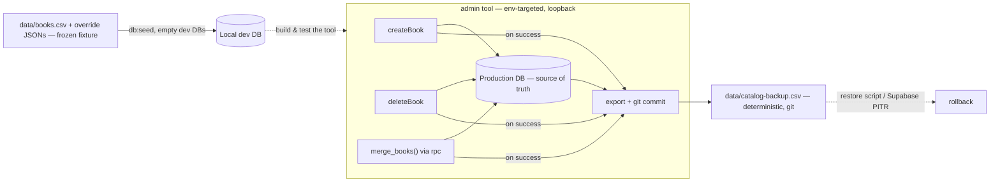

# ✨ Catalog Add-Book, Delete, and Merge — on a DB-source-of-truth foundation

## Overview

Give the admin tool the database verbs the catalog is missing — **add**, **delete**, and **merge** — by flipping the source of truth from the `data/books.csv` + override-JSON git round-trip to the **production Supabase database**. Once the DB is canonical, these become plain, correct DB operations instead of a CSV round-trip that today *physically cannot delete* (`scripts/seed.ts:157` upserts on slug, never removes a row).

- **Add a book** — search-first: enter an ISBN or title, query Open Library + Google Books (reuse the existing builders), pick a result to prefill, save → `INSERT`. Manual blank-create fallback. Slug auto-generated (new code), unique, immutable after create.
- **Delete a book** — standalone, guarded (typed slug confirmation) → `DELETE`. Ships **only after** the auto-backup exists.
- **Merge duplicates** — a correct `merge_books()` Postgres function (repoint shelves + delete losers, atomically). Run manually to clear the known backlog now; in-tool UI deferred until duplicates recur.

The admin is **env-target-configurable**: point at **production** for real edits (loopback-only now; the hosted admin later adds an auth gate), local for tool development. This sets up `docs/plans/2026-05-30-feat-ossusarchives-web-and-hosted-admin-plan.md`, which assumes DB-as-source-of-truth.

> **Scope note (post-review):** this plan was reviewed by the DHH, Kieran, and Simplicity reviewers and deliberately re-scoped down. The auto-duplicate detector, `dismissed_duplicates` table, and duplicates view were **cut** (over-built for ~185 books with an enumerated backlog). The override-JSON retirement + `seed.ts`/`buildBookFields` rewrite were **deferred to the web plan** (they break `db:seed` and deliver no user-facing capability now). What remains is the spine: add, delete, an atomic merge function, and an auto-committed backup.

## Problem Statement / Motivation

- **The current model can't delete.** `db:seed:prod` upserts on slug (`scripts/seed.ts:157`); a book removed from CSV stays in prod forever. You cannot build "delete books" on an upsert-only transport.
- **The CSV round-trip is friction for the primary workflow.** Add/delete in a CSV-truth model need reverse mapping + intent logs + a multi-pass reconcile on every edit. The data has lived in Postgres since the seed ran; the CSV+4-JSONs is a costume.
- **Editing must reach prod and back up reliably.** Edits hit prod directly, so the git backup must be **atomic with the destructive action**, not a remembered chore.

## The foundation flip

| Concern | Today | After |
|---|---|---|
| Canonical catalog | `data/books.csv` + 4 override JSONs | **Production DB** |
| Add / Delete | reverse-map round-trip / impossible | **`INSERT` / `DELETE`** |
| Merge | n/a | atomic `merge_books()` plpgsql function |
| `data/books.csv` + JSONs + `seed.ts` | source of truth | **frozen genesis fixture** (untouched; still feeds `db:seed` for empty dev DBs) |
| Backup | the round-trip itself | **separate deterministic `SELECT *` dump, auto-committed on every write** |
| Local DB | editing scratch space | **dev/test surface only** |

### Confirmed decisions
1. **Source of truth = production DB.** Admin reads `SUPABASE_URL`/`SUPABASE_SERVICE_ROLE_KEY` from env (`admin/lib/env.ts` already does); point at prod (`.env.production`) for real work, local for dev. Loopback-only; no auth until hosted.
2. **Backup is atomic with writes.** After each successful create/delete/merge, the action runs the exporter and commits — the write isn't "done" until the backup is committed. Delete ships only once this exists.
3. **Minimal foundation.** Leave `data/books.csv`, the override JSONs, `buildBookFields`, and `seed.ts` **frozen and untouched**. The backup is a *new, separate* deterministic file. Defer the format/seed rewrite + JSON retirement to the web plan.
4. **Merge function now, UI later.** Build and test `merge_books()`; clear the known dup backlog by calling it manually. Defer all detector/UI work.

## Architecture

## Corrections folded in from review (must-honor during implementation)
- **`lib/slug.ts` does not exist** — slug generation is **net-new, tested code** (diacritic-fold, lowercase, strip punctuation, collapse hyphens; handle apostrophes/`:`/`&` e.g. "Aftermath: Empire's End"), not reuse.
- **`id` is a `uuid`** (`books.id uuid PRIMARY KEY`); the *CSV's* integer `id` is a separate artifact. **Every action keys on the uuid** (or slug for UI). The backup omits the CSV integer `id`.
- **`asin` is already dropped** (`20260505000000_drop_asin_column.sql`). `characters`, `series`, `amazon_affiliate_link` are **CSV-only — never DB columns**, so a `SELECT *` backup naturally omits them. **Phase 0 must confirm nothing reads these** (esp. `amazon_affiliate_link` vs the affiliate plan — verify it's derived from `primary_isbn` at runtime, not stored) before treating the backup as complete.
- **`type` enum is only** `Adult Novel | YA Novel | Middle Grade Novel` (`books.ts:28`, migration CHECK). `createBook` reusing it can create **only these three** — confirm that's the real domain, or add an enum/CHECK migration. (The earlier "junior novelization" merge example was wrong; removed.)
- **`splitMultiValue` splits on `;` AND `,`** (`lib/catalog.ts:43`) — comma-bearing authors corrupt on re-parse. The backup/restore pair must use **`;` only** and **sorted array cells** so the dump is deterministic and losslessly restorable. (Do not route this through `buildBookFields`.)
- **Merge cannot be atomic via supabase-js** (no multi-statement transaction) and **`UPDATE … ON CONFLICT` is invalid SQL.** Merge must be a `plpgsql` function (below), called via `supabase.rpc`.
- **All three actions must `revalidateTag('books')`** (as `patchBook` does, `books.ts:62`) or `/books` won't refresh.

## Implementation Phases

### Phase 0 — Foundation: prod target + manual backup (prerequisite for delete)
- [x] **Env-target confirmed** — `admin/lib/env.ts` + `scripts/_supabase.ts` read `SUPABASE_URL`/`SUPABASE_SERVICE_ROLE_KEY`. Point at prod by putting `.env.production` creds in `admin/.env.local` (admin) / passing `--production` (scripts); local is the default. Loopback-only.
- [x] **Deterministic exporter** `scripts/export-db-to-csv.ts` (+ `serializeBackup`/`buildBackupRecord` in `lib/csv/backup.ts`): `select('*').order('slug')`; fixed column order = DB schema (uuid `id` kept; legacy CSV-only columns gone); arrays joined on `;` **only** (commas survive via CSV quoting); array element order **preserved** (Postgres keeps it; sorting `author` would corrupt order — determinism holds for a fixed DB state); `\n`, trailing newline, no timestamp. Writes `data/catalog-backup.csv` (a **new file**; `data/books.csv` stays frozen).
- [x] **Restore script** `scripts/restore-from-backup.ts` — reads `data/catalog-backup.csv` (split arrays on `;` only) → upsert on **uuid `id`** (preserves identity + `user_books` FKs); prompts before writing to non-local. Rollback path alongside Supabase PITR.
- [x] **Manual backup** (decision: not auto-commit-from-action) — `npm run catalog:backup` (`scripts/catalog-backup.sh`) exports prod → commits `data/catalog-backup.csv` if changed. `npm run catalog:export[:prod]` / `npm run catalog:restore` also wired. Delete (Phase 2) ships after this exists. ✅
- [x] **CSV-only columns confirmed dead** — `characters` 0/185 populated; `series` is the redundant "Yes"/"No" flag (superseded by `series_name`); `amazon_affiliate_link` read **nowhere** in code (only the frozen CSV writer's column list) — affiliate links are constructed from ISBN at display time, and the 168 historical URLs remain in the frozen `data/books.csv` + git history. `type` enum confirmed = exactly the three Novel values (Adult 160 / YA 21 / Middle Grade 4), so `createBook` reusing the enum is correct.
- [x] **Unit tests** `lib/csv/__tests__/backup.test.ts` — byte-stable no-op re-serialize (comma- + diacritic-bearing fixtures), comma-author round-trip, multi-ISBN order, null/empty handling, uuid + numeric coercion, slug ordering. 8/8 pass; full suite 43/43.
- [ ] **(You, locally — needs prod DB)** Genesis backup + sync verification: `npm run catalog:export:prod` → confirm `data/catalog-backup.csv` row count + slug set match prod; round-trip check: restore into a scratch/local DB and diff against prod. Then `npm run catalog:backup` to commit the genesis backup.

### Phase 1 — Add a new book (search-first + manual fallback) ✅ built
- [x] `admin/app/_actions/lookup.ts` — `searchForNewBook({ isbn?, title?, author? })` taking **raw input**; anchors on ISBN-13 (`toIsbn13`, invalid → `INVALID_ISBN`), else title+author; `allSettled` so a failed source degrades gracefully; empty input → `EMPTY`.
- [x] `lib/slug.ts` — `slugify(title)` (strip diacritics/apostrophes, `&`→`and`, kebab) + `ensureUniqueSlug(base, taken)`. **13 unit tests** matched to the existing slug convention. Registered `@app/slug` in `admin/tsconfig.json`.
- [x] `admin/app/_actions/books.ts` — `createBook(input)`: shared `bookFields` (patch & create don't drift; **patchSchema still omits `slug`** → immutability structural); **strict** `primary_isbn ∈ isbn[]` refine for create; `INSERT` with friendly `SLUG_TAKEN` (+ suggested alt) on clash and on 23505 race; `revalidateTag('books')`.
- [x] `admin/app/books/new/page.tsx` + `_components/new-book-form.tsx` — search → OL/GB candidate cards → **Prefill** → editable form (slug auto-suggested from title via `slugify`, editable, immutable after) → **Create** → route to `/books/[slug]`. "+ New book" entry on `/books`. **tsc + biome clean.**
- [ ] **(You, locally — needs `npm run admin` against prod/local)** Visual/interaction pass: search by ISBN prefills; manual create with no search works; a colliding slug surfaces the suggestion; created book appears in `/books`. (Can't be exercised here — no running app / DB.)
- **Note:** backup is the **manual** `npm run catalog:backup` (per the chosen design), not a per-action `commitBackup()`. Run it after an add session.

### Phase 2 — Delete a book (guarded) ✅ built
- [x] `admin/app/_actions/books.ts` — `deleteBook(id, typedSlug)`: fetches the row by `id` (uuid), asserts `typedSlug === row.slug` (no TOCTOU deleting a different row), `DELETE` (cascades to `user_books`). `revalidateTag('books')`. Returns `CONFIRM`/`NOT_FOUND`/`DB` errors.
- [x] Typed-confirmation `AlertDialog` row action (trash icon) in `books-table.tsx`; Delete disabled until the slug is typed exactly; on success the row is removed from the table (`removeRow` table-meta). Copy states "no undo — recovery is the CSV backup / PITR".
- [ ] **(You, locally)** Confirm in `npm run admin`: trash → type slug → row vanishes; wrong slug stays disabled. Run `npm run catalog:backup` after deletions to capture the post-delete state.
- **Note:** backup is the **manual** `npm run catalog:backup` (chosen design), not a per-action commit.

### Phase 3 — Merge function (clear the backlog manually; UI deferred) ✅ built
- [x] **Migration** `supabase/migrations/20260602000000_add_merge_books_function.sql` — `ordered_text_union()` + `merge_books(survivor uuid, losers uuid[], resolution jsonb)` `plpgsql`, atomic: (1) OR-merge loser shelf flags into the survivor's row, (2) collide-delete loser shelves that would violate `UNIQUE(user_id, book_id)`, (3) repoint remaining shelves, (4) union `isbn[]`/`format[]` (survivor-first, deduped) + apply optional scalar overrides from `resolution` + validate `primary_isbn ∈ isbn[]`, (5) delete losers.
- [x] `mergeBooks(survivorId, loserIds, resolution)` server action — thin `rpc('merge_books', …)` wrapper (typed cast until `db:types` re-run) + `revalidateTag('books')`. Guards empty/self-merge.
- [x] **Self-checking test** `supabase/tests/merge_books_test.sql` — seeds two users (one shelving both books with differing flags), runs the merge, asserts isbn/format union, loser deleted, OR-merge + dedup + repoint with no shelf data lost; `BEGIN/ROLLBACK` (non-destructive).
- [ ] **(You, locally)** Apply + verify: `npm run db:reset` (applies the migration) → `npm run db:types` (regenerates `lib/types.ts` so `merge_books` is typed) → run `supabase/tests/merge_books_test.sql` (expect `PASS`).
- [ ] **(You)** Clear the known backlog: call `merge_books` manually for the dups enumerated in `docs/plans/2026-05-05-feat-catalog-data-quality-pass-plan.md` / `scripts/isbn-collisions.json` (against prod), then `npm run catalog:backup`. No detector/UI.
- **Deferred (only if dups recur):** a manual multi-select "Merge" in the table that calls the same function. The detector / dismissed-pairs / duplicates view stay cut.
- **Acceptance:** `merge_books` yields one survivor (unioned ISBNs/formats, valid primary_isbn), losers gone, shelves repointed with flags preserved and no constraint failure; backlog cleared.

## Cut / Deferred (with rationale)
- **Auto-duplicate detector + `dismissed_duplicates` + duplicates view** — cut. Discovery tooling for a hand-knowable, enumerated set on ~185 books. Revisit only if duplicates recur faster than eyeballs catch them.
- **Override-JSON retirement + `buildBookFields`/`seed.ts` rewrite + flat-format migration of `data/books.csv`** — deferred to the web plan. Inert JSONs cost nothing; rewriting now would break `db:seed` for no user-facing gain.
- **Merge UI / conflict-resolution toggles** — deferred; the function + manual invocation clears today's backlog.

## Acceptance Criteria

### Functional
- [ ] Add a book by ISBN/title (OL/GB prefill) or manual fallback → inserted into the target DB, visible immediately.
- [ ] Guarded standalone delete (typed slug, keyed on uuid).
- [ ] `merge_books()` clears the known duplicate backlog; survivor correct; shelves preserved.
- [ ] Admin env-targets prod vs local cleanly; loopback-only.

### Non-Functional / Data integrity
- [ ] `primary_isbn ∈ isbn[]` enforced (strict) on create and in merge resolution.
- [ ] Merge is a single atomic `plpgsql` transaction; shelf booleans OR-merged; unique `(user_id, book_id)` deduped; no lost shelves.
- [ ] Every create/delete/merge auto-exports + commits the deterministic backup before reporting success.
- [ ] Slugs unique (vs DB), convention-matching, structurally immutable (absent from `patchSchema`).
- [ ] Backup is byte-stable on no-op and losslessly restorable (sorted, `;`-delimited arrays; comma/diacritic fixture covered).
- [ ] CSV-only columns (`characters`/`series`/`amazon_affiliate_link`) confirmed unused before the backup is treated as canonical.

### Quality Gates
- [ ] `npm run lint` (Biome) passes in `admin/` and root.
- [ ] `slugify`/`ensureUniqueSlug` unit-tested; merge `user_books` repoint covered by the fake-user fixture.
- [ ] `db:seed` from the frozen fixture still works unchanged (not touched).

## Dependencies & Risks
- **Editing prod directly, no per-edit review gate.** Mitigations: guarded delete, atomic auto-backup (rollback), PITR. Draft/publish staging deferred to the web plan's Phase E.
- **Loopback-only is the sole protection** for the prod-targeted admin until hosting adds auth — don't expose it.
- **`type` enum / CSV-only-column checks** are gating unknowns — resolve in Phase 0/1 before relying on create + the backup.
- **`commitBackup()` shelling to git** assumes the admin runs inside the repo working tree (true locally; replaced by the GitHub Action when hosted).

## Relationship to the web/hosted-admin plan
This is the foundation that plan assumed: DB is the source of truth, the exporter + `create`/`delete`/`merge_books` primitives exist, and the backup is wired. The web plan then reduces to: host on Vercel, add the Supabase-Auth gate + `requireAdmin()`, and promote `commitBackup()` to the scheduled GitHub Action — plus the deferred override-JSON retirement / seed rewrite if/when it wants the flat CSV as the single canonical file.

## References
- Internal: `docs/plans/2026-05-30-feat-ossusarchives-web-and-hosted-admin-plan.md`, `docs/plans/2026-05-07-feat-local-admin-tool-plan.md`, `docs/plans/2026-05-05-feat-catalog-data-quality-pass-plan.md` (enumerated dup/collision cases), `docs/brainstorms/2026-05-07-local-admin-tool-brainstorm.md`
- Code: `admin/app/_actions/{books,export,lookup,bulk}.ts`, `admin/lib/env.ts`, `lib/catalog.ts` (`splitMultiValue:43`, `buildBookFields:74`), `lib/csv/{read,write}.ts`, `scripts/seed.ts:157`, `supabase/migrations/20260410000000_create_books_and_user_books.sql` (`user_books` `UNIQUE(user_id,book_id)`:40, `ON DELETE CASCADE`:34), `supabase/migrations/20260505000000_drop_asin_column.sql`
