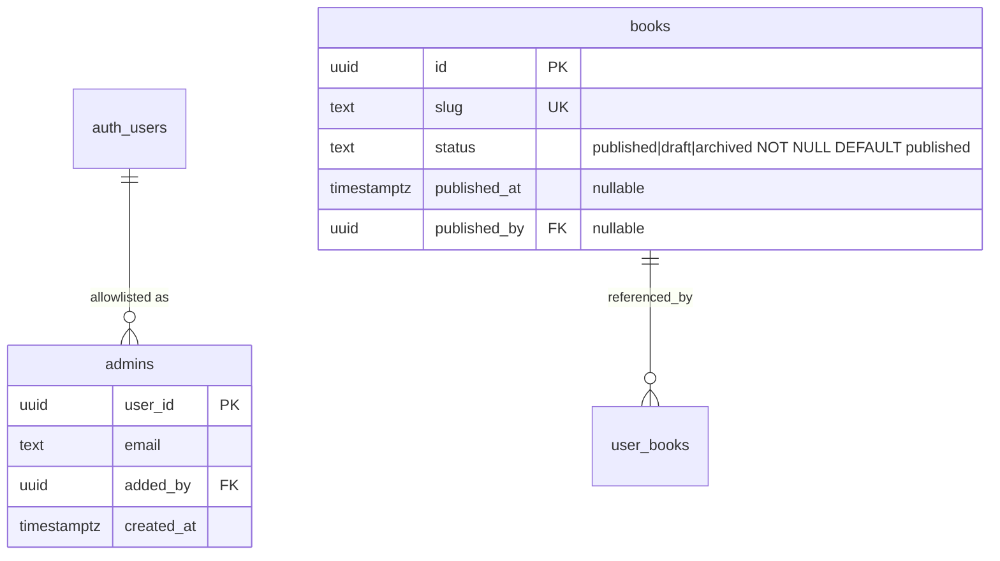

# ✨ ossusarchives.com — Marketing stub, Privacy Policy, and Hosted Admin

## Enhancement Summary

**Deepened on:** 2026-05-30
**Research agents used:** Supabase-SSR/RLS/GitHub-Actions researcher, Apple/Google privacy + account-deletion researcher, Vercel/Next.js hosting researcher, security-sentinel, data-migration-expert, code-simplicity-reviewer.

### ⚠️ Key scope decision (needs your sign-off)
The simplicity review — corroborated by the migration and security reviews — recommends **cutting the draft/publish `status` apparatus from V1**. The reasoning is strong:
- For a single trusted admin, `draft` is "review your own work seconds after typing it" — ceremony, not safety.
- It does **not** even gate the one risky case (edits/bulk-ops on *already-live* rows apply live regardless; only brand-new/removed books are gated).
- It adds the **two scariest changes in the whole plan**: the RLS read-path swap (`USING(true)` → `USING(status='published')`) risks a **catalog blackout for every installed app** if mis-sequenced, and a leftover permissive policy leaks drafts to the shippable anon key.
- The **CSV→git backup is already the rollback** story. You don't need a second undo mechanism.

**Recommendation:** ship **V1 = Privacy page + Hosting/marketing stub + Auth-gated admin writing live to prod + CSV backup**, with an **env-var admin allowlist** (not an `admins` table). Keep the full draft/publish + `admins`-table design **fully specified but deferred** to Phase E, to add when a real draft backlog or a second editor actually appears. This removes ~half the surface area and both catastrophic risks.

This document is written **recommended-path-first**; the deferred design (with a verified-safe migration recipe) lives at the end so nothing is lost.

### Key improvements folded in from research
1. Concrete two-client Supabase SSR auth code (`@supabase/ssr` `getAll/setAll`, `getClaims()` not `getUser()`, PKCE callback with `x-forwarded-host` for Vercel previews).
2. Full Apple/Google **account-deletion** requirements — a hard launch blocker beyond the privacy URL (in-app deletion + Apple token revocation).
3. Vercel specifics: `force-static` public pages, sitemap/robots excluding `/admin`, function `maxDuration` (300s default in 2026), and a **client-driven chunked** bulk-op pattern.
4. GitHub Actions backup: default `GITHUB_TOKEN` pushes **don't** re-trigger workflows (no infinite loop), deterministic output is mandatory, **read-only credential** instead of service-role in CI.
5. Security hardening: column-allowlist (not `select *`) for the CSV, `next`/redirect validation (open-redirect), `serverActions.allowedOrigins`, bundle-grep as a blocking CI gate, status not mass-assignable.
6. Fact corrections: `asin` is **already dropped** (merged migration `20260505000000`) — not part of this release; pin **Next.js 15** (Next 16 removes the `dynamic` segment export).

---

## Overview

Now that we own **ossusarchives.com**, stand up a single web property serving three things:

1. **Marketing website** — stubbed placeholder only (real build deferred).
2. **Privacy policy** — a real, crawlable `/privacy` page. A **hard blocker** for the iOS/Play launch (and tied to a second blocker: in-app account deletion).
3. **Hosted admin tool** — grow the existing local-only `admin/` Next.js app into the whole site, with an auth-gated `/admin` that edits the **production** catalog directly.

Strategic shift: **the production Supabase DB becomes the source of truth** for the catalog. `data/books.csv` is demoted from "editing surface" to a **versioned git backup** (and the seed source for empty local/preview databases). Preview branches are reserved for **schema migrations only** — they cannot stage row data (see Research).

One Vercel deployment built on the existing `admin/` package: `/` (marketing stub), `/privacy`, `/admin/*` (auth-gated).

## Problem Statement / Motivation

- **TestFlight/Play are blocked** on (a) a hosted privacy policy URL and (b) an in-app account-deletion path (Apple Guideline 5.1.1(v) + Google Play Data deletion). Tracked as ❌ in `docs/plans/2026-05-04-feat-ios-testflight-launch-roadmap-plan.md`.
- **Catalog editing is laptop-bound** — only runs on `127.0.0.1:3100` against a local stack, then round-trips CSV → git → `db:seed:prod`. Too much ceremony to fix a typo on the live catalog.
- **We own the domain now** — natural moment to consolidate marketing, legal, and admin.

## Research Findings (consolidated)

### Supabase preview branches do NOT stage row data — reframed
The original idea ("edit catalog rows on a preview branch, merge to prod") is **not how Supabase branching works** ([Branching](https://supabase.com/docs/guides/deployment/branching), [GitHub integration](https://supabase.com/docs/guides/deployment/branching/github-integration)):
- Branches are **data-less by design** — no production data is copied; rows come only from `supabase/seed.sql`.
- **Merging promotes migrations/DDL, never row data.** "Data changes in your seed files are not merged to production." Branch row edits are lost on delete.
- Branching requires **Pro**; persistent branches bill compute continuously.

→ **Decision:** preview branches are used for **schema migrations only**, validated via a PR-linked branch before merge. (Relevant only if/when the deferred Phase E lands.)

### Existing code that conflicts with DB-as-source-of-truth (load-bearing regardless of scope)
- `admin/app/_actions/export.ts` + `admin/lib/safe-fs.ts:6` write to the **local filesystem** (`process.cwd()/../data`). **This cannot run on Vercel.** The CSV backup must move to **GitHub Actions** (Phase D).
- Export **silently drops DB rows not already in `books.csv`** (`export.ts:179,208`). Admin-created books would vanish from the backup. The new exporter must write **all** rows with an explicit **column allowlist** (not `select *`).
- Export reconciles four **manual-override JSONs** against a CSV+pipeline baseline (`export.ts:198-238`). Once the DB is authoritative this baseline is meaningless → **retire the override-JSON reconcile**; write all fields as plain CSV columns.
- The mobile app reads `from('books').select('*')` with **no filter** (`lib/hooks.tsx:45`) under `anon_read_books USING (true)` (`supabase/migrations/20260410000000_*.sql:67-75`).

### Key local references
| File | Why it matters |
|------|----------------|
| `admin/lib/supabase-admin.ts` | Service-role client; `server-only` guard — reuse as-is. |
| `admin/lib/env.ts` | Zod-validated env — extend with Auth vars. |
| `admin/app/_actions/books.ts:12,42-64` | `patchSchema`/`patchBook`/`batchPatch` — blind `UPDATE … WHERE id`, returns raw PG error. |
| `admin/app/_actions/export.ts`, `admin/lib/safe-fs.ts` | Local-FS export — replaced by the CI exporter. |
| `lib/catalog.ts:74` | `buildBookFields` CSV→row transform; shared by seed + export. |
| `lib/hooks.tsx:45` | Mobile `books` query (anon key). |
| `scripts/seed.ts:157` | Upsert `onConflict:'slug'` — status-clobber risk (Phase E only). |
| `supabase/config.toml:305-330` | Apple + Google OAuth already configured. |

## Topology — one Next.js app on Vercel

Grow `admin/` into the full site:

```
admin/app/
  page.tsx                    → "/"        marketing stub   (public, force-static)
  privacy/page.tsx            → "/privacy" privacy policy   (public, force-static, crawlable)
  sitemap.ts, robots.ts       → public routes only; robots disallows /admin
  admin/                      → "/admin/*" catalog tool (auth-gated; existing /books, /books/[slug], /diff move here)
  login/page.tsx              → "/login"   Supabase Auth (Google)
  auth/callback/route.ts      → OAuth code exchange (PKCE)
middleware.ts                 → token refresh + redirect (matcher: /admin/:path* ONLY)
```

### Research Insights — Vercel + Next.js 15
- **Pin Next.js 15** in `package.json`. Next 16 makes Cache Components/PPR default and **removes** the `dynamic`/`revalidate`/`fetchCache` segment exports — the static guarantees below would need `use cache` + `<Suspense>` instead.
- Public pages are static by default; **force it**: `export const dynamic = 'force-static'` on `app/page.tsx` and `app/privacy/page.tsx` so nothing can accidentally flip them dynamic. ([Route Segment Config](https://nextjs.org/docs/app/api-reference/file-conventions/route-segment-config))
- `app/sitemap.ts` + `app/robots.ts` (file conventions, static at build); list only `/` and `/privacy`, **disallow `/admin`**.
- Per-page static `metadata` for title/description/OG.
- **Custom domain:** add `ossusarchives.com` (apex `A → 76.76.21.21`, confirm via `vercel domains inspect`) and `www` (`CNAME cname.vercel-dns.com`); set a 308 redirect to one canonical host. HTTPS+HSTS automatic. ([custom domain](https://vercel.com/docs/domains/set-up-custom-domain))
- Keep `middleware.ts` matcher = `/admin/:path*` so crawlers reach public pages with zero auth overhead. **Reading cookies in `/admin` makes only that segment dynamic** — marketing stays static.

## Implementation Phases (recommended V1: A → B → C → D)

> Ship as **three PRs**: (1) Privacy page, (2) Hosting + marketing stub + auth gate, (3) CSV backup. Phase A has no dependencies and unblocks store review first.

### Phase A — Privacy policy + account-deletion (ship first)

The privacy **page** is quick; the **account-deletion** requirement it links to is a separate, hard launch blocker — scope it here so the policy doesn't promise something that doesn't exist.

`admin/app/privacy/page.tsx` — static, crawlable, no auth, static `metadata`.

#### Privacy/compliance checklist (2026) — paste into the page + store consoles
**Privacy policy (both stores):**
- [ ] **[REJECTION]** Privacy Policy **URL** set in App Store Connect *and* Google Play Console; **publicly reachable without login**, no PDF, not geofenced.
- [ ] Also linked from **inside the app** (Settings).
- [ ] Content: data collected + uses; third parties (Supabase, Vercel, Google, Apple) provide equal protection; **retention/deletion + how to revoke consent**; contact email; effective date; children's/age policy (SW YA → COPPA question).
- [ ] Complete Apple **App Privacy nutrition label** + Google **Data Safety form**, consistent with the policy. Data types: **Identifiers→User ID**, **Contact→Email** (note Apple private-relay), **User Content→shelves**, plus Diagnostics/Usage only if an analytics/crash SDK is present.

**Account deletion (Apple 5.1.1(v) + Google Play) — [REJECTION] triggers:**
- [ ] **In-app** entry point to initiate account deletion (web-only fails Apple). Easy to find (Settings).
- [ ] Must **delete** (not deactivate) the account + personal data; available in **all regions**; no forced phone/email support hoops.
- [ ] **Sign in with Apple:** call Apple's REST API `POST https://appleid.apple.com/auth/revoke` to revoke tokens on deletion (store the Apple refresh token at sign-in). Skipping this = non-compliant.
- [ ] **Google Play:** provide a **web URL** (HTTPS, no login, links *directly* to deletion request) in the Data safety form, in addition to the in-app path.
- [ ] Backend (Supabase Edge Function, service-role, verifies caller JWT): `delete from user_books where user_id=<uid>` (or `on delete cascade`) + `auth.admin.deleteUser(uid)` + Apple revoke. Web page calls the same function logic.

**Amazon Associates / FTC (if affiliate links ship):**
- [ ] Exact phrase **"As an Amazon Associate I earn from qualifying purchases"** (no variations) — Associates agreement. Reuse `components/affiliate-disclosure-sheet.tsx` copy.
- [ ] Per-link conspicuous disclosure ("paid link"/"#ad") **and** an affiliate paragraph in the policy.

Sources: [App Review 5.1.1](https://developer.apple.com/app-store/review/guidelines/) · [Offering account deletion](https://developer.apple.com/support/offering-account-deletion-in-your-app/) · [TN3194 token revocation](https://developer.apple.com/documentation/technotes/tn3194-handling-account-deletions-and-revoking-tokens-for-sign-in-with-apple) · [Play account deletion](https://support.google.com/googleplay/android-developer/answer/13327111) · [Play Data safety](https://support.google.com/googleplay/android-developer/answer/10787469) · [auth.admin.deleteUser](https://supabase.com/docs/reference/javascript/auth-admin-deleteuser)

- **Acceptance:** `https://ossusarchives.com/privacy` reachable without JS/auth; passes a manual Apple/Google checklist; the in-app delete path + Apple revoke exist (or are tracked as an explicit sub-task) before store submission.

> **Note:** the in-app account-deletion Edge Function + Apple revocation is its own workstream (already flagged in the TestFlight roadmap). It lives in the Expo app, not this web repo. The privacy page may ship first, but **store submission needs both.**

### Phase B — Hosting skeleton + marketing stub
- Configure Vercel (root directory = `admin/`); `force-static` public pages; sitemap/robots; apex+www domains + canonical redirect.
- `admin/app/page.tsx` — minimal placeholder ("Ossus Archives — coming soon", link to `/privacy` + App Store when live).
- Move existing admin routes under `/admin/*`.
- **Acceptance:** `/` and `/privacy` public + crawlable; `/admin/*` redirects to `/login` (gate lands in C).

### Phase C — Auth-gated admin (login + **env allowlist**), writing live to prod  ✅ built

Two clients, `requireAdmin()` in every privileged surface, env-var allowlist (no table in V1).

> **✅ Built.** `@supabase/ssr` session client (`admin/lib/supabase-auth.ts`) separate from the service-role data client; `getAdmin()`/`requireAdmin()` (`admin/lib/auth.ts`) verify via `getClaims()` + `ADMIN_USER_IDS` allowlist (by auth user id). Middleware (`admin/middleware.ts` + `supabase-middleware.ts`) refreshes the session + redirects unauthed → `/login`; every **mutating** server action re-checks `getAdmin()` (CVE defense). Google OAuth: `/login` (prints your user id when signed-in-but-not-allowlisted, for bootstrap) + `/auth/callback` (PKCE, same-origin `next`, `x-forwarded-host`). `serverActions.allowedOrigins` via `ADMIN_ALLOWED_ORIGIN`.
>
> **Deviation (deliberate):** the gate **enforces only in production builds** (`NODE_ENV==='production'`). Local `next dev` is loopback-only and stays **ungated**, so local development needs no auth env and no login. This keeps the existing local workflow frictionless while gating any hosted deploy.
>
> **(You, to verify — prod/hosted only):** set `NEXT_PUBLIC_SUPABASE_URL` + `NEXT_PUBLIC_SUPABASE_ANON_KEY` (prod, publishable) + `ADMIN_USER_IDS`; add `<origin>/auth/callback` to the prod Supabase **Auth → URL Configuration → Redirect URLs** (Google is already configured for the app). First login → `/login` shows your user id → paste into `ADMIN_USER_IDS` → redeploy. OAuth can't be exercised here.

#### Research Insights — two-client SSR auth (current `@supabase/ssr`)
- **Cookie/session client** `admin/lib/supabase-server.ts` (anon/publishable key) — uses `getAll/setAll` (the `get/set/remove` triplet is deprecated; `setAll` now takes a 2nd `_headers` arg); `cookies()` is async in Next 15.
- **Service-role client** stays exactly as `admin/lib/supabase-admin.ts` (no cookies, `import 'server-only'`). Never mix `@supabase/ssr` into it.
- **`requireAdmin()`** uses `getClaims()` (local JWT signature verify) — **not `getSession()`** (spoofable cookie), and not `getUser()` in the plan's prior wording. Check the allowlist, return claims, throw `NotAdminError` otherwise:

```ts
// admin/lib/auth.ts
import { createClient } from './supabase-server'

const ADMIN_USER_IDS = (process.env.ADMIN_USER_IDS ?? '').split(',').map(s => s.trim()).filter(Boolean)
export class NotAdminError extends Error { constructor(){ super('Not authorized'); this.name='NotAdminError' } }

export async function requireAdmin() {
  const supabase = await createClient()
  const { data, error } = await supabase.auth.getClaims()
  const claims = data?.claims
  if (error || !claims) throw new NotAdminError()
  if (!ADMIN_USER_IDS.includes(claims.sub)) throw new NotAdminError() // pin to user_id, not email
  return claims
}
```

- **Every** privileged server action **and route handler under `/admin`** calls `await requireAdmin()` as line 1, *before* constructing the service-role client.
- **OAuth (PKCE):** `/login` calls `signInWithOAuth({provider:'google', options:{ redirectTo: \`${origin}/auth/callback?next=/admin\` }})`; `/auth/callback/route.ts` calls `exchangeCodeForSession(code)` and honors `x-forwarded-host` (makes Vercel preview URLs work). **Validate `next` is a same-origin path** (`startsWith('/')`, not `//`/`https:`) — open-redirect guard.
- **Supabase Dashboard → URL config:** Site URL `https://ossusarchives.com`; add `…/auth/callback` for prod + `http://localhost:3100/auth/callback`. **Prefer a single stable preview alias over broad `*.vercel.app` wildcards** (phishing/redirect surface) — or run admin OAuth only on the prod domain.
- **Middleware** = token refresh + UX redirect only (matcher `/admin`). Real gate is `requireAdmin()`; mitigates **CVE-2025-29927** (pin Next ≥ 15.2.3 + CI floor check).

#### Security hardening (from security-sentinel)
- **Service-role key:** Vercel **Sensitive** env var, **Production only** (never Preview/Dev, or every preview URL becomes a prod-write surface); never `NEXT_PUBLIC_`. **Blocking CI gate:** `next build` then `grep -r SUPABASE_SERVICE_ROLE .next/static/` (and the key value) must return nothing.
- **`serverActions.allowedOrigins`** in `next.config` = exact prod host(s) (Next's built-in CSRF check depends on it).
- **`status`/`published_*` must not be mass-assignable** via `patchBook` (Phase E) — transitions go through dedicated audited actions.
- **Map PG errors to generic codes** before returning to the browser (`books.ts:61` currently leaks `error.message`).
- Add `updated_at` **optimistic concurrency** to `patchBook` now (single admin in multiple tabs already races itself + the nightly backup snapshot).
- Baseline headers: HSTS, `X-Frame-Options: DENY` on `/admin`, minimal CSP.
- **Why env allowlist over `admins` table in V1:** removes bootstrap/lockout/recovery complexity and the "allowlist enumerable via anon key" risk entirely. Pin to `user_id` (grab yours once after first login). Promote to a table in Phase E when a 2nd admin appears.

- **Acceptance:** non-allowlisted Google login denied at `/admin`; allowlisted owner gets full access; service-role key absent from client bundle (CI-enforced); spoofed middleware header still cannot mutate (action-level check holds); `next=` cannot redirect off-origin.

### Phase D — CSV backup (GitHub Actions, replaces local-FS export)

A scheduled + manual workflow runs `scripts/export-prod-to-csv.ts`, writes `data/books.csv` deterministically, commits on diff. **Retire the override-JSON reconcile**; write all fields as columns; **append admin-created rows** (fixes the silent-drop bug).

#### Research Insights — workflow
```yaml
# .github/workflows/catalog-backup.yml
name: Catalog CSV Backup
on:
  schedule: [{ cron: '17 8 * * *' }]   # daily; avoid :00 (laggy)
  workflow_dispatch: {}
concurrency: { group: catalog-backup, cancel-in-progress: false }
permissions: { contents: write }       # least privilege
jobs:
  backup:
    runs-on: ubuntu-latest
    steps:
      - uses: actions/checkout@v5
      - uses: actions/setup-node@v4
        with: { node-version: 20, cache: npm }
      - run: npm ci
      - run: npx tsx scripts/export-prod-to-csv.ts
        env:
          SUPABASE_URL: ${{ secrets.SUPABASE_URL }}
          # READ-ONLY credential — see security note; NOT the Vercel service-role key
          SUPABASE_READONLY_KEY: ${{ secrets.SUPABASE_READONLY_KEY }}
      - uses: stefanzweifel/git-auto-commit-action@<pin-sha>  # pin to SHA, not tag
        with:
          commit_message: 'chore(catalog): nightly CSV backup [skip ci]'
          file_pattern: 'data/books.csv'
```

**Gotchas / security:**
- **No infinite loop for free:** pushes made with the default `GITHUB_TOKEN` **do not re-trigger** workflows. `[skip ci]` only matters if you switch to a PAT/deploy key — don't "fix" a non-problem.
- **Deterministic output is mandatory** or you commit phantom diffs: `ORDER BY slug`, fixed column order (frozen allowlist), RFC-4180 quoting, `\n` endings, trailing newline, **no generated-at timestamp header**.
- **Use a read-only credential, not service-role, in CI** (biggest blast-radius reduction). The backup only reads. If a public/anon read policy allows it, the anon key suffices; otherwise a dedicated read-only Postgres role. Keep CI and Vercel secrets **distinct** so either rotates independently; document a rotation runbook.
- **Repo visibility is a precondition:** committing prod rows to a public repo is a public data dump. Catalog is arguably public, but exclude `id`/`published_by` (an `auth.users.id`) via the column allowlist; freeze the CSV header set in a test.
- Pin third-party actions to commit SHAs; never run this on `pull_request`/`pull_request_target` from forks (secret exfiltration).

- **Acceptance:** scheduled + manual runs commit a clean, deterministic `books.csv`; no-op when unchanged; header set matches a frozen allowlist (test fails if schema adds an un-allowlisted column); admin-created rows appear in the backup.

### Phase C bulk-ops — chunked, not one long action
The admin's bulk ops (refresh-covers / fill-empty across 100s of rows hitting Open Library + Google Books) must not run as one giant server action.
- **2026 Vercel limits:** 300s default (Hobby max 300s; Pro/Ent max 800s) via `export const maxDuration`. A function over the limit is hard-killed.
- **Pattern (simplest robust):** client-driven **chunked Route Handler** (`POST /api/admin/refresh-covers`) processing ~20–25 rows/invocation, returning `{processed, cursor, done}`; client loops with a progress bar; `p-limit(3-5)` per chunk to be nice to the APIs. Gives progress, retry-per-chunk, backpressure, no extra infra. (Optional later: a Vercel Cron nightly fill-empty pass.) Avoid a single long action (one timeout loses the whole run) and `after()`/`waitUntil()` (still counts against `maxDuration`, no progress).

## Acceptance Criteria (V1)

### Functional
- [ ] `ossusarchives.com/privacy` public, server-rendered, crawlable; passes Apple/Google checklist; in-app deletion + Apple revoke tracked/exist before submission.
- [ ] `ossusarchives.com/` shows a marketing stub linking to `/privacy`.
- [ ] `/admin/*` requires Google login **and** env-allowlist membership; non-admins denied even with a spoofed middleware header.
- [ ] Admin edits the **production** catalog from the browser; bulk ops run chunked without timeout.
- [ ] Scheduled + manual GitHub Action commits `data/books.csv` (all rows, frozen column allowlist, deterministic order); no-op when unchanged.

### Non-Functional / Security
- [ ] Service-role key server-only, Production-env-only, absent from client bundle (**blocking** CI grep).
- [ ] Every privileged server action + `/admin` route handler calls `requireAdmin()` (`getClaims()`, never `getSession()`) first.
- [ ] `serverActions.allowedOrigins` = prod host; `next=` redirect validated same-origin; PG errors mapped to generic codes; `updated_at` optimistic check on `patchBook`.
- [ ] CI floor: Next.js ≥ 15.2.3 (CVE-2025-29927); Next.js pinned to 15.x.

### Quality Gates
- [ ] `npm run lint` (Biome) passes in `admin/` and root.
- [ ] CSV header set == frozen allowlist (test).
- [ ] Local round-trip (`db:reset && db:seed`) yields visible rows.

## Dependencies & Risks
- **Account deletion is a parallel hard blocker** (Expo-app Edge Function + Apple token revoke). The privacy page links to it; store submission needs it built.
- **Repo visibility** must be confirmed before the CSV backup commits prod rows.
- **CI secret blast radius** — use a read-only key, distinct from Vercel's, with a rotation runbook.
- **Preview-URL OAuth allowlisting** is a phishing surface — prefer prod-domain-only admin OAuth or a single stable alias.
- **`asin`** is **already dropped** (`20260505000000`) — not part of this release; ensure no plan text implies otherwise.

## Out of Scope (V1)
- The real marketing site (stub only).
- The draft/publish `status` apparatus, `admins` table, audit columns, `archived` soft-delete, RLS read-path swap, mobile filter change — **see Phase E (deferred)**.
- `book_drafts` staging table for edit-staging of live rows.

---

## Phase E — Draft/publish staging (DEFERRED — add when a draft backlog or 2nd editor appears)

Fully specified so it's a known quantity, but **not built in V1** per the scope decision. This is the schema-change phase; validate via a preview branch / PR.

### Why deferred
A single `status` column gates only new/removed books (live edits apply live anyway), the git/CSV backup is already the rollback, and the RLS swap is the highest-risk change (catalog blackout). Pull this forward only when content staging earns its cost.

### ERD (Phase E additions)


### Verified-safe migration recipe (from data-migration-expert)
Single file, single transaction; column add is **metadata-only/fast** on PG ≥11 (constant default, no rewrite). **`NOT NULL` is required** — `USING(status='published')` evaluates NULL→excluded, so a NULL status hides a row.

```sql
-- supabase/migrations/<ts>_add_book_status_and_admins.sql
BEGIN;
ALTER TABLE public.books
  ADD COLUMN status text NOT NULL DEFAULT 'published'
    CHECK (status IN ('published','draft','archived')),
  ADD COLUMN published_at timestamptz,                       -- nullable, no default (avoid rewrite)
  ADD COLUMN published_by uuid REFERENCES auth.users (id);

UPDATE public.books SET status='published' WHERE status IS DISTINCT FROM 'published';      -- explicit intent
UPDATE public.books SET published_at=COALESCE(published_at, created_at) WHERE published_at IS NULL;

CREATE INDEX idx_books_status_published ON public.books (status) WHERE status='published';

CREATE TABLE public.admins (
  user_id uuid PRIMARY KEY REFERENCES auth.users (id) ON DELETE CASCADE,
  email text, added_by uuid REFERENCES auth.users (id),
  created_at timestamptz NOT NULL DEFAULT now()
);
ALTER TABLE public.admins ENABLE ROW LEVEL SECURITY;          -- NO anon/authenticated policy (don't expose the allowlist)

-- RLS swap LAST. Drop the USING(true) policies; recreate scoped. service_role bypasses RLS (sees all).
DROP POLICY "authenticated_read_books" ON public.books;
DROP POLICY "anon_read_books" ON public.books;
CREATE POLICY "authenticated_read_published_books" ON public.books FOR SELECT TO authenticated USING (status='published');
-- Decide: KEEP an anon policy at all? If the app requires sign-in, DROP anon entirely rather than weaken it.
CREATE POLICY "anon_read_published_books" ON public.books FOR SELECT TO anon USING (status='published');
COMMIT;
```

### Seed strategy (critical correction)
**Do NOT** have `buildBookFields` emit `status:'published'` for upserts. `seed.ts:157` upserts `onConflict:'slug'`, so emitting status would **re-publish drafts / un-archive soft-deletes** on any `db:seed:prod`. **Omit `status` from the upsert payload** — fresh/empty preview DBs still get `'published'` from the column DEFAULT; existing rows keep their status. (Type gate: once `status` is a column, `BookFields` requires handling it — TS will force the decision.)

### Verification (release gate) + rollback
```sql
-- MUST return 0:
SELECT count(*) FROM books WHERE status IS NULL OR status NOT IN ('published','draft','archived');
-- The installed-app simulation — MUST equal the pre-migration published count, not 0:
SET LOCAL role anon; SELECT count(*) FROM books; RESET role;
-- Policies are status-scoped:
SELECT polname, pg_get_expr(polqual, polrelid) FROM pg_policy WHERE polrelid='public.books'::regclass;
```
**Fast un-blackout rollback** (no data movement): drop the published-only policies, recreate `USING(true)`. Snapshot via Supabase PITR before deploy as the ultimate backstop.

### Phase E app/admin changes
- RLS is **authoritative**; add `.eq('status','published')` in `lib/hooks.tsx` only as defense-in-depth. **Ship RLS at/before any data goes draft.**
- New-book flow → `draft`; `/diff` shows pending drafts/archived + transactional "Publish" (stamps `published_at`/`published_by` from `claims.sub`); remove → `archived`.
- Promote env allowlist → `admins` table; bootstrap by parameterized insert *after* the owner's first login (`INSERT INTO admins SELECT id,email FROM auth.users WHERE email=$1`); guard against removing the last admin.
- CSV backup switches to `status='published'` only; consider backing up `archived` rows separately (else a bad hard-delete is unrecoverable).
- Decide anon-policy fate (drop vs published-only) — a published-only anon policy still exposes the full published catalog to anyone with the bundled key.

## References
- Supabase Branching — https://supabase.com/docs/guides/deployment/branching
- Server-Side Auth (Next.js) — https://supabase.com/docs/guides/auth/server-side/nextjs · Creating a client — https://supabase.com/docs/guides/auth/server-side/creating-a-client
- Google login — https://supabase.com/docs/guides/auth/social-login/auth-google · Redirect URLs — https://supabase.com/docs/guides/auth/redirect-urls
- RLS (+ `(select auth.uid())` perf) — https://supabase.com/docs/guides/database/postgres/row-level-security
- Vercel function duration — https://vercel.com/docs/functions/configuring-functions/duration · Sensitive env vars — https://vercel.com/docs/environment-variables/sensitive-environment-variables
- Next.js Route Segment Config — https://nextjs.org/docs/app/api-reference/file-conventions/route-segment-config · Data Security — https://nextjs.org/docs/app/guides/data-security
- GitHub Actions: schedule — https://docs.github.com/en/actions/using-workflows/events-that-trigger-workflows#schedule · GITHUB_TOKEN no-retrigger — https://docs.github.com/en/actions/security-guides/automatic-token-authentication
- Apple account deletion / TN3194 · Google Play account deletion & Data safety (links inline in Phase A)
- CVE-2025-29927 (Next.js middleware bypass) — re-verify auth in actions; Next ≥ 15.2.3
- Internal: `docs/plans/2026-05-07-feat-local-admin-tool-plan.md`, `docs/plans/2026-05-04-feat-ios-testflight-launch-roadmap-plan.md`, `docs/brainstorms/2026-05-07-local-admin-tool-brainstorm.md`
