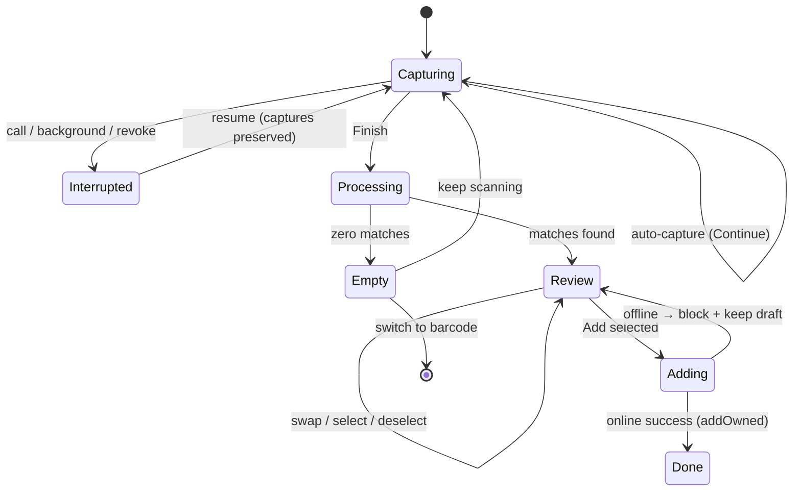

# ✨ Visual Shelf Scanner (Spine Recognition → Owned Shelf)

## Overview

Evolve the scan tab from a single-ISBN barcode reader into a **shelf scanner**: the user
pans their camera across a bookshelf, the app silently auto-captures photos, reads spine
text on-device with OCR, fuzzy-matches it against the in-memory Star Wars catalog, and
presents a review queue to add matches to the owned shelf in one batch. The existing
barcode reader is retained as a secondary mode introduced by a first-run dialogue.

Everything except the shelf write runs **on-device** (free, offline, private). The only
network dependency is the final batch add to Supabase; v1 requires a connection at Add
(blocks + keeps the draft if offline), with an auto-queue/sync fast-follow.

This plan is the implementation (HOW) of the 2026-06-05 brainstorm (WHAT). Settled
product decisions are not re-litigated here; see the brainstorm for rationale.

## Problem Statement / Motivation

Cataloguing a physical Star Wars collection one barcode at a time is tedious — exactly
the friction that stops collectors from building their shelf in the app. A collector with
80 books will not scan 80 barcodes. Visual spine recognition turns "populate my library"
from an hour of barcode tedium into a 30-second pan, which is the difference between the
feature being used and not. It also leans directly into the app's design north star —
*collector's pride, books are the hero*.

## Proposed Solution

A capture → recognize → review → add pipeline:

1. **Capture** — hands-free auto-capture on steady/in-focus frames; Finish/Continue loop
   to cover a large library; edge "ghost" overlay guides overlap; per-capture flourish
   (still collapses into little books dropping into a "processing library" indicator).
2. **Recognize (on-device)** — each photo → OCR (ML Kit) → text fragments.
3. **Match (on-device, pure JS)** — TF-IDF cosine scorer over the catalog returns ranked
   top-N candidates per fragment; aggregate/dedupe by `book_id` across all photos;
   bucket by confidence (high / low / reject) using score + #1–#2 margin.
4. **Review** — list (default) / grid (toggle) queue; high-confidence pre-selected,
   low-confidence in a "double-check these" group; already-owned badged + excluded; swap
   a wrong match among ranked alternatives or via catalog search.
5. **Add** — one batch upsert to the owned shelf; optimistic UI; v1 requires a connection
   (blocks + keeps the draft if offline); auto-queue + sync is a fast-follow.

## Technical Approach

### Architecture

```
app/(tabs)/scan.tsx  ── mode switch (shelf | barcode) + first-run dialogue
  ├─ shelf mode → ShelfScanner (capture loop, useReducer states)
  │     └─ camera (VisionCamera v5)  ──takePhoto()──▶ still uri
  │            └─ lib/ocr.ts        ──PhotoRecognizer(uri)──▶ text fragments
  │                   └─ lib/spine-match.ts (IDF scorer) ─▶ ranked candidates
  │                          └─ aggregate/dedupe ─▶ match session
  │     └─ inline review overlay (reuses scan.tsx result-overlay) ─▶ addOwned(ids[])
  └─ barcode mode → useCodeScanner (ean-13/upc-a) ─▶ existing ISBN lookup

ScanSessionProvider  ── holds the match-session draft ABOVE the tab navigator
                        (survives tab-switch/background; see Decision 4)
lib/hooks.tsx        ── useBooks() (catalog), addOwned() → add_owned_books RPC
add_owned_books RPC  ── server-side flag-merge (sets owned=true, never touches read/want)
lib/shelf-queue.ts   ── offline write queue (Phase 2.5 fast-follow; not v1)
user_books           ── UNIQUE (user_id, book_id) ALREADY EXISTS — no schema migration
                        (20260410000000_create_books_and_user_books.sql:40)
```

**Module boundaries (key principle):** OCR and matching are pure, camera-agnostic
modules (`lib/ocr.ts`, `lib/spine-match.ts`) that operate on a photo URI / a text bag and
the in-memory catalog. This keeps the recognition layer identical whether v1 runs OCR on
stills or a future version runs it on live frames — and makes the matcher unit-testable
with vitest (no native deps, Hermes-safe).

### Decision 1 — Camera foundation (with a de-risking spike)

Adopt **`react-native-vision-camera@^5`** (Nitro Modules) as the camera, per the
brainstorm's "build once on the capable foundation" call: v5 frame processors are the
substrate for the future live-pan goal, and `useCodeScanner` folds the barcode reader
into the same stack (eventually dropping `expo-camera`). v1 still runs OCR on **stills**
via `takePhoto()` → so no frame-processor complexity ships in v1, but the foundation
needs no rewrite later.

**The risk (must de-risk first):** v5 + the OCR plugin expect `react-native-worklets`
**0.8.x+**; the app is on **0.5.1** (pulled in by Reanimated 4.1.1). Bumping worklets must
not break Reanimated 4. v4 of VisionCamera is *not* an option — it needs
`react-native-worklets-core`, which collides with the installed `react-native-worklets`
(duplicate native class on Android).

→ **Phase 0 is a throwaway spike** that proves the worklets bump + Reanimated 4 + a clean
iOS *and* Android dev build *before* any feature code. If the spike fails, fall back to
**Path A** (keep `expo-camera`, add standalone `@react-native-ml-kit/text-recognition` for
still-image OCR — expo-camera already does barcode + `takePictureAsync` in one view, so v1
is fully shippable on it, at the cost of a later camera migration for live-pan). The
recognition/matching/queue layers are identical either way, so the fallback is contained
to the camera screen.

### Decision 2 — Matching engine (`lib/spine-match.ts`, pure TS)

Hand-rolled **IDF-weighted scorer** — zero dependencies, <1ms/fragment over a
few-hundred-book catalog, and a score we fully control (Fuse.js's Bitap score saturates on
shared franchise words exactly where disambiguation is needed). Fuse.js can be added later
as a recall booster; not needed for v1.

> **Build the dumb version first, then earn each refinement with real data.** Per the
> plan_review (all three reviewers): the IDF weighting + score/margin buckets are
> load-bearing — they are the technical heart and ship in v1. Everything else below marked
> *(calibration)* is **deferred to Phase 4** and added back **only if 20–40 labeled real
> photos show it moves precision.** Tuning seven interacting knobs before seeing one OCR
> failure is overfitting.

- **Index (built once from `useBooks()`):** tokenize `title + author[] + series_name`;
  `idf(t) = ln(N / (1 + df(t)))` so "Star Wars/Jedi/Darth" auto-deweight and
  "Thrawn/Zahn/Plagueis" dominate. v1 score = **IDF-weighted token coverage**: sum of IDF
  of the book's tokens present in the fragment bag, normalized by the book's total IDF
  mass. *(calibration: per-field boosts, L2 cosine vectors.)*
- **Normalize (index + query identically):** case-fold; strip diacritics
  (`normalize('NFKD')`); punctuation→space; drop a tiny stopword set. **OCR-confusion
  canonicalization is a single-direction collapse to one alphabet applied to BOTH sides**
  (e.g. `{o,0}→0`, `{l,1,i,|}→1`, `{s,5}→5`, `{b,8}→8`) — *(calibration; the brainstorm's
  `↔`/`rn→m`/`cl→d` rewrites are dropped: `↔` is not a function and `cl→d` corrupts "Clone
  Wars" → "done wars").* *(calibration: sliding 1–4-token windows across wrapped lines.)*
- **Score refinements** *(all calibration):* author-exact bonus, contiguous-bigram bonus
  (word-order signal).
- **Title-coverage floor (v1, REQUIRED):** a match must cover a minimum number of the
  candidate's **title** tokens — **count-based, not IDF-mass** (IDF-mass would let a single
  rare title token clear the floor, which is exactly the hole this guards). Use a named
  provisional constant `MIN_TITLE_TOKEN_COVERAGE` (start ≈ "≥2 distinct title tokens, or
  all of them for 1-token titles"; calibrated in Phase 4.5). Guards the brainstorm's
  flagged false-positive (a distinctive token from book A printed on book B's spine/blurb
  matching A).
- **Confidence buckets** — **thresholds are PROVISIONAL placeholders until Phase 4
  calibration** (do not treat as final):
  - High (auto-select): `S1 ≥ ~0.6` AND `margin ≥ ~0.12`
  - Low ("double-check"): `S1 ≥ ~0.4` and not high
  - Reject (silent): below low, or high score with tiny margin → disambiguation
- **Aggregate/dedupe:** group fragments by `book_id`; book confidence = **max** fragment
  score + small boost for count of distinct supporting fragments (don't sum — rewards
  noise); union across photos keeps best evidence.
- **Edition collapse (define the key):** the schema has **no `work_id`** (verified
  `lib/types.ts:38-58`), so collapse on a derived key = **normalized title + normalized
  first author** (`author[0]`; books with no author key on title + `''`, with a unit test
  asserting two distinct authorless same-title works are *not* wrongly merged). Tie-break
  for which row becomes the owned entry, in order: (1) `primary_isbn` present; (2) explicit
  **format priority `hardcover > paperback > ebook > audiobook`** (first match in that
  list; unknown formats rank last); (3) lowest `timeline_order` (column verified at
  `lib/types.ts:55`). Canon/Legends/format variants of one work → one owned entry. *(Open:
  letting the user pick the specific edition — deferred.)*
- **Output:** ranked top-N `{ book, score, margin }` per recognized book (powers the swap
  UI; cached on the result so swapping is instant and offline).

### Decision 3 — Shelf write data layer

The current `toggleShelf` (`lib/hooks.tsx:127`) is **toggle-only, single-row, serial, and
fails silently** — wrong for a batch add (it would turn an already-owned book *off*, and N
books = N round-trips with silent partial failures). The `UNIQUE (user_id, book_id)`
constraint already exists (`20260410000000_create_books_and_user_books.sql:40`), so no
schema migration is needed. Two changes:

1. **Server-side RPC `add_owned_books(book_ids uuid[])`** (one small function migration —
   mirrors the existing `merge_books` precedent). Round-2 plan_review converged here:
   doing the flag-merge **in the database** is both simpler and strictly more correct than
   a client-side merge, which would re-introduce the clobber whenever the in-memory Map is
   stale (e.g. a `read` toggled on another device). The function:

   ```sql
   -- supabase/migrations/<ts>_add_owned_books_rpc.sql   (SECURITY INVOKER → RLS applies)
   create function public.add_owned_books(book_ids uuid[])
   returns setof public.user_books
   language sql
   as $$
     insert into public.user_books (user_id, book_id, owned)
     select auth.uid(), unnest(book_ids), true
     on conflict (user_id, book_id) do update set owned = true
     returning *;
   $$;
   ```
   - **`read`/`want_to_read` are preserved by construction** — `DO UPDATE SET owned = true`
     lists *only* `owned`, so the other flags are never touched (no clobber, no stale-Map
     race). New rows insert `owned=true` with the table defaults (`read=false`,
     `want_to_read=false`).
   - **`user_id` + RLS handled server-side** via `auth.uid()` — the client can't omit it
     or forge another user's id; `SECURITY INVOKER` keeps the `TO authenticated` RLS
     policies (`20260410000000:78-92`) in force.
   - **Idempotent** — re-running for an already-owned book is a harmless no-op (the
     Phase 2.5 queue replay relies on this).

2. **`addOwned(bookIds: string[]): Promise<Result<{ rows: UserBook[] }>>`** on
   `UserBooksProvider`, thin wrapper over the RPC:
   - **Optimistic:** snapshot `userBooksRef.current` *before* mutating; for each id, set
     `owned: true` on the existing Map entry (preserving its other flags) or add a
     temporary entry for not-yet-on-shelf books (keyed by `book_id`; any placeholder `id`
     is display-only and is **replaced wholesale** by the returned rows — nothing writes it
     back).
   - **Authoritative reconcile:** `supabase.rpc('add_owned_books', { book_ids })` returns
     the real `user_books` rows; merge them into the Map by `book_id` (gives new books
     their real `id`/`created_at`). On error, restore the snapshot. Atomic — all-or-nothing.
   - **Auth sequencing:** no-ops on `!user` (like `toggleShelf:129`). For the
     signed-out→sign-in-at-Add flow, call it **only after the post-sign-in owned-set
     refetch has completed** (`UserBooksProvider.fetchUserBooks`, `hooks.tsx:118-125`) — not
     merely after the sign-in promise resolves — then recompute already-owned exclusions.
3. **`lib/shelf-queue.ts` (FAST-FOLLOW, not v1)** — tiny AsyncStorage-backed write queue.
   Op = `{ id (expo-crypto uuid), type: 'add_owned', userId, bookId, attempts, createdAt }`;
   enqueue collapses duplicates; flush is mutex-guarded, oldest-first, exponential backoff
   + jitter; triggered on app start, foreground (`AppState`), and NetInfo
   `isInternetReachable` rising edge; adds `@react-native-community/netinfo`. Lands right
   after v1 — the `add_owned_books` RPC + `addOwned` make it purely additive (swap the
   direct call for enqueue+flush; the RPC's idempotency makes replay safe).

> **DECIDED (2026-06-08):** v1 ships **"Add requires connection"** — if offline at Add,
> block with a clear message and **keep the review draft** intact; no writes are lost. The
> offline queue is a **fast-follow**. `addOwned` lands in v1, so the queue upgrade is
> additive (swap the direct `addOwned` call for enqueue+flush).

### Decision 4 — Scanner flow state (`useReducer`, not a library)

Most SpecFlow gaps map to a missing state, so model the **flow states** with a plain
`useReducer` — *not* XState, not a dependency. The genuine flow states are the boxes
below. The prereq conditions (signed-out, camera-denied, catalog-loading/failed) are
**derived at render** from `useAuth`/`useCameraPermissions`/`useBooks().loading|error` —
they gate entry into `Capturing` but are not reducer states.

**Where the state lives (plan_review fix):** the match-session draft must survive a
tab-switch. Expo Router native tabs can unmount a blurred tab's screen, so screen-level
reducer state would be lost. Hoist the draft into a **`ScanSessionProvider` mounted above
the tab navigator** (sibling to `UserBooksProvider`); the scan screen reads/writes it.
This is what makes "survives tab-switch + background" true (per Decisions Locked #2).
Keep it thin — a `useReducer` + context holding only the draft; no selectors, no
persistence (app-kill clearing is deliberately deferred).

**Account-switch safety (plan_review fix):** the draft's recognized books + pre-selection
were computed against *one* user's shelf. `ScanSessionProvider` must **clear the draft when
`user.id` changes to a different non-null id** (account switch / a different sign-in),
mirroring `UserBooksProvider`'s clear-on-user-change (`hooks.tsx:122`). It must **preserve
the draft across `null → first sign-in`** (the intended signed-out→sign-in-at-Add flow).
Without this, User B could add books User A scanned.


*No `Queued` state in v1 — offline at Add returns to `Review` with a blocking "reconnect
to save" message; the queue (and its `Queued` state) arrives in Phase 2.5.*

### Screens & Navigation

- **`app/(tabs)/scan.tsx`** — the mode host (shelf default, barcode secondary) +
  first-run dialogue. Reuses existing permission UI (`scan.tsx:85-115`).
- **Inline review overlay (v1)** — rather than a new route, the review queue renders as a
  full-screen overlay on the scan screen, reusing the existing result-overlay pattern
  (`scan.tsx:152-203`). This sidesteps a navigation boundary and the "draft across
  navigation" problem entirely. List rows reuse the `BookCard` pattern
  (`app/(tabs)/shelf.tsx`); the grid toggle reuses `Book3D` (`components/Book3D.tsx`);
  already-owned via `userBooks.get(id)`. **Promote to a dedicated `app/scan-review.tsx`
  screen later** if the queue UI outgrows an overlay.
- **First-run flag** — AsyncStorage `@ossus/scan_intro_seen`, following the existing
  ref-guarded hydrate pattern in `components/catalog-sort-control.tsx:41-53`.

## Implementation Phases

### Phase 0 — Camera foundation spike (de-risk before building) 🔬 ✅ GO (2026-06-09, iOS)
> Spike branch `spike/visioncamera-v5` (commit `31642e3`, throwaway — never merge).
> **Verdict: the VisionCamera v5 path is GO on iOS.** Validated on the iPhone 16 Pro sim:
> - **BUILD SUCCEEDED** — `react-native-vision-camera@5.0.11` + `…-worklets@5.0.11` +
>   `…-ocr-plus@2.0.0` + `react-native-worklets` **0.5.1→0.8.3** (0.9.x needs RN 0.83+) +
>   `react-native-nitro-modules@0.35.9`/`nitro-image@0.15.1` on RN 0.81.5 / New Arch.
> - **Reanimated 4.1.1 intact** after the worklets bump (its peer range is `>=0.5.0`;
>   runtime spring verified, no crash). The plan's top risk did not materialize.
> - **`PhotoRecognizer(uri)` on a bundled still: perfect OCR** (all 5 test lines exact);
>   the **Phase 1 matcher on real ML Kit output** returned 2× `[high] 1.00` with zero
>   distractor false positives.
> - **Calibration note (Phase 4.5):** a title-only spine ("A New Dawn", author not
>   printed) scored exactly 0.40 — at the reject boundary — because coverage normalizes
>   by the book's *total* token mass (title+author). Title-only spines are common on
>   real shelves; revisit normalization (e.g. title-coverage-weighted score) or floor.
> - **Required config:** `expo-build-properties` with `ios.deploymentTarget: "16.4"` —
>   ocr-plus's podspec needs ≥16.0 to select modern GoogleMLKit (`>=8.0`); below that it
>   falls into an unversioned branch that conflicts with Google Sign-In's
>   GoogleUtilities 8. (16.4 is the plugin's own minimum.)
> - **v5 ships no Expo config plugin** (v4-era docs are wrong) — camera permissions stay
>   on the existing expo-camera plugin / `infoPlist` until expo-camera is dropped.
> - **App-size note:** ocr-plus unconditionally links all 5 ML Kit scripts + Translate;
>   Latin-only would need a podspec patch (possible fast-follow).
> - **Deferred to device/local:** `takePhoto()` + `useCodeScanner` EAN-13 (no camera on
>   sim; physical iPhone has the known dev-server issue), and the **Android build** (no
>   Android SDK on this machine) — run both before Phase 3 completes.

Original spike spec (for reference):
- Throwaway branch: add `react-native-vision-camera@^5` +
  `react-native-vision-camera-worklets` + `react-native-vision-camera-ocr-plus`, bump
  `react-native-worklets` to required version, `npx expo prebuild`.
- **Success criteria:** clean iOS *and* Android dev build; Reanimated 4 animations
  (existing `Book3D` spring, scan FadeIn/Out) still work; a `takePhoto()` →
  `PhotoRecognizer(uri)` round-trip returns text; `useCodeScanner` reads an EAN-13.
- **Gate:** if it fails → adopt Path A (`expo-camera` + `@react-native-ml-kit/text-recognition`)
  and note the deferred live-pan migration. Either way, lock the camera/OCR module API
  (`lib/ocr.ts`) so later phases are camera-agnostic.

### Phase 1 — Recognition core (pure logic, no UI) 🧠 ✅ DONE (2026-06-08)
> Shipped `lib/spine-match.ts` (IDF-coverage scorer, title-coverage floor, score/margin
> buckets, edition collapse, cross-fragment/photo aggregation) + `lib/ocr.ts` (the
> camera-agnostic OCR→matcher contract) + `lib/spine-match.test.ts` (25 vitest cases).
> Full suite green (81 tests), Biome + `tsc` strict clean. Used smoothed idf
> (`ln((1+N)/(1+df))+1`) so scoring is well-behaved on any catalog size. Thresholds are
> provisional pending Phase 4.5 calibration.

- `lib/ocr.ts` — `recognizeImage(uri): Promise<Result<OcrFragment[]>>` wrapping the
  chosen OCR engine. v1 `OcrFragment = { text }` only — **`box`/`line` are NOT carried in
  v1** (the matcher pools all text into one bag; no spatial use). Add geometry later as an
  explicit forward-hook for spine segmentation if needed. **Phase 0 pins the exact
  engine→`OcrFragment[]` adapter** so the engine swap (VisionCamera plugin vs ML Kit)
  doesn't retro-fit Phase 1.
- `lib/spine-match.ts` — `buildCatalogIndex(books)`, `matchFragments(fragments, index):
  RankedMatch[]`. v1 = IDF coverage score + title-coverage floor + score/margin buckets +
  edition-collapse (normalized-title+first-author key) + aggregation/dedupe. Tuning
  refinements deferred (see Decision 2).
- `lib/spine-match.test.ts` — vitest table-driven cases (reuse `book(partial)` factory
  from `lib/sort.test.ts:6-8`; `it.each` like `lib/__tests__/slug.test.ts`): shared-word
  disambiguation, partial/wrapped titles, title-coverage-floor rejects, margin/confidence
  buckets, edition collapse, cross-fragment aggregation. **Assert behavior with provisional
  thresholds via named constants** so Phase 4 calibration re-tunes the constant, not every
  test.

### Phase 2 — Data layer (batch add) 🗄️ ✅ DONE (2026-06-09; one local step remains)
> Shipped: `supabase/migrations/20260609000000_add_owned_books_function.sql` (the RPC,
> `DO UPDATE SET owned = true` — flags preserved server-side), `addOwned` on
> `UserBooksProvider` (optimistic flip → RPC → merge returned rows by `book_id` →
> snapshot revert on error, `Result` return, `not_signed_in` no-op), pure helpers in
> `lib/shelf.ts` (`applyOwnedOptimistic`, `mergeServerRows`, `shouldClearScanDraft`) with
> 12 vitest cases incl. the flag-preservation and account-switch tables, and
> `ScanSessionProvider` (`lib/scan-session.tsx`) mounted above the tab navigator in
> `app/_layout.tsx` with the account-switch draft clear. 93/93 tests, tsc clean.
> **Local step completed (2026-06-09):** migration applied via `db:reset`, types
> regenerated, the temporary `@ts-expect-error` + cast removed, and the RPC integration
> test PASSED (psql, in-transaction + rolled back, as the `authenticated` role with
> `auth.uid()` set): `read:true, want_to_read:true` book → `add_owned_books` →
> `owned:t, read:t, want:t` (flags preserved); fresh row inserted clean for the
> caller's uid; idempotent re-add. Note: repo-wide `npm run lint` currently fails on
> pre-existing format drift unrelated to this work (fails identically on HEAD).
- **No schema migration** — `UNIQUE (user_id, book_id)` already exists. One small
  **function migration**: the `add_owned_books(book_ids uuid[])` RPC (Decision 3); regen
  `lib/types.ts` (`npm run db:types`) so the RPC is typed.
- `addOwned(bookIds[])` in `UserBooksProvider`: thin wrapper over the RPC — optimistic Map
  flip (preserving other flags), authoritative reconcile from returned rows, whole-batch
  snapshot revert, `Result` return, post-refetch `!user` auth sequencing (Decision 3).
- `ScanSessionProvider` (above the tab navigator) holding the draft + clearing on
  account switch (Decision 4).
- v1 add path calls `addOwned` directly; **offline → block with "reconnect to save" and
  keep the draft** (no queue yet).

### Phase 2.5 — Offline write queue (FAST-FOLLOW, post-v1) 🔌
- `lib/shelf-queue.ts` + `@react-native-community/netinfo`; wire optimistic state + flush
  triggers; swap the v1 direct-`addOwned` call for enqueue+flush; `lib/shelf-queue.test.ts`
  (enqueue dedupe, backoff, mutex, idempotent replay).

### Phase 3 — Capture experience 📸 ✅ DONE (2026-06-09; device QA outstanding)
> Shipped (code complete; verified by 118/118 vitest + tsc + Biome + a clean iOS
> simulator build of the full app with the new native deps):
> - **Native deps on the feature branch** (from the spike): VisionCamera 5.0.11 +
>   vc-worklets + ocr-plus 2.0.0, worklets 0.8.3, nitro modules,
>   `expo-build-properties` iOS 16.4 — plus `expo-file-system` (temp-file lifecycle)
>   and `expo-sensors` (steadiness gating).
> - **`lib/shelf-scan.ts`** (pure, 19 vitest cases): the Decision-4 reducer with the
>   full state chart (capturing/interrupted/processing/review/empty/adding/done),
>   stale-async-safe OCR bookkeeping, MAX_CAPTURES cap; `createCaptureGate` —
>   steady-hold (gyro magnitude ≤ threshold for `STEADY_HOLD_MS`) + min interval +
>   **movement required between captures** (holding still never duplicates a framing).
>   Auto-capture gates on **gyroscope steadiness, not frame processors** — keeps
>   worklets out of v1 capture; live-frame gating stays the planned future upgrade.
> - **`lib/ocr.ts`**: `recognizeImage` implementing the Phase-1 contract over
>   `PhotoRecognizer` (line-level fragments; `no_text` mapped to a benign
>   zero-fragment capture, engine throw → `engine_error`).
> - **`hooks/useShelfScan.ts`**: gyro subscription → gate → `capturePhotoToFile`
>   (silent shutter) → move still into `<cache>/shelf-scan/` → incremental OCR →
>   reducer; temp-file lifecycle derived from reducer state (only the current ghost
>   still lives on disk; startup orphan sweep clears crash leftovers); AppState
>   interrupt/resume; Finish waits for in-flight OCR, runs the matcher, publishes the
>   draft (+ `defaultSelection` — high bucket minus already-owned) to
>   `ScanSessionProvider`. `usePhotoOutput()` defaults (no `'speed'`
>   prioritization — it throws on unsupporting devices).
> - **`components/shelf-scan-capture.tsx`**: ghost overlay (expo-image, 0.18
>   opacity), per-capture white-flash + counter-pop flourish (reanimated) +
>   light-impact haptic, manual shutter (the VoiceOver path, formalized in Phase 6),
>   Finish/Continue, cap nudge, processing/empty states; `review` renders a
>   placeholder card until Phase 4's overlay replaces it. Temporary mode toggle in
>   `scan.tsx` (Phase 5 builds the real mode host).
> - **Outstanding for this phase (local/device):** physical-device QA — gate
>   thresholds (`SHELF_SCAN_CONSTANTS`) tuning, `takePhoto` round-trip, plus the
>   deferred Phase 0 device checks (`useCodeScanner` EAN-13) and the **Android build**
>   (no Android SDK on this machine).
- `hooks/useShelfScan.ts` state machine (states above); capture loop with steady/in-focus
  auto-capture gating + min interval; Finish/Continue; ghost-overlay (previous frame, low
  opacity); per-capture flourish (reanimated, following `scan.tsx` FadeIn patterns) +
  expo-haptics light impact (first use of the already-installed dep); temp-file lifecycle
  (OCR-then-delete per still + startup orphan sweep); max-photo cap + memory strategy
  (incremental OCR per capture, discard still after).

### Phase 4 — Review overlay (inline) 📋 ✅ DONE (2026-06-10; device QA outstanding)
> Shipped (133/133 vitest + tsc + Biome clean; native deps unchanged from the
> Phase 3 verified build):
> - **`components/shelf-scan-review.tsx`**: full-screen overlay — list default +
>   grid toggle, "On your shelf" (high, pre-selected) vs "Double-check these" (low)
>   groups, already-owned badge + exclusion, swap sheet (ranked alternates +
>   catalog search, keyboard-avoiding), batch Add with adding spinner,
>   offline-blocked banner (draft kept), Done state with View Shelf / Scan More.
>   Swap is list-view only by design (grid = visual confirmation).
> - **Pure helpers** (`lib/shelf.ts`, tested): `toggleSelection`; `swapMatch`
>   (old book ⇄ replacement trade places so swaps are reversible; selection
>   follows; **owned replacement auto-deselects**; refuses a replacement already
>   held by another match — no duplicate rows/keys); `pruneOwned` (live-ownership
>   prune of the frozen selection — count, button, and RPC payload all honest when
>   a book became owned after the scan).
> - **`hooks/useShelfScan.ts`**: resume-to-review reducer init when a draft
>   survived a tab switch; `addSelected` with synchronous in-flight guard
>   (double-tap can't fire two RPCs whose snapshot reverts collide), try/finally
>   (a throw can't strand the user in `adding`), live-prune of the payload,
>   success haptic, draft consumed on success; account-switch safety net does a
>   FULL `reset()` (no ghost addError).
> - **`lib/scan-session.tsx`**: `getDraft()` — setDraft writes a ref
>   synchronously so same-batch toggle+Add reads truth at call time.
> - **`lib/hooks.tsx`**: `addOwned` dedupes ids (duplicate ids in one
>   `ON CONFLICT DO UPDATE` statement is a Postgres error).
> - Review-applied fixes: Book3D's internal Pressable neutralized at all three
>   embed sites (taps reach rows; VoiceOver loses the nameless button), ownership
>   FROZEN during `adding` (no "Already owned" flash under the spinner),
>   safe-area insets, keyboard avoidance for the swap search, tokens instead of
>   raw colors on the content surface.
> - **Deferred** (noted, not blocking): per-match stable `rowId` (only matters if
>   rows grow local state/animations), SectionList refactor, row memoization
>   (lists are ≤ photo-cap sized), grid-view swap affordance.
- Inline review overlay on `scan.tsx` (reusing the result-overlay pattern): list default +
  grid toggle, high vs "double-check" groups, pre-selection, already-owned badge/exclude,
  per-row swap (ranked alts + catalog-search fallback), batch Add → `addOwned`.
- Swap to an already-owned book → show the badge + auto-deselect (consistent with the
  exclude rule).

### Phase 4.5 — Matching calibration (data task, gates the precision criterion) 🎯 ✅ DONE (2026-06-10; device re-validation outstanding)
- Split from the UI (plan_review: different skill/timeline; avoids rewriting Phase-1
  tests). **Runs as a parallel track — data collection can begin as soon as Phase 0's OCR
  adapter + Phase 1's matcher exist** (it needs neither the capture UI nor the overlay), so
  the one measurable criterion (≥0.95 precision) is de-risked early, not discovered late.
- Capture 20–40 real shelf photos, hand-label, sweep the **knobs that exist** (score floor,
  margin, `MIN_TITLE_TOKEN_COVERAGE`); bias to ≥0.95 precision in the high bucket; set the
  named threshold constants with a dated calibration comment. **Then** add back tuning
  refinements (field boosts/cosine, OCR-confusion collapse, n-gram windows, bigram bonus)
  **one at a time, keeping only those that measurably move precision.**
- **Completed (2026-06-10).** Dataset: 3 user shelf photos (IMG_7374–76, 48MP), hand-labeled
  → 28 expected catalog books + heavy noise (12 on-shelf off-catalog SW books, SW DVDs, an
  RPG/comic cube, two full non-SW shelves). OCR proxy: macOS Vision (`VNRecognizeTextRequest`
  accurate) over wide frames + 18 per-cube tiles (≈ app captures) at 4 orientations —
  fragments are realistically noisy ("RETURNINJ EDI", "PATHOLDESTRUCTION KARYSHYN").
  Harness: `.calibration/` (local-only, **gitignored — contains personal photos**):
  `ocr.swift` + `calibrate.ts` (real `parseCsv`/`buildBookFields`/`matchFragments` against
  the real 185-row catalog, precision/recall vs labels, `--detail`, `--sweep`).
- **Headline result:** threshold sweeps alone could not fix the baseline (high-bucket
  recall 0.36 at precision 1.0) — the failures were structural, so calibration changed the
  matcher (the refinements this phase reserved), then re-swept:
  1. **Margin counts only superset-evidence competitors** (observed-title-token ⊇). The old
     any-shared-token rule made same-series siblings ("…Revan" / "…Deceived", the Darth Bane
     trilogy) and 1-token parasites ("I, Jedi") zero each other's margins.
  2. **Parasite drop:** a candidate beaten by a competitor that explains ⊇ its evidence
     (strictly more at equal-or-better score, or equal evidence at strictly better score)
     is dropped, surviving only as the winner's swap alternate. Margins are now ≥ 0.
  3. **Evidence-quality gate** for multi-token titles: ≥2 title tokens together in ONE
     fragment, or ≥2 observed *distinctive* tokens (df ≤ `MAX_TITLE_TOKEN_DF`, new constant,
     **5** — a natural gap in the catalog: 'empire'/'squadron' df 5 in; 'darth' 6, 'wing' 7,
     'jedi' 44 out). Kills Frankenstein matches assembled across spines ('wing'+'solo'+
     'command' → "X-Wing: Solo Command") while keeping stacked-spine OCR ("OUTBOUND" /
     "FLIGHT", both df 1).
- **Final metrics** (up+right orientation pool, the device-realistic one): high bucket
  **recall 1.00 (28/28), precision 0.933**; low bucket 2 FPs; zero misses. Both high FPs
  ("Rogue One" novelization 0.80, "Catalyst" 0.73) trace to a **physical Rogue One DVD**
  whose spine reads "ROGUE ONE A STAR WARS STORY" — genuine text evidence no text-only
  matcher can reject; the review queue is the designed escape. Excluding non-book media in
  frame, high precision is 1.00 → criterion judged met for book shelves. Sweep confirmed
  thresholds stay at `HIGH_SCORE 0.6 / HIGH_MARGIN 0.12 / LOW_SCORE 0.4 / MIN_TITLE 2`
  (raising `HIGH_SCORE` to 0.74 would trade the Hand of Thrawn duology, true at 0.73, for
  one DVD FP — brittle overfit, rejected). The Phase-0 "A New Dawn at 0.40" boundary is why
  `LOW_SCORE` stays 0.4: weak-but-true title-only spines must still surface for double-check.
- **Caveats / follow-ups:** (1) Apple Vision ≠ ML Kit — re-validate the headline numbers on
  device during Phase 6 QA (constants are one file if retuning is needed). (2) Known FP
  class: movie/TV media physically labeled with a catalog title. (3) `matchFragments` /
  `classifyConfidence` take an optional `constants` override (harness-only by convention).

### Phase 5 — Mode host, first-run, edge states 🧩
- Shelf/barcode mode switch in `scan.tsx`; migrate barcode path to `useCodeScanner`
  (strip leading-zero EAN-13→UPC-A) *if* Phase 0 chose VisionCamera; first-run dialogue +
  `@ossus/scan_intro_seen`; wire all edge states (auth gate, catalog-loading vs
  catalog-failed vs zero-match, interruption/resume, draft persistence).
- From the Phase 3 review (carried explicitly so they aren't forgotten):
  - **Mode switch mid-session is destructive** — leaving shelf mode with un-Finished
    captures must confirm (the Phase 3 temporary toggle silently discards them).
  - **Consecutive capture/OCR failures need user feedback** — today failures are
    dev-log-only; a user whose every capture fails sees an eternal "hold steady" hint.
  - Replace the Phase 3 interim gates: "Shelf (beta)" hidden until `books.length > 0`
    → real catalog-loading vs catalog-failed states.

### Phase 6 — Accessibility, polish, QA ♿
- Accessibility for the silent-capture model (the largest usability gap): VoiceOver/
  TalkBack manual-shutter fallback, per-capture + total announcements, review-queue focus
  order, accessible list/grid toggle. Run the `accessibility-compliance` skill.
- Haptics map (capture / finish / add-success); thermal/battery sanity on a large scan;
  Biome lint (`npm run lint`); full `vitest`; manual device QA on iOS + a low-RAM Android.

## Alternative Approaches Considered

- **expo-camera + standalone ML Kit OCR (Path A):** simplest v1, no worklets risk, but no
  frame-processor path → a later camera rewrite for live-pan. Kept as the Phase 0
  fallback, not the default (conflicts with build-once).
- **VisionCamera v4:** rejected — requires `react-native-worklets-core`, which collides
  with the installed `react-native-worklets` (Android duplicate-class build failure).
- **Cloud vision (Claude/Google Vision via Edge Function):** higher accuracy, but cost +
  network + server infra the user explicitly declined. Matching layer is unchanged, so it
  remains a clean future graduation if on-device accuracy disappoints.
- **Fuse.js / fuzzysort as the matcher:** their scores saturate on shared franchise words;
  no controllable confidence signal. Fuse can augment recall later; not v1.
- **Pixel-stitching photos into a composite:** rejected in brainstorm (fragile on
  repetitive SW spines); data-space dedupe by `book_id` is simpler and more reliable.
- **redux-offline / TanStack offline mutations:** overweight + known RN offline-mutation
  footguns for one write type; a tiny hand-rolled AsyncStorage queue is simpler and robust.

## Acceptance Criteria

### Functional
- [ ] User pans a shelf; app auto-captures hands-free on steady frames with Finish/Continue.
- [ ] Edge ghost overlay of the prior shot guides overlap; per-capture flourish + haptic fire.
- [ ] On Finish, photos are OCR'd on-device and matched to the catalog; matches dedupe by book and across photos.
- [ ] Review queue: list default + grid toggle; high-confidence pre-selected; low-confidence in a "double-check" group; already-owned badged + excluded.
- [ ] A wrong match can be swapped among ranked alternatives or via catalog search; swap to an already-owned book auto-deselects with the badge.
- [ ] Selected books add to the owned shelf in one batch; UI reflects them immediately.
- [ ] Adding to owned sets only `owned=true` and **leaves `read`/`want_to_read` unchanged** for books already on a shelf (the `add_owned_books` RPC `DO UPDATE SET owned = true`; verified by an integration test, incl. a stale-client case).
- [ ] Barcode mode still reads ISBNs (existing behavior preserved); first-run dialogue introduces both modes once.
- [ ] Non-catalog books are silently ignored; zero-match shows the helpful empty state + barcode fallback.

### Non-Functional
- [ ] Recognition + matching run fully on-device (no network); only the shelf add hits Supabase.
- [ ] Matching ≥0.95 precision in the high-confidence bucket on the calibration sample.
- [ ] No OOM on a large scan; per-still memory bounded (incremental OCR + temp cleanup).
- [ ] Offline at add (v1) → blocked with a clear "reconnect to save" message; **review draft is kept**, nothing lost. (Auto-queue + sync lands in Phase 2.5; replayed writes idempotent via the unique constraint.)
- [ ] Silent-capture flow is operable with VoiceOver/TalkBack (manual shutter + announcements).
- [ ] All colors via `constants/tokens.ts`, **except** the documented camera-feed overlay raw-hex exception (`scan.tsx` already uses intentional `#000`/`rgba(...)` over the live feed where tokens read wrong).

### Quality Gates
- [ ] `lib/spine-match.test.ts` passes; `vitest` green. (`lib/shelf-queue.test.ts` is a Phase 2.5 gate.)
- [ ] `npm run lint` (Biome) clean.
- [ ] Clean iOS **and** Android dev builds with the new native deps.
- [ ] Manual QA on iOS + a low-RAM Android device.

## Success Metrics
_Instrumentation is **out of v1 scope** (no analytics wiring is planned in any phase) —
listed as the signals to wire post-v1 if/when analytics land._
- **Adoption:** % of new shelves populated via shelf-scan vs barcode vs manual.
- **Throughput:** median books added per shelf-scan session; time-to-populate vs barcode.
- **Trust:** swap/deselect rate in the review queue (proxy for match precision).
- **Reliability:** scan-session crash rate; offline-queue sync success rate.

## Dependencies & Risks

| Risk | Impact | Mitigation |
|---|---|---|
| `react-native-worklets` bump breaks Reanimated 4 | Blocks VisionCamera path | **Phase 0 spike** gates it; Path A fallback (expo-camera + ML Kit) |
| VisionCamera v5 on SDK 54 build issues (early reports) | iOS build fails | Validate EAS/local iOS build in Phase 0 before feature work |
| Native deps need a fresh dev build (no `ios/`/`android/` dirs; managed prebuild) | Can't OTA; rebuild required | Plan a `npx expo prebuild` + dev-build step; communicate no-Expo-Go |
| Match thresholds are data-specific | Bad auto-adds erode trust | Calibrate on 20–40 labeled real photos; bias to precision |
| Large library OOM | Crash on target power-user | Incremental per-capture OCR + temp-file cleanup + photo cap |
| Adding owned overrides `read`/`want_to_read` | Silent data loss | `add_owned_books` RPC `DO UPDATE SET owned = true` touches only `owned` — other flags preserved server-side, immune to stale-client races. Covered by an integration test. |
| Draft persists across an account switch | User B adds User A's books | `ScanSessionProvider` clears the draft on a change to a different non-null `user.id`; preserves it across `null → first sign-in` |
| Draft loss on tab-switch (native tabs unmount blurred screen) | Catastrophic to trust | Hoist draft into `ScanSessionProvider` above the tab navigator; app-kill persistence deferred |
| reactCompiler experiment + worklets | Overstated for v1 | **v1 app code has no worklets** (OCR on stills) — this is a Phase-0-spike + future-live-pan concern only; if needed, exclude a file via `"use no memo"` |

## Edge Cases → Resolution (from SpecFlow)

| Case | Resolution |
|---|---|
| Signed-out entering scanner | Allow capture+review; prompt sign-in at **Add**; keep the draft across sign-in; call `addOwned` only after the session propagates, then recompute already-owned from the refetch. |
| Catalog still loading / failed at Finish | Distinct "catalog loading / retry" state — **never** routed into the lighting/coverage empty state. |
| Session expiry / account switch mid-flow | `ScanSessionProvider` clears the draft on a different non-null `user.id`; re-validate `user` + refetch owned-set before Add; recompute exclusions. |
| Permission revoked / call / background mid-capture | Enter `Interrupted`; preserve captured set; offer resume. |
| Interruption mid-**Processing** (OCR) | Fail-safe: stills are preserved, so re-run OCR from them on resume (Processing is fast + re-runnable); no partial-result persistence needed. |
| Navigate away from review queue | Draft lives in `ScanSessionProvider` above the tab navigator → survives tab-switch + background; app-kill clears it (deferred). |
| Large library | Photo cap + nudge to Finish (number set in Phase 3); incremental OCR; bounded memory. |
| Temp captures | Delete each still after its OCR; startup sweep of orphans (storage + privacy). |
| Swap to already-owned book | Show "already in library" badge + auto-deselect. |
| Two physical copies of one title | v1: no affordance — set semantics, one owned entry (decided). |
| Offline at add (v1) | Block with "reconnect to save"; keep draft. Auto-queue/idempotent replay = Phase 2.5. |
| OCR huge/empty text | Per-photo token/size cap; empty → silent bad-frame gating. |

## Documentation Plan
- Update `CLAUDE.md` (scan tab now multi-mode; new native deps + dev-build requirement).
- Note the worklets/VisionCamera version constraints near `package.json` deps.
- After shipping, capture the calibration method + thresholds as a `docs/solutions/` entry
  (directory does not exist yet — create it) so future catalog growth can re-tune.

## References & Research

### Internal
- Current scanner / permission / result UI: `app/(tabs)/scan.tsx:1-206` (barcode flow `:31-71`, permission `:85-115`, camera `:120-129`).
- Shelf data layer: `lib/hooks.tsx` — `useBooks()` `:35-70` (full in-memory catalog, `loading`/`error`), `toggleShelf` `:127-196` (toggle-only, serial, silent-revert, `!user` no-op `:129`, clears owned-set on account change `:122`).
- Types: `lib/types.ts` — `books` `:38-58` (title/author[]/series_name/series_order/isbn[]/primary_isbn/canon/format/cover_image), `user_books` `:107-116`.
- Schema/RLS: `supabase/migrations/20260410000000_create_books_and_user_books.sql:40` (**existing** `UNIQUE (user_id, book_id)`), `:78-92` (`TO authenticated` RLS); `supabase/migrations/20260602000000_add_merge_books_function.sql:67-76` (`ON CONFLICT (user_id, book_id)` + `bool_or` flag-merge — the precedent `addOwned` follows).
- Routing: `app/_layout.tsx:42-66` (Stack; providers wrap at `:37-41`); `app/book/[id].tsx` (pushed-screen pattern); native tabs `app/(tabs)/_layout.tsx:46-49`.
- Reuse: `lib/result.ts:5-15` (Result type); `constants/tokens.ts:9-47` (tokens + `badge.canon/legends` for the owned badge); `components/catalog-sort-control.tsx:41-53` (AsyncStorage ref-guard pattern for `@ossus/scan_intro_seen`); `components/Book3D.tsx:31-39` (grid mode); `app/(tabs)/shelf.tsx` (FlashList `BookCard` rows + `userBooks.get(id)` owned-lookup).
- Tests: `lib/sort.test.ts:6-8` (`book(partial)` factory), `lib/__tests__/slug.test.ts:5-14` (`it.each`); `vitest.config.ts` (node env, `**/*.test.ts`).
- Config: `app.json` (`newArchEnabled:true`, `plugins` incl. expo-camera, `experiments.reactCompiler:true`, EAS projectId); `eas.json` development profile (`developmentClient`, `ios.simulator`); **no `ios/`/`android/` dirs** (prebuild).

### External (verify versions at install — fast-moving)
- VisionCamera v5 / worklets: https://blog.margelo.com/whats-new-in-visioncamera-v5 · https://react-native-vision-camera.com/docs/guides · v5-on-SDK54 build report https://github.com/mrousavy/react-native-vision-camera/issues/3743 · v4 worklets-core Android conflict https://github.com/mrousavy/react-native-vision-camera/issues/3563
- OCR: `react-native-vision-camera-ocr-plus` v2 (still `PhotoRecognizer` + live `useTextRecognition`) https://github.com/jamenamcinteer/react-native-vision-camera-ocr-plus · standalone `@react-native-ml-kit/text-recognition` https://www.npmjs.com/package/@react-native-ml-kit/text-recognition · Infinite Red ML Kit (Expo-first) https://docs.infinite.red/react-native-mlkit/
- expo-camera SDK 54: https://docs.expo.dev/versions/latest/sdk/camera/ · New Architecture: https://docs.expo.dev/guides/new-architecture/
- Offline: NetInfo https://github.com/react-native-netinfo/react-native-netinfo · idempotent upsert pattern (Supabase `onConflict`).
- Matching: Fuse.js https://www.fusejs.io/ (considered, not adopted v1); hand-rolled IDF-weighted coverage scorer (cosine/TF-IDF refinements deferred to Phase 4.5).

### Related Work
- Brainstorm: `docs/brainstorms/2026-06-05-visual-shelf-scanner-brainstorm.md`
- Prior plans for house style: `docs/plans/2026-05-30-feat-catalog-add-merge-delete-plan.md`

## Decisions Locked (2026-06-08)
1. **Offline:** v1 = **"Add requires connection"** (block + keep draft). Auto-queue + sync = **Phase 2.5 fast-follow**. The `add_owned_books` RPC + `addOwned` ship in v1 (queue is an additive upgrade).
2. **Draft persistence:** in-memory, survives **background + tab-switch only**; app-kill clears it (persistence deferred).
3. **Camera:** **VisionCamera v5** default; **Phase 0 spike** gates the worklets/Reanimated bump; **expo-camera + ML Kit** is the documented fallback if the spike fails.
4. **Photo cap + auto-capture thresholds:** **deferred to Phase 3** tuning on real devices.
5. **Two physical copies:** **no affordance in v1** — set semantics, one owned entry.

## Plan Review Revisions (2026-06-08)

Applied after review by the DHH, Kieran, and code-simplicity reviewers (findings verified
against the codebase):
- **Removed the `UNIQUE (user_id, book_id)` migration** — it already exists
  (`20260410000000_…:40`). Dropped the `db:types` regen and the fake "duplicate rows" risk.
- **`addOwned` redesigned** to prevent a silent `read`/`want_to_read` clobber + auth
  sequencing. *(The client-side merge described here was **superseded in Round 2** by the
  server-side `add_owned_books` RPC — see below. Implement the RPC version.)*
- **Matcher de-tuned for v1:** ship IDF-coverage scoring + title-coverage floor +
  score/margin buckets; **defer** field boosts/cosine, OCR-confusion table, n-gram
  windows, bigram bonus to calibration. Fixed the unimplementable `↔` notation and dropped
  `cl→d`/`rn→m` (they corrupt "Clone Wars"). Defined the edition-collapse key. Thresholds
  marked provisional-until-calibration.
- **Review queue is now an inline overlay** (no new route) for v1; promote to a screen later.
- **State:** plain `useReducer`, dead `Queued` state removed; draft hoisted into a
  `ScanSessionProvider` above the tab navigator so it survives tab-switch.
- **Calibration split** into its own phase (4.5) to avoid rewriting Phase-1 tests.
- **reactCompiler risk re-scoped:** v1 app code has no worklets.

**Kept against reviewer pushback (user decisions):** VisionCamera v5 build-once foundation
(accepting the Phase 0 spike risk); the full capture experience (auto-capture + ghost
overlay + flourish + haptics). The offline queue stays deferred to Phase 2.5.

### Round 2 (2026-06-08)

Second review pass; the round-1 blockers were confirmed resolved. Applied:
- **`addOwned` moved server-side to an `add_owned_books(book_ids uuid[])` RPC** (the one
  fix all three reviewers converged on). `DO UPDATE SET owned = true` preserves
  `read`/`want_to_read` by construction — closes the **stale-Map clobber** Kieran flagged
  (a client-side merge overwrites flags toggled on another device) *and* removes the
  optimistic placeholder→row reconciliation ceremony DHH/Simplicity flagged *and* handles
  `user_id`/RLS server-side via `auth.uid()`. One small function migration; mirrors the
  existing `merge_books` precedent.
- **`ScanSessionProvider` clears the draft on account switch** (different non-null
  `user.id`), preserves across `null → first sign-in` — fixes a cross-account
  add-User-A's-books bug.
- **Title-coverage floor pinned as count-based** (`MIN_TITLE_TOKEN_COVERAGE`), not IDF-mass.
- **Edition-collapse tie-break enumerated** (primary_isbn → hardcover>paperback>ebook>audiobook → lowest `timeline_order`); authorless-collapse guarded by a test.
- **Auth sequencing tightened:** call `addOwned` after the post-sign-in owned-set *refetch*, not just after the sign-in promise.
- **Calibration (4.5) made a parallel track** — can start once Phase 0 OCR + Phase 1 matcher exist (de-risks the precision criterion early).
- Deleted the lingering dead "duplicate rows / migration fails" risk row; trimmed Success Metrics to mark instrumentation out of v1 scope; noted interruption-during-Processing.

_No open questions remain; ready for implementation._
