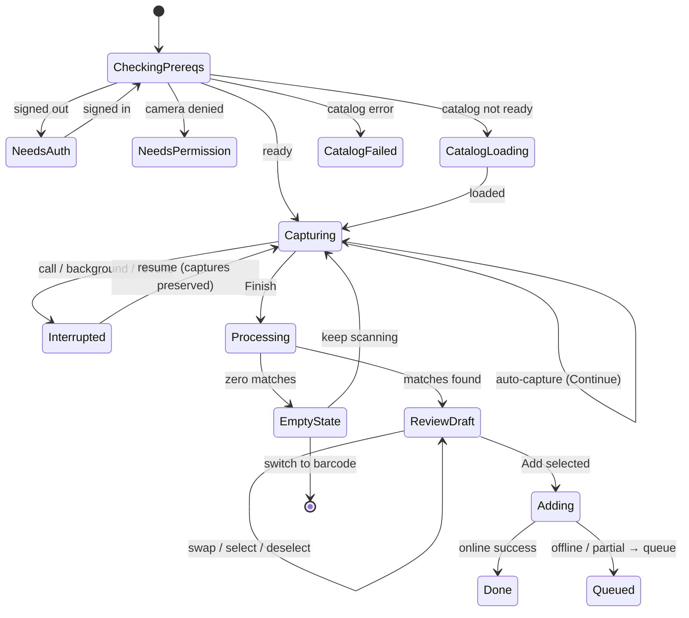

# ✨ Visual Shelf Scanner (Spine Recognition → Owned Shelf)

## Overview

Evolve the scan tab from a single-ISBN barcode reader into a **shelf scanner**: the user
pans their camera across a bookshelf, the app silently auto-captures photos, reads spine
text on-device with OCR, fuzzy-matches it against the in-memory Star Wars catalog, and
presents a review queue to add matches to the owned shelf in one batch. The existing
barcode reader is retained as a secondary mode introduced by a first-run dialogue.

Everything except the shelf write runs **on-device** (free, offline, private). The only
network dependency is the final batch add to Supabase, which is queued and synced if
offline.

This plan is the implementation (HOW) of the 2026-06-05 brainstorm (WHAT). Settled
product decisions are not re-litigated here; see the brainstorm for rationale.

## Problem Statement / Motivation

Cataloguing a physical Star Wars collection one barcode at a time is tedious — exactly
the friction that stops collectors from building their shelf in the app. A collector with
80 books will not scan 80 barcodes. Visual spine recognition turns "populate my library"
from an hour of barcode tedium into a 30-second pan, which is the difference between the
feature being used and not. It also leans directly into the app's design north star —
*collector's pride, books are the hero*.

## Proposed Solution

A capture → recognize → review → add pipeline:

1. **Capture** — hands-free auto-capture on steady/in-focus frames; Finish/Continue loop
   to cover a large library; edge "ghost" overlay guides overlap; per-capture flourish
   (still collapses into little books dropping into a "processing library" indicator).
2. **Recognize (on-device)** — each photo → OCR (ML Kit) → text fragments.
3. **Match (on-device, pure JS)** — TF-IDF cosine scorer over the catalog returns ranked
   top-N candidates per fragment; aggregate/dedupe by `book_id` across all photos;
   bucket by confidence (high / low / reject) using score + #1–#2 margin.
4. **Review** — list (default) / grid (toggle) queue; high-confidence pre-selected,
   low-confidence in a "double-check these" group; already-owned badged + excluded; swap
   a wrong match among ranked alternatives or via catalog search.
5. **Add** — one batch upsert to the owned shelf; optimistic UI; queued + synced if
   offline.

## Technical Approach

### Architecture

```
app/(tabs)/scan.tsx  ── mode switch (shelf | barcode) + first-run dialogue
  ├─ shelf mode → ShelfScanner (capture loop, state machine)
  │     └─ camera (VisionCamera v5)  ──takePhoto()──▶ still uri
  │            └─ lib/ocr.ts        ──PhotoRecognizer(uri)──▶ text fragments
  │                   └─ lib/spine-match.ts (TF-IDF cosine) ─▶ ranked candidates
  │                          └─ aggregate/dedupe ─▶ match session
  │     └─ app/scan-review.tsx (review queue) ─▶ addOwned(ids[])
  └─ barcode mode → useCodeScanner (ean-13/upc-a) ─▶ existing ISBN lookup

lib/hooks.tsx        ── useBooks() (catalog), addOwned() (NEW batch mutation)
lib/shelf-queue.ts   ── NEW offline write queue (AsyncStorage + NetInfo + backoff)
supabase/migrations/ ── NEW unique constraint on user_books(user_id, book_id)
```

**Module boundaries (key principle):** OCR and matching are pure, camera-agnostic
modules (`lib/ocr.ts`, `lib/spine-match.ts`) that operate on a photo URI / a text bag and
the in-memory catalog. This keeps the recognition layer identical whether v1 runs OCR on
stills or a future version runs it on live frames — and makes the matcher unit-testable
with vitest (no native deps, Hermes-safe).

### Decision 1 — Camera foundation (with a de-risking spike)

Adopt **`react-native-vision-camera@^5`** (Nitro Modules) as the camera, per the
brainstorm's "build once on the capable foundation" call: v5 frame processors are the
substrate for the future live-pan goal, and `useCodeScanner` folds the barcode reader
into the same stack (eventually dropping `expo-camera`). v1 still runs OCR on **stills**
via `takePhoto()` → so no frame-processor complexity ships in v1, but the foundation
needs no rewrite later.

**The risk (must de-risk first):** v5 + the OCR plugin expect `react-native-worklets`
**0.8.x+**; the app is on **0.5.1** (pulled in by Reanimated 4.1.1). Bumping worklets must
not break Reanimated 4. v4 of VisionCamera is *not* an option — it needs
`react-native-worklets-core`, which collides with the installed `react-native-worklets`
(duplicate native class on Android).

→ **Phase 0 is a throwaway spike** that proves the worklets bump + Reanimated 4 + a clean
iOS *and* Android dev build *before* any feature code. If the spike fails, fall back to
**Path A** (keep `expo-camera`, add standalone `@react-native-ml-kit/text-recognition` for
still-image OCR — expo-camera already does barcode + `takePictureAsync` in one view, so v1
is fully shippable on it, at the cost of a later camera migration for live-pan). The
recognition/matching/queue layers are identical either way, so the fallback is contained
to the camera screen.

### Decision 2 — Matching engine (`lib/spine-match.ts`, pure TS)

Hand-rolled **TF-IDF cosine** scorer — zero dependencies, <1ms/fragment over a
few-hundred-book catalog, and a score we fully control (Fuse.js's Bitap score saturates on
shared franchise words exactly where disambiguation is needed). Fuse.js can be added later
as a recall booster; not needed for v1.

- **Index (built once from `useBooks()`):** tokenize `title + author[] + series_name`;
  `idf(t) = ln(N / (1 + df(t)))` so "Star Wars/Jedi/Darth" auto-deweight and
  "Thrawn/Zahn/Plagueis" dominate; per-field boosts (title ×1.0, author ×0.9, series
  ×0.7); store each book's L2-normalized weighted vector.
- **Normalize (index + query identically):** case-fold; strip diacritics
  (`normalize('NFKD')`); punctuation→space; canonicalize OCR confusions on a match-only
  copy (`{l,1,I,|}→l`, `{O,0}→o`, `rn→m`, `cl→d`, `S↔5`, `B↔8`); drop tiny stopword set;
  generate sliding 1–4-token windows per OCR line and across adjacent lines (spine text
  wraps unpredictably).
- **Score:** cosine(query, book) + small author-exact and contiguous-bigram bonuses
  (restores word-order signal lost by bag-of-words).
- **Confidence buckets** (calibrate against a labeled sample — see Phase 4):
  - High (auto-select): `S1 ≥ 0.62` AND `margin ≥ 0.12`
  - Low ("double-check"): `S1 ≥ 0.42` and not high
  - Reject (silent): `S1 < 0.42`, or high score with `margin < 0.05` → disambiguation
- **Aggregate/dedupe:** group fragments by `book_id`; book confidence = **max**
  fragment score + small boost for count of distinct supporting fragments (don't sum —
  rewards noise); union across photos keeps best evidence; collapse editions to one
  catalog row per title (canon/legends/format variants of the same work → single owned
  entry).
- **Output:** ranked top-N `{ book, score, margin }` per recognized book (powers the swap
  UI; cached on the result so swapping is instant and offline).

### Decision 3 — Shelf write data layer

The current `toggleShelf` (`lib/hooks.tsx:127`) is **toggle-only, single-row, serial, and
fails silently** — wrong for a batch add (it would turn an already-owned book *off*, and N
books = N round-trips with silent partial failures). Three changes:

1. **Migration — idempotency:** add `UNIQUE (user_id, book_id)` to `user_books` (new
   migration file). Enables safe `upsert(onConflict)` so a replayed queued write is a
   harmless no-op. *Pre-check for existing duplicate rows before applying* (see Data
   Integrity in Risks).
2. **`addOwned(bookIds: string[])`** — new method on `UserBooksProvider` alongside
   `toggleShelf`: splits selected ids into existing-rows (`update owned:true`) vs new
   (batch `insert`/`upsert`), one optimistic Map update for all, single round-trip,
   aggregate success/partial-failure result (`Result<…>`), revert-on-failure. Reused by
   the offline queue's flush.
3. **`lib/shelf-queue.ts`** — tiny AsyncStorage-backed write queue (AsyncStorage 2.2.0 is
   already installed; no new storage dep). Op = `{ id (expo-crypto uuid), type:
   'add_owned', userId, bookId, attempts, createdAt }`. Enqueue collapses duplicates;
   flush is mutex-guarded, oldest-first, exponential backoff + jitter; triggered on app
   start, foreground (`AppState`), and NetInfo `isInternetReachable` rising edge. Adds
   `@react-native-community/netinfo`. Optimistic local state on enqueue + a subtle "N
   changes will sync when you're online" indicator.

> **Scope lever:** the offline queue is the one piece of *net-new infra*. If schedule
> pressure appears, v1 can ship with **"Add requires connection"** (block + clear message,
> keep the review draft) and the queue becomes a fast follow — the migration + `addOwned`
> still land, so the upgrade is additive. Default plan includes the queue.

### Decision 4 — Scanner state machine

Most SpecFlow gaps map to a missing state. Model the shelf flow explicitly (e.g. a
`useReducer` or XState-lite in `hooks/useShelfScan.ts`):



### Screens & Navigation

- **`app/(tabs)/scan.tsx`** — becomes the mode host (shelf default, barcode secondary) +
  first-run dialogue. Reuses existing permission UI (`scan.tsx:85-115`).
- **`app/scan-review.tsx`** — NEW stack screen (register in `app/_layout.tsx:59-65`
  mirroring `book/[id]`; `typedRoutes` is on). Receives the match session; renders the
  review queue. List rows reuse the `BookCard` pattern (`app/(tabs)/shelf.tsx`); grid
  mode reuses `Book3D` (`components/Book3D.tsx`). Already-owned via `userBooks.get(id)`.
- **First-run flag** — AsyncStorage `@ossus/scan_intro_seen`, following the existing
  ref-guarded hydrate pattern in `components/catalog-sort-control.tsx:41-53`.

## Implementation Phases

### Phase 0 — Camera foundation spike (de-risk before building) 🔬
- Throwaway branch: add `react-native-vision-camera@^5` +
  `react-native-vision-camera-worklets` + `react-native-vision-camera-ocr-plus`, bump
  `react-native-worklets` to required version, add the config plugin, `npx expo prebuild`.
- **Success criteria:** clean iOS *and* Android dev build; Reanimated 4 animations
  (existing `Book3D` spring, scan FadeIn/Out) still work; a `takePhoto()` →
  `PhotoRecognizer(uri)` round-trip returns text; `useCodeScanner` reads an EAN-13.
- **Gate:** if it fails → adopt Path A (`expo-camera` + `@react-native-ml-kit/text-recognition`)
  and note the deferred live-pan migration. Either way, lock the camera/OCR module API
  (`lib/ocr.ts`) so later phases are camera-agnostic.

### Phase 1 — Recognition core (pure logic, no UI) 🧠
- `lib/ocr.ts` — `recognizeImage(uri): Promise<Result<OcrFragment[]>>` wrapping the
  chosen OCR engine; `OcrFragment = { text, box?, line }`.
- `lib/spine-match.ts` — `buildCatalogIndex(books)`, `matchFragments(fragments, index):
  RankedMatch[]`, normalization, TF-IDF, confidence bucketing, aggregation/dedupe.
- `lib/spine-match.test.ts` — vitest table-driven cases (reuse `book(partial)` factory
  from `lib/sort.test.ts:6-8`; `it.each` like `lib/__tests__/slug.test.ts`): shared-word
  disambiguation, OCR-confusion inputs, partial/wrapped titles, margin/confidence
  buckets, edition collapse, cross-fragment aggregation.

### Phase 2 — Data layer (migration + batch add + offline queue) 🗄️
- Migration: `supabase/migrations/<ts>_add_user_books_owner_unique.sql` (`UNIQUE
  (user_id, book_id)`; pre-check duplicates). Regenerate `lib/types.ts` (`npm run db:types`).
- `addOwned(bookIds[])` in `UserBooksProvider` with batch upsert + aggregate `Result`.
- `lib/shelf-queue.ts` + `@react-native-community/netinfo`; wire optimistic state + flush
  triggers; `lib/shelf-queue.test.ts` (enqueue dedupe, backoff, mutex, idempotent replay).

### Phase 3 — Capture experience 📸
- `hooks/useShelfScan.ts` state machine (states above); capture loop with steady/in-focus
  auto-capture gating + min interval; Finish/Continue; ghost-overlay (previous frame, low
  opacity); per-capture flourish (reanimated, following `scan.tsx` FadeIn patterns) +
  expo-haptics light impact (first use of the already-installed dep); temp-file lifecycle
  (OCR-then-delete per still + startup orphan sweep); max-photo cap + memory strategy
  (incremental OCR per capture, discard still after).

### Phase 4 — Review queue + matching calibration 📋
- `app/scan-review.tsx`: list/grid toggle, high vs "double-check" groups, pre-selection,
  already-owned badge/exclude, per-row swap (ranked alts + catalog-search fallback),
  batch Add → `addOwned`/queue.
- **Calibration:** capture 20–40 real shelf photos, hand-label, sweep thresholds, bias to
  ≥0.95 precision in the high bucket; hard-code constants with a dated calibration comment.

### Phase 5 — Mode host, first-run, edge states 🧩
- Shelf/barcode mode switch in `scan.tsx`; migrate barcode path to `useCodeScanner`
  (strip leading-zero EAN-13→UPC-A) *if* Phase 0 chose VisionCamera; first-run dialogue +
  `@ossus/scan_intro_seen`; wire all edge states (auth gate, catalog-loading vs
  catalog-failed vs zero-match, interruption/resume, draft persistence).

### Phase 6 — Accessibility, polish, QA ♿
- Accessibility for the silent-capture model (the largest usability gap): VoiceOver/
  TalkBack manual-shutter fallback, per-capture + total announcements, review-queue focus
  order, accessible list/grid toggle. Run the `accessibility-compliance` skill.
- Haptics map (capture / finish / add-success); thermal/battery sanity on a large scan;
  Biome lint (`npm run lint`); full `vitest`; manual device QA on iOS + a low-RAM Android.

## Alternative Approaches Considered

- **expo-camera + standalone ML Kit OCR (Path A):** simplest v1, no worklets risk, but no
  frame-processor path → a later camera rewrite for live-pan. Kept as the Phase 0
  fallback, not the default (conflicts with build-once).
- **VisionCamera v4:** rejected — requires `react-native-worklets-core`, which collides
  with the installed `react-native-worklets` (Android duplicate-class build failure).
- **Cloud vision (Claude/Google Vision via Edge Function):** higher accuracy, but cost +
  network + server infra the user explicitly declined. Matching layer is unchanged, so it
  remains a clean future graduation if on-device accuracy disappoints.
- **Fuse.js / fuzzysort as the matcher:** their scores saturate on shared franchise words;
  no controllable confidence signal. Fuse can augment recall later; not v1.
- **Pixel-stitching photos into a composite:** rejected in brainstorm (fragile on
  repetitive SW spines); data-space dedupe by `book_id` is simpler and more reliable.
- **redux-offline / TanStack offline mutations:** overweight + known RN offline-mutation
  footguns for one write type; a tiny hand-rolled AsyncStorage queue is simpler and robust.

## Acceptance Criteria

### Functional
- [ ] User pans a shelf; app auto-captures hands-free on steady frames with Finish/Continue.
- [ ] Edge ghost overlay of the prior shot guides overlap; per-capture flourish + haptic fire.
- [ ] On Finish, photos are OCR'd on-device and matched to the catalog; matches dedupe by book and across photos.
- [ ] Review queue: list default + grid toggle; high-confidence pre-selected; low-confidence in a "double-check" group; already-owned badged + excluded.
- [ ] A wrong match can be swapped among ranked alternatives or via catalog search; swap to an already-owned book auto-deselects with the badge.
- [ ] Selected books add to the owned shelf in one batch; UI reflects them immediately.
- [ ] Barcode mode still reads ISBNs (existing behavior preserved); first-run dialogue introduces both modes once.
- [ ] Non-catalog books are silently ignored; zero-match shows the helpful empty state + barcode fallback.

### Non-Functional
- [ ] Recognition + matching run fully on-device (no network); only the shelf add hits Supabase.
- [ ] Matching ≥0.95 precision in the high-confidence bucket on the calibration sample.
- [ ] No OOM on a large scan; per-still memory bounded (incremental OCR + temp cleanup).
- [ ] Offline at add → queued and synced on reconnect; replayed writes are idempotent (no duplicates).
- [ ] Silent-capture flow is operable with VoiceOver/TalkBack (manual shutter + announcements).
- [ ] All colors via `constants/tokens.ts`; no hardcoded hex in new screens.

### Quality Gates
- [ ] `lib/spine-match.test.ts` + `lib/shelf-queue.test.ts` pass; `vitest` green.
- [ ] `npm run lint` (Biome) clean.
- [ ] Clean iOS **and** Android dev builds with the new native deps.
- [ ] Manual QA on iOS + a low-RAM Android device.

## Success Metrics
- **Adoption:** % of new shelves populated via shelf-scan vs barcode vs manual.
- **Throughput:** median books added per shelf-scan session; time-to-populate vs barcode.
- **Trust:** swap/deselect rate in the review queue (proxy for match precision); ratio of
  high-confidence auto-selected that survive to Add.
- **Reliability:** scan-session crash rate; offline-queue sync success rate.

## Dependencies & Risks

| Risk | Impact | Mitigation |
|---|---|---|
| `react-native-worklets` bump breaks Reanimated 4 | Blocks VisionCamera path | **Phase 0 spike** gates it; Path A fallback (expo-camera + ML Kit) |
| VisionCamera v5 on SDK 54 build issues (early reports) | iOS build fails | Validate EAS/local iOS build in Phase 0 before feature work |
| Native deps need a fresh dev build (no `ios/`/`android/` dirs; managed prebuild) | Can't OTA; rebuild required | Plan a `npx expo prebuild` + dev-build step; communicate no-Expo-Go |
| Match thresholds are data-specific | Bad auto-adds erode trust | Calibrate on 20–40 labeled real photos; bias to precision |
| `user_books` has pre-existing `(user_id, book_id)` duplicates | Unique migration fails | Pre-check + de-dupe query before adding the constraint |
| Large library OOM | Crash on target power-user | Incremental per-capture OCR + temp-file cleanup + photo cap |
| Draft loss on interruption/navigation | Catastrophic to trust | Persist review draft (≥ tab-switch/background; decide app-kill) |
| reactCompiler experiment + worklet/frame code | Subtle bugs | Verify in Phase 0; exclude frame code from compiler if needed |

## Edge Cases → Resolution (from SpecFlow)

| Case | Resolution |
|---|---|
| Signed-out entering scanner | Allow capture+review; prompt sign-in at **Add**; persist the draft across sign-in. |
| Catalog still loading / failed at Finish | Distinct "catalog loading / retry" state — **never** routed into the lighting/coverage empty state. |
| Session expiry / account switch mid-flow | Re-validate `user` + refetch owned-set immediately before Add; recompute exclusions. |
| Permission revoked / call / background mid-capture | Enter `Interrupted`; preserve captured set; offer resume. |
| Navigate away from review queue | Persist draft (survive tab-switch + background; app-kill persistence = open question). |
| Large library | Hard photo cap + nudge to Finish; incremental OCR; bounded memory. |
| Temp captures | Delete each still after its OCR; startup sweep of orphans (storage + privacy). |
| Swap to already-owned book | Show "already in library" badge + auto-deselect. |
| Two physical copies of one title | Accepted v1 limitation (set semantics); no affordance yet. |
| Partial/flaky offline mid-batch | Per-book status (added / pending sync); idempotent upsert reconciles on flush. |
| OCR huge/empty text | Per-photo token/size cap; empty → silent bad-frame gating. |

## Documentation Plan
- Update `CLAUDE.md` (scan tab now multi-mode; new native deps + dev-build requirement).
- Note the worklets/VisionCamera version constraints near `package.json` deps.
- After shipping, capture the calibration method + thresholds as a `docs/solutions/` entry
  (directory does not exist yet — create it) so future catalog growth can re-tune.

## References & Research

### Internal
- Current scanner / permission / result UI: `app/(tabs)/scan.tsx:1-206` (barcode flow `:31-71`, permission `:85-115`, camera `:120-129`).
- Shelf data layer: `lib/hooks.tsx` — `useBooks()` `:35-70` (full in-memory catalog, `loading`/`error`), `toggleShelf` `:127-196` (toggle-only, serial, silent-revert, `!user` no-op `:129`, clears owned-set on account change `:122`).
- Types: `lib/types.ts` — `books` `:38-58` (title/author[]/series_name/series_order/isbn[]/primary_isbn/canon/format/cover_image), `user_books` `:107-116`.
- Routing: `app/_layout.tsx:42-66` (Stack; providers wrap at `:37-41`); `app/book/[id].tsx` (pushed-screen pattern); native tabs `app/(tabs)/_layout.tsx:46-49`.
- Reuse: `lib/result.ts:5-15` (Result type); `constants/tokens.ts:9-47` (tokens + `badge.canon/legends` for the owned badge); `components/catalog-sort-control.tsx:41-53` (AsyncStorage ref-guard pattern for `@ossus/scan_intro_seen`); `components/Book3D.tsx:31-39` (grid mode); `app/(tabs)/shelf.tsx` (FlashList `BookCard` rows + `userBooks.get(id)` owned-lookup).
- Tests: `lib/sort.test.ts:6-8` (`book(partial)` factory), `lib/__tests__/slug.test.ts:5-14` (`it.each`); `vitest.config.ts` (node env, `**/*.test.ts`).
- Config: `app.json` (`newArchEnabled:true`, `plugins` incl. expo-camera, `experiments.reactCompiler:true`, EAS projectId); `eas.json` development profile (`developmentClient`, `ios.simulator`); **no `ios/`/`android/` dirs** (prebuild).

### External (verify versions at install — fast-moving)
- VisionCamera v5 / worklets: https://blog.margelo.com/whats-new-in-visioncamera-v5 · https://react-native-vision-camera.com/docs/guides · v5-on-SDK54 build report https://github.com/mrousavy/react-native-vision-camera/issues/3743 · v4 worklets-core Android conflict https://github.com/mrousavy/react-native-vision-camera/issues/3563
- OCR: `react-native-vision-camera-ocr-plus` v2 (still `PhotoRecognizer` + live `useTextRecognition`) https://github.com/jamenamcinteer/react-native-vision-camera-ocr-plus · standalone `@react-native-ml-kit/text-recognition` https://www.npmjs.com/package/@react-native-ml-kit/text-recognition · Infinite Red ML Kit (Expo-first) https://docs.infinite.red/react-native-mlkit/
- expo-camera SDK 54: https://docs.expo.dev/versions/latest/sdk/camera/ · New Architecture: https://docs.expo.dev/guides/new-architecture/
- Offline: NetInfo https://github.com/react-native-netinfo/react-native-netinfo · idempotent upsert pattern (Supabase `onConflict`).
- Matching: Fuse.js https://www.fusejs.io/ (considered, not adopted v1); TF-IDF cosine (hand-rolled).

### Related Work
- Brainstorm: `docs/brainstorms/2026-06-05-visual-shelf-scanner-brainstorm.md`
- Prior plans for house style: `docs/plans/2026-05-30-feat-catalog-add-merge-delete-plan.md`

## Open Questions / Decisions to Confirm
1. **Offline queue in v1, or fast-follow?** Default = ship it. Confirm vs "Add requires connection" v1.
2. **Review-draft persistence depth:** survive tab-switch/background (yes) — also survive full app-kill? (adds AsyncStorage/SQLite draft storage).
3. **Camera path:** proceed assuming VisionCamera (Phase 0 confirms); accept Path A fallback if the spike fails?
4. **Photo cap number** (e.g. 20) and the steady/in-focus auto-capture thresholds — set during Phase 3 tuning.
5. **Two-physical-copies:** confirm "no affordance in v1" is acceptable.
```
