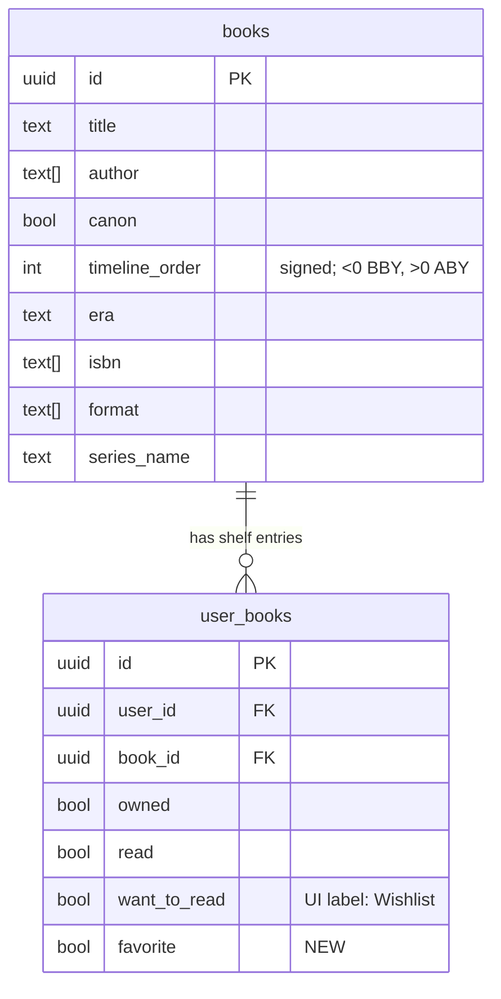

# ✨ Navigation Redesign, New Tabs & Hologram Detail

## Overview

A multi-surface redesign of OssusArchives to match the updated Figma
([Main Screens section](https://www.figma.com/design/QXX32qKJOCbQzkEnO9tJPA/Ossus-Archives?node-id=142-365)).
Five things move at once: the **information architecture** (tabs + where Scan/Profile live), a
new **Timeline** tab, a dedicated **Search** tab, a **hologram** book cover that replaces the
3D cover everywhere, and a shared **Card + Notch** design language used by book rows, detail
groupings, and settings.

The plan is a **linear sequence**: **Phase 1 (navigation + data + primitives) lands first**,
then the feature screens build on top in order. Steps are ordered so each one only depends on
work already done.

> **Reviewed 2026-06-22** (DHH / Kieran / Simplicity). Folded in: dropped the concurrent-
> workstream framing for a linear sequence; Aurebesh shrunk to a setting (not a system);
> `DetailGroupCard` not pre-extracted; `lib/shelf.ts` collision fixed (new `lib/library-filter.ts`);
> `getCoverColor` relocated out of the deleted file; affiliate disclaimer corrected to a
> sheet+component reused in About; Timeline year/grouping math specified; acceptance criteria
> made measurable; empty/loading/reduce-motion reuse called out; five open questions resolved.

## Enhancement Summary (deepened 2026-06-22)

Parallel research grounded six areas in current Expo SDK 54 docs + project skills. Key
improvements and corrections:

1. **Native headers need per-tab Stacks (Step 1 correction).** A bare `NativeTabs.Trigger`
   renders **no header** — to get `headerLargeTitle` per tab, each tab must nest its own
   `<Stack>` (convert tab routes to group folders `(archives)/(timeline)/(library)/(search)`).
   Also: the JSX header API (`Stack.Toolbar`) is **SDK 55+**; on SDK 54 use the classic
   `Stack.Screen` `headerRight` render-prop (it *does* accept arbitrary RN views for glass
   buttons). Modal/sheet routes belong on the **root** `app/_layout.tsx` Stack.
2. **`expo-glass-effect` is already installed** (`~0.1.10`) and gives true iOS 26 Liquid Glass
   (`GlassView` + `isLiquidGlassAvailable()`), auto-falling back to a plain View on iOS<26 /
   Android — no `expo-blur` needed. Keep lucide icons (SF Symbols only inside NativeTabs).
3. **Use Reanimated 4's built-in `useAnimatedSensor(SensorType.ROTATION)`** for the HoloCover
   gyro tilt instead of wiring `expo-sensors` by hand — UI-thread, auto-cleanup, less code.
   Exactly **one** animated `hero` on screen ever; `thumb` early-returns static.
4. **FlashList 2.0: remove `estimatedItemSize`** (deprecated/auto-sizing); for Timeline's
   horizontal paging you **must** wrap FlashList with `Animated.createAnimatedComponent` +
   `useAnimatedScrollHandler` (its `onScroll` is a plain JS callback otherwise).
5. **Data-layer hardening:** add a per-book in-flight guard to `toggleShelf` (double-tap on the
   star otherwise clobbers); add `favorite:false` to the optimistic placeholder in
   `lib/shelf.ts`; partial index on `favorite` is **not** worth it (client filters in JS).

### New considerations discovered (need attention)

- **✅ Aurebesh = full coverage (resolved).** `Text.defaultProps` only styles JS `<Text>`, so
  Step 9 **also** sets explicit `fontFamily` on native chrome — `headerTitleStyle` (large titles),
  NativeTabs `Label` style, and the search-bar `TextInput`. The **Android `TextInput` placeholder**
  font (RN bug #50137) is the one documented exception. (See Step 9.)
- **SDK 54 large-title-collapse bug** (expo/expo#40717): large titles can vanish when a NativeTab
  Stack screen's content is a `ScrollView`/`FlashList`. Mitigate (scrollable = first child +
  `contentInsetAdjustmentBehavior="automatic"`) and **QA Archives/Library**.
- **Glass in a native `headerRight` has a device-build bug** (expo/expo#39667) — verify on a
  device build early; the flat fallback covers it if it fails.
- **`role="search"` does not give a free search bar** on SDK 54 — the Search tab builds its own
  input (Step 6 already does).

### Resolved decisions

| Decision | Choice |
|---|---|
| Filter UI | **Inline pills** (category/shelf) **+ sort dropdown** from the filter icon |
| Profile/Account presentation | **Bottom sheet** (detent), not full-screen |
| "Want to read" → "Wishlist" | **Relabel UI only** — keep `user_books.want_to_read` column |
| Navigation tech | **Native** — NativeTabs + native large-title Stack headers + native modal/sheet presentations |
| Scan confirmation | New `AddedBooksSheet` = confirm step for **barcode/quick** + post-capture summary for shelf; existing `shelf-scan-review` stays for shelf **batch editing** |
| Favorites ↔ Library | **Independent** — favoriting does **not** add a book to Library; "All" excludes favorite-only rows |
| Library "Not read" | `owned && !read` (owned & unread only) |
| Aurebesh scope | **Entire app incl. native chrome** — JS text + native header titles, NativeTabs labels, and the search bar all swap; Android `TextInput` placeholder is a documented exception |
| Archives search | **Removed** — Search tab is the only search entry point |
| Search placeholder | "Search the archives…" |

---

## Target Information Architecture

**Bottom tab bar (NativeTabs):** `Archives` · `Timeline` · `Library` · `Search` (Search uses
`role="search"`). New SF Symbol icons for Archives & Library.

**Out of the tab bar** — now top-nav actions:
- **Scan** → full-screen modal sheet (camera fills screen). Was a tab.
- **Profile/Account** → bottom sheet. Was a tab.

**Per-screen top nav (native large-title header):** large inline title + circular "Liquid
Glass" header buttons:
- Archives, Library: **filter** · **scan** · **profile**
- Timeline, Search: **scan** · **profile**
- Book Detail: **back** · **favorite (star)** + large title with author byline

```
Before:  Tabs = [Archives, Shelves, Scan, Profile]
After:   Tabs = [Archives, Timeline, Library, Search]
         Scan    = full-screen modal (header scan button)
         Profile = bottom sheet (header profile button)
```

### Current → target file map

| Current | Target |
|---|---|
| `app/(tabs)/_layout.tsx` (4 native tabs) | New 4 tabs; Scan/Profile triggers removed |
| `app/(tabs)/index.tsx` (Archives, inline search+sort) | Archives = browse + filter pills + sort dropdown (search removed in Step 6) |
| `app/(tabs)/shelf.tsx` (Shelves) | **Rename → `app/(tabs)/library.tsx`** |
| — | **New** `app/(tabs)/timeline.tsx` |
| — | **New** `app/(tabs)/search.tsx` |
| `app/(tabs)/scan.tsx` | **Move → `app/scan.tsx`** (full-screen modal) |
| `app/(tabs)/profile.tsx` | **Move → `app/profile.tsx`** (bottom sheet) + `app/about.tsx` |
| `app/book/[id].tsx` (3D cover) | Hologram cover, new header/toolbar, reordered sections |
| `components/Book3D.tsx`, `components/Book3DViewer.tsx` | **Delete** (replaced by `HoloCover`) |
| `components/affiliate-disclosure-sheet.tsx` | **Reused inside About**, removed from book detail |

---

## Data Model Changes

**Favorite is a net-new feature** (the only new shelf flag): `user_books` today has just
`owned / read / want_to_read` — there is no favorite column. "Wishlist" and "Read" already exist
as booleans; "Wishlist" is a **label-only** change over `want_to_read`. Adding `favorite` also
touches one server function (`merge_books`) that OR-merges shelf flags — see below.



- Migration `supabase/migrations/<ts>_add_favorite_to_user_books.sql` —
  `alter table user_books add column favorite boolean not null default false;`
  (RLS already covers `user_books`; no policy change.)
- **Update `merge_books`** (`supabase/migrations/20260602000000_add_merge_books_function.sql`) in
  the same migration: add `favorite` to its `bool_or(...)` flag-merge and the insert/`on conflict`
  column lists — otherwise merging duplicate books silently drops favorites.
  (`add_owned_books` needs no change — it only ever sets `owned`.)
- `lib/hooks.tsx` → `toggleShelf(bookId, field)`: extend `field` to
  `'owned' | 'read' | 'want_to_read' | 'favorite'`; include `favorite` in the existing
  all-flags-false row-delete check (`lib/hooks.tsx:140`).
  **Encode this behavior:** toggling `favorite` on a book with no other flags **creates** a
  `user_books` row; un-favoriting it (all flags false) **deletes** the row. Optimistic update
  **reverts on write failure** (mirror existing rollback).
- `npm run db:reset` (local) → `npm run db:types` to regenerate `lib/types.ts`.

### Library filter semantics

Filters (Figma `134:1450`). Single source of truth in a **new** `lib/library-filter.ts`
(NOT `lib/shelf.ts` — that file already exists and is scoped to the scanner):

| Pill | Predicate |
|---|---|
| All | `owned \|\| read \|\| want_to_read` &nbsp;*(favorite-only rows excluded — favorites are independent)* |
| Favorites | `favorite` |
| Want | `want_to_read` |
| Read | `read` |
| Not read | `owned && !read` |

> A favorite-only `user_books` row exists in the DB (so the star persists) but does **not**
> appear under Library "All"; it only surfaces under the "Favorites" pill.

---

## Shared Primitives (build once, in Phase 1)

1. **`Card` + `CardNotch`** (`components/ui/card.tsx`) — dark card shell + skeuomorphic Notch +
   Light Bars motif (Figma `130:394`). Used by book rows, detail groupings, account card.
2. **`HoloCover`** (`components/holo-cover.tsx`) — replaces `Book3D`. Projected cover + cyan beam
   cone + glowing emitter base + looping projector-light animation. Props:
   `variant: 'hero' | 'thumb'`, `animated?`, `width/height`, `coverUri`, fallback color.
   - `hero` = animated (detail `134:2693`, timeline `134:2073`). `thumb` = **static**, no
     per-instance animation (rows `130:346`, scan thumbnails `153:2609`).
   - **Gyroscope tilt ±15°** via Reanimated 4 **`useAnimatedSensor(SensorType.ROTATION)`** (UI
     thread, auto-cleanup — preferred over manual `expo-sensors`) is the **deferred final step**
     (Step 10) on `hero` only. Clamp with `Extrapolation.CLAMP` + `withTiming(~90ms)` damping.
     Gate on `useReduceMotion()` (already in `hooks/useAccessibility.ts`). **No-op in the iOS
     simulator** — ship static first.
   - New tokens: `holoCyan #3DE0FF`, emitter `rgba(61,224,255,0.55)` (additive).
3. **`GlassIconButton`** (`components/ui/glass-icon-button.tsx`) — circular Liquid-Glass header
   button via **`expo-glass-effect` `GlassView`** (already installed `~0.1.10`;
   `isLiquidGlassAvailable()` → flat translucent `View` fallback on iOS<26/Android; respect
   `AccessibilityInfo.isReduceTransparencyEnabled()`). lucide icons. Header actions + sheet
   close X. **Do not** wrap in opacity<1 (kills the glass effect — conflicts with Reanimated
   fades). Keep props minimal.
4. **`FilterPills`** (`components/ui/filter-pills.tsx`) — pill row (`130:642` / `134:1450`),
   active=blue. Used by Archives, Library, Timeline.
5. **`getCoverColor`** → move to neutral **`lib/cover.ts`** (currently exported from the
   to-be-deleted `Book3D.tsx`). Both `HoloCover` and any stragglers import from here.

Tokens: additive only in `constants/tokens.ts` (holo cyan, Light Bars accent).

---

## Implementation Plan (linear)

### Phase 1 — Foundation

#### Step 1 — Navigation & routing restructure + stubs ⭐ START HERE

- Rewrite `app/(tabs)/_layout.tsx`: tabs = Archives, Timeline, Library, Search (`role="search"`).
  New SF Symbols for Archives & Library. Remove Scan & Profile triggers.
- Each tab = native large-title header (`headerLargeTitle: true`); `headerRight` = stub
  `GlassIconButton`s wired to routes (visuals refined in Step 3).
- Add Stack routes in `app/_layout.tsx`: `app/scan.tsx` (`presentation: 'fullScreenModal'`),
  `app/profile.tsx` (`presentation: 'formSheet'` + `sheetAllowedDetents` + grabber),
  `app/about.tsx` (pushed from Profile). (`app/_layout.tsx` already wraps `ScanSessionProvider`.)
- **Rename** `app/(tabs)/shelf.tsx` → `app/(tabs)/library.tsx` (label, route name, tests). Update
  its empty-state CTA `router.push('/(tabs)/scan')` → `/scan`.
- **Stub** `app/(tabs)/timeline.tsx` + `app/(tabs)/search.tsx` (title + empty state + TODO).
- Move (don't rewrite) current scan/profile screens into the new routes so they still work.

**Acceptance:** four tabs render; header scan/profile open the modal + sheet and return to the
originating tab; Library shows old shelf content under the new name; Timeline/Search stubs
visible; deep link `/book/[id]` works; Android tabs navigable; `npm run lint` clean.

**Research Insights (Expo SDK 54 / expo-router 6.0.23):**
- **NativeTabs render no header** — each tab needs its own nested `<Stack>` to get a large
  title. Convert tab routes to group folders; `NativeTabs.Trigger name` matches the folder name
  *including parentheses*:
  ```tsx
  // app/(tabs)/_layout.tsx
  <NativeTabs.Trigger name="(archives)"> <Icon sf={{default:"externaldrive",selected:"externaldrive.fill"}}/> <Label>Archives</Label> </NativeTabs.Trigger>
  // … (timeline) clock, (library) books.vertical, (search) magnifyingglass role="search" (keep LAST)

  // app/(tabs)/(archives)/_layout.tsx
  <Stack screenOptions={{ headerLargeTitle: true, headerShadowVisible: false }}>
    <Stack.Screen name="index" options={{ title: "Archives", headerRight: () => <HeaderButtons/> }} />
  </Stack>
  ```
- **Header API is classic on SDK 54** — `Stack.Toolbar`/`NativeTabs.Trigger.Icon` namespace are
  SDK 55+. Use `headerRight: () => <View row>…GlassIconButton…</View>` (accepts arbitrary RN views).
- **Modal/sheet routes on the root `app/_layout.tsx` Stack** (sibling to `(tabs)`):
  ```tsx
  <Stack.Screen name="scan" options={{ presentation:"fullScreenModal", headerShown:false, animation:"slide_from_bottom" }} />
  <Stack.Screen name="profile" options={{ presentation:"formSheet", sheetAllowedDetents:[0.6,1.0], sheetGrabberVisible:true, sheetCornerRadius:24 }} />
  ```
  Android ignores detents/grabber/cornerRadius (renders ~full-height modal) — acceptance is
  iOS-verified. `ScanSessionProvider` already wraps at root → no provider change. `router.push`
  /`router.back` + existing `unstable_settings.anchor:'(tabs)'` give correct return-to-tab +
  deep-link. Update Library CTA `'/(tabs)/scan'` → `'/scan'`.
- **Risks:** large-title-collapse with ScrollView/FlashList (expo#40717 — scrollable as first
  child + `contentInsetAdjustmentBehavior="automatic"`); glass-in-headerRight device-build bug
  (expo#39667 — verify on device build). `role="search"` ≠ free search bar (Step 6 builds it).
- Docs: [native-tabs](https://docs.expo.dev/router/advanced/native-tabs/) ·
  [modals](https://docs.expo.dev/router/advanced/modals/) ·
  [stack](https://docs.expo.dev/router/advanced/stack/)

#### Step 2 — Data: `favorite` migration + hooks + library-filter

- Migration (add `favorite` column **and** update the `merge_books` function to OR-merge it) +
  `db:reset` + `db:types` (see Data Model).
- `lib/hooks.tsx`: extend `toggleShelf` field union + all-false delete check to include
  `favorite`; optimistic **revert on failure**; comment the create/destroy-row behavior.
- **New** `lib/library-filter.ts`: `deriveLibraryFilter(userBook, filter)` per the semantics
  table + `lib/library-filter.test.ts` (all five pills incl. favorite-only exclusion and the
  `owned && !read` boundary).

**Acceptance:** favorite round-trips optimistically and reverts on a forced failure; all five
Library predicates covered by passing Vitest; owned/read/want flows unchanged; types regenerated.

**Research Insights:**
- Migration is **online/metadata-only** on PG11+ (`ADD COLUMN … DEFAULT false NOT NULL` = brief
  lock, no rewrite). RLS is column-agnostic → no policy change. **Partial index not worth it** —
  the app fetches all `user_books` once and filters in JS; add `(user_id) where favorite` only if
  filtering moves server-side.
- Also add `favorite: false` to the optimistic placeholder in **`lib/shelf.ts:29-38`** or TS errors
  once types regenerate.
- **Add a per-book in-flight guard** to `toggleShelf` — double-tapping the star fires two writes
  against the same stale snapshot and a slow first response clobbers the second:
  ```ts
  const inFlight = useRef(new Set<string>());
  // if (inFlight.current.has(bookId)) return; add()… finally inFlight.current.delete(bookId)
  const allOff = !u.owned && !u.read && !u.want_to_read && !u.favorite; // include favorite
  const updatePayload = { [field]: newValue };  // replaces the 3-way ladder
  ```
- `deriveLibraryFilter` as a pure `switch` over a `LibraryFilter` union (no React/Supabase import,
  node-testable like `lib/shelf.ts`). **Key test:** favorite-only row → `all=false`,
  `favorites=true`; plus `owned&&read` → `not_read=false` boundary; favorite+owned → both true.
- Docs: [PG ADD COLUMN locks](https://www.postgresql.org/docs/current/sql-altertable.html) ·
  [partial indexes](https://www.postgresql.org/docs/current/indexes-partial.html)

#### Step 3 — Shared primitives

Build the 5 items in **Shared Primitives**. Relocate `getCoverColor` to `lib/cover.ts` first.
`HoloCover` static projection + beam/emitter is the core (gyro is Step 10).

**Acceptance:** `Card` notch matches Figma `130:394` at 386px; `HoloCover` `thumb` renders a
**static** image with **no per-row animation**; `HoloCover` `hero` runs the projector loop in
the simulator; `GlassIconButton` shows glass/blur with a flat fallback.

**Research Insights — HoloCover (Reanimated 4):**
- Structure (hero, back→front): emitter glow ellipse → beam cone (`LinearGradient` trapezoid,
  cyan→transparent up) → tilted `Animated.View` wrapping the cover → optional scanline sheen.
  `thumb` = early-return plain `expo-image` (zero shared values/sensors).
- Drive **one** master `progress` SV (`withRepeat(withTiming(...2800ms, Easing.inOut), -1, true)`)
  and derive beam/glow/sheen; animate **only `opacity`/`transform`**; keep flicker amplitude tiny
  (~±0.04) — tasteful, non-seizure. No `filter`/blur per frame; soften via gradient stops.
- **Perf rule (load-bearing):** `thumb` must have no `useSharedValue`/`useAnimatedSensor` —
  FlashList recycles rows and sensor subscriptions don't dedupe; only the single on-screen `hero`
  animates. `expo-image` thumbs: `recyclingKey={book.id}`, `cachePolicy="memory-disk"`.
- `GlassIconButton`: 44×44 + `hitSlop`, `borderRadius:size/2` (glass clips circular), `isInteractive`,
  `accessibilityRole/label/state`; merge adjacent header buttons with `GlassContainer` not N views.
- Docs: [useAnimatedSensor](https://docs.swmansion.com/react-native-reanimated/docs/device/useAnimatedSensor/) ·
  [glass-effect](https://docs.expo.dev/versions/latest/sdk/glass-effect/) ·
  [expo-image](https://docs.expo.dev/versions/latest/sdk/image/)

### Phase 2 — Screens (in order)

#### Step 4 — Book card / row

- Rebuild `components/book-card.tsx` on `Card` + `HoloCover(thumb)` per Figma `130:344`:
  cover (66×108) · title/author · Canon/Legends badge · Data Points (SERIES/ISBN/TIMELINE/
  FORMAT) · Notch footer. Wire into Archives + Library lists (FlashList).
- Do **not** extract a `DetailGroupCard`; detail groupings are built inline in Step 5.

**Acceptance:** Archives & Library rows render via FlashList with **static** thumb covers (no
per-row Reanimated loops); badges/data points populate from `Book`; parity with Figma `130:344`
at the 393pt iPhone width.

**Research Insights (FlashList 2.0):**
- **Remove `estimatedItemSize`** — v2 auto-sizes (deprecated). Keep stable `keyExtractor` +
  `useCallback` `renderItem`.
- **Memoize** `BookCard` with `React.memo`. To avoid a toggle on book A re-rendering book B: have
  the card read only the immutable `Book` and receive shelf badges via parent-derived props, or
  select a primitive (`userBooks.get(id)?.favorite ?? false`) — never pass the whole `Map`. Pass a
  small `extraData={filter}` primitive so recycled cells re-render on filter change.
- **Per-filter empty states** (`ListEmptyComponent` branches on active pill): "No favorites yet —
  tap the star on a book", "Nothing on your wishlist", etc. Full-screen "collection awaits" only
  when `counts.all === 0`.
- **Loading:** `book-detail-skeleton.tsx` is detail-shaped — **don't** reuse for list rows; use the
  existing `refreshing`/`onRefresh` spinner or a lightweight row skeleton (`react-content-loader` is
  already a dep). Reuse `error-state.tsx` for `catalogError`.
- Docs: [FlashList v2 migration](https://shopify.github.io/flash-list/docs/v2-migration) ·
  [performant components](https://shopify.github.io/flash-list/docs/fundamentals/performant-components)

#### Step 5 — Book Detail redesign (`app/book/[id].tsx`)

Per Figma `134:2691` + button states `153:2511`:
- **Header:** back + favorite **star** (outline → `star.fill` blue when `favorite`); large title +
  author byline (`134:2859`).
- **Hero:** `HoloCover(hero)` replacing the 3D cover (remove `Book3D`/`Book3DViewer` imports).
- **Order:** synopsis → **Find on Amazon** (moved *below* summary) → Details/Series/Formats/ISBN
  groupings built **inline on `Card`** (`134:2730/2778/2797/2817`).
- **Bottom toolbar** (`134:2853`, new `components/book-detail-toolbar.tsx`): left = **Add to
  library / In library** (owned; outline → blue `checkmark.square.fill`); right two = **Wishlist**
  (want_to_read) + **Read** (read; `bookmark` → `bookmark.fill` blue). All states in `153:2511`.
- **Remove** the `AffiliateDisclosureSheet` trigger here; the component is **reused in About**
  (Step 9) — do not delete `components/affiliate-disclosure-sheet.tsx`.
- Reuse `components/book-detail-skeleton.tsx` (loading) and `components/error-state.tsx`.
- **After this step, Book3D is unused** (Step 4 + Step 5 dropped the imports; `getCoverColor` is in
  `lib/cover.ts`) → delete `components/Book3D.tsx` + `components/Book3DViewer.tsx`.

**Acceptance:** favorite/owned/wishlist/read toggle optimistically and match the active fills in
`153:2511`, reverting on failure; hologram hero renders; loading uses the existing skeleton; no
`Book3D` import remains anywhere.

#### Step 6 — Search tab (`app/(tabs)/search.tsx`)

- Extract search normalization/match logic from `app/(tabs)/index.tsx` into `lib/search.ts`
  (title/author/series/slug; punctuation) with a test.
- Per Figma `142:366`: large "Search" title; **search bar pinned to bottom** (magnifier + mic +
  clear X; placeholder "Search the archives…"); results above using the Step 4 `BookCard`; empty +
  no-results states.
- **Remove the inline search field from `app/(tabs)/index.tsx`** (Search tab is the only search
  entry point).

**Acceptance:** typing filters live; bottom bar clears the keyboard; Archives no longer shows a
search field; `lib/search.test.ts` covers the punctuation/normalization cases.

#### Step 7 — Timeline tab (`app/(tabs)/timeline.tsx`) 🔬 highest risk

Per Figma `133:1094` (rail `134:2638`, hero `134:2073`):
- Horizontal, snap-paginated scroll of all books ordered by `timeline_order` asc (oldest→newest);
  each page = `HoloCover(hero)`.
- **Year derivation:** there is **no year column** — derive BBY/ABY from `timeline_order` using the
  **existing formatter** already used on book detail (locate in `app/book/[id].tsx`; extract to
  `lib/timeline.ts` if inline). Do not invent a new mapping.
- **`lib/timeline.ts` output shape (so gesture code + tests agree):**
  `groupBooksByYear(books): { order: number; label: string; books: Book[] }[]` sorted
  oldest→newest, plus a flat `pageIndex → groupIndex` map. Exclude `timeline_order = null`.
  Pure + unit-tested before any gesture wiring.
- **Notch rail:** ticks per year; **tall/blue active** vs **short/dim** inactive. Labels render
  **only** on year-bearing notches (sparse), e.g. "25,793 BBY".
- **Multi-book-per-year:** swiping moves the featured book within a year group without advancing
  the notch; the rail re-anchors only when `groupIndex` changes.
- Projector-light loop gated on `useReduceMotion()`. Filter pills reuse `FilterPills`. Empty state
  when no timeline-ordered books.

**Acceptance:** `lib/timeline.test.ts` covers grouping, label sparsity, null exclusion, and
multi-book years; paging is snap-aligned; the active notch corresponds to the centered group;
labels appear only on year-bearing notches; reduce-motion disables the projector loop.

**Research Insights:**
- **Paging:** horizontal **FlashList** (windowing for hundreds of holo pages) with
  `snapToInterval={PAGE_WIDTH}` (from `useWindowDimensions`), `disableIntervalMomentum`,
  `decelerationRate="fast"`, `getItemType={() => 'page'}`. Prefer `snapToInterval` over
  `pagingEnabled` (precise stride, survives peek/padding). Plain `Animated.ScrollView` mounts
  every page (hundreds of holo loops) — avoid.
- **⚠ FlashList v2 `onScroll` is a plain JS callback** — to get a UI-thread `scrollX`, wrap it:
  `const AnimatedFlashList = Animated.createAnimatedComponent(FlashList)` and pass
  `onScroll={useAnimatedScrollHandler(...)}`. Drive rail ticks from `scrollX` in `useAnimatedStyle`
  (zero re-renders); drive the React-state group label from `onViewableItemsChanged`
  (`itemVisiblePercentThreshold: 60`).
- **Rail anchoring "for free":** active test = `page ∈ [groupPageStart, groupPageEnd)` so swiping
  within a year keeps the same tick lit; re-anchors only when crossing into the next group.
- **`lib/timeline.ts` refined shape:** `groupBooksByYear(books): { groups: TimelineGroup[];
  pageToGroup: number[]; groupPageRange: {start,end}[] }`. Group by **eraLabel** (reuse the existing
  formatter at `app/book/[id].tsx:193-203`), not raw `timeline_order`. Edge cases to test: **zero
  point** (no canonical "year 0" in BBY/ABY — pin behavior), null excluded, deterministic
  intra-year ordering (`series_order` then title), ticks **index-spaced not proportional** (a
  25,793-yr gap can't be to-scale), label count == group count.
- **Perf:** only the centered hologram animates (gate the loop on an `isActive` derived from
  `scrollX`); neighbors static. If groups > ~80, virtualize the rail and move a single indicator
  overlay rather than animating every tick.
- Docs: [FlashList usage](https://shopify.github.io/flash-list/docs/usage/) ·
  [useAnimatedScrollHandler](https://docs.swmansion.com/react-native-reanimated/docs/2.x/api/hooks/useAnimatedScrollHandler/)

#### Step 8 — Scan full-screen modal + "N books added" confirmation

- Host the existing scan stack (`barcode-scan-panel`, `shelf-scan-capture`, `scan-mode-switcher`,
  `useShelfScan`) in `app/scan.tsx` (full-screen modal from Step 1). Camera fills the screen;
  switcher + close float on top.
- **New** `components/added-books-sheet.tsx` per Figma `153:2606`/`153:2510`: inspector sheet over
  the live camera — close **X**, title "N books added", horizontal `HoloCover(thumb)` row,
  pagination dots, blue **checkmark** confirm. X discards; checkmark commits via `addOwned`.
- `AddedBooksSheet` = confirm for the **barcode/quick** path + post-capture summary for shelf; the
  existing `shelf-scan-review.tsx` (wired to `ScanSessionProvider`) stays for shelf **batch
  editing**. Keep the draft flow intact.

**Acceptance:** scan opens full-screen and dismisses to the originating tab; confirmation sheet
floats over the feed; confirm adds to library, X discards; shelf batch-edit path unchanged.

#### Step 9 — Profile bottom sheet + About + Aurebesh setting

Per Figma account design (`142:1220` content) as a **bottom sheet**:
- Account card (on `Card`): email + "Signed in with {provider}".
- **Aurebesh** toggle → persists one boolean (AsyncStorage) and swaps the app font **app-wide,
  including native chrome**:
  - JS text: global `Text.defaultProps.style = { fontFamily: 'Aurebesh' }` + a `key` remount on the
    root view so mounted `<Text>` re-reads it. **No** font-context provider, **no** `<ThemedText>`
    system, **no** Supabase sync.
  - Native chrome (full-coverage decision): set `fontFamily` explicitly on `headerTitleStyle`
    (and `headerLargeTitleStyle`) in the tab Stacks, on the NativeTabs `Label` style, and on the
    Search-tab `TextInput` style. Toggle these in tandem with the boolean.
  - **Documented exception:** the Android `TextInput` **placeholder** font (RN #50137) may not
    swap — accept it.
  - Load Aurebesh via `useFonts` (font-load line added to `app/_layout.tsx`); read the persisted
    flag before `SplashScreen.hideAsync()` to avoid a flash of the wrong font.
- **About app** disclosure → `app/about.tsx`, which hosts the **Amazon affiliate disclaimer**
  (reuse `components/affiliate-disclosure-sheet.tsx` content moved from book detail).
- **Logout** (red `#CC4444`) → `supabase.auth.signOut()`.

**Acceptance:** sheet presents at a sensible detent with grabber; Aurebesh toggle persists across
relaunch and swaps **all** app text **including native tab labels, header titles, and the search
bar** (Android `TextInput` placeholder excepted); default (off) unchanged; About shows the
affiliate disclaimer; logout works.

**Research Insights — Aurebesh:**
- **Scope (resolved = full coverage):** `Text.defaultProps.style` covers JS `<Text>` only, so also
  set explicit `fontFamily` on the native surfaces this redesign uses — `headerTitleStyle` /
  `headerLargeTitleStyle` in each tab Stack, the NativeTabs `Label` style, and the Search
  `TextInput` `style`. Drive all of these off the same persisted boolean. The Android `TextInput`
  **placeholder** (RN #50137) is the documented exception.
- Mechanism: `useFonts({ Aurebesh: require('@/assets/fonts/Aurebesh.ttf') })` at root (assets/fonts
  exists but is empty; add the TTF). Gate `SplashScreen.hideAsync()` on `fontsLoaded` **and** the
  persisted flag (read AsyncStorage before hiding → no flash of wrong font). Apply via
  `Text.defaultProps.style` + a `key` remount on the root `<View>` so mounted Text re-reads it.
- Caveats: React 19 deprecates *function-component* `defaultProps` (warns) but **host `Text` still
  reads it** — works today. Hardcoded mono styles (`profile.tsx:101`, `book/[id].tsx:449`,
  `barcode-scan-panel.tsx:350`) won't swap (explicit `style` wins — intentional for ISBN blocks).
  Aurebesh is typically single-weight → don't rely on `fontWeight` for hierarchy; long synopses
  become decorative — keep default off.
- Docs: [expo-font](https://docs.expo.dev/versions/latest/sdk/font/) ·
  [Fonts guide](https://docs.expo.dev/develop/user-interface/fonts/)

#### Step 10 — HoloCover gyroscope tilt (deferred; device pass)

Add ±15° `DeviceMotion` tilt to `HoloCover(hero)`, gated on `useReduceMotion()`.

**Acceptance:** *"static fallback verified in simulator; gyro tilt verified manually on a physical
device."* (DeviceMotion is a no-op in the simulator — do not block earlier steps on this.)

---

## Global Acceptance Criteria

- [ ] Tabs = Archives/Timeline/Library/Search; Scan & Profile reachable from header.
- [ ] `favorite` persists + reverts on failure; favorite-only books appear under "Favorites" but
      not "All"; all 5 pill predicates unit-tested.
- [ ] Book detail uses hologram cover; no `Book3D*` files or imports remain.
- [ ] Shared `Card`/`Notch`, `HoloCover`, `GlassIconButton`, `FilterPills` used consistently.
- [ ] Timeline paging + sparse-label notch rail behave per the multi-book-per-year rule (tested).
- [ ] Search is its own tab; Archives has no inline search; sort moved to the filter dropdown.
- [ ] Amazon affiliate disclaimer lives in About, not book detail.
- [ ] Aurebesh toggle swaps all app text and persists across relaunch.
- [ ] Loading/error/empty states reuse `book-detail-skeleton.tsx` / `error-state.tsx`; motion gated
      on `useReduceMotion()`.
- [ ] `npm run lint` clean; Vitest passes; verified in iOS simulator (gyro deferred to device).

## Risks & Mitigations

- **Native glass header buttons:** use `expo-glass-effect` `GlassView` (already installed) with
  `isLiquidGlassAvailable()` flat fallback. **Glass inside a native `headerRight` has a device-build
  bug** (expo/expo#39667 — renders in Expo Go, may not in a device build) → verify on a device
  build early; fallback covers it.
- **SDK 54 large-title collapse** (expo/expo#40717): large titles can vanish when a NativeTab Stack
  screen's content is a `ScrollView`/`FlashList` → make the scrollable the first child with
  `contentInsetAdjustmentBehavior="automatic"`; QA Archives/Library in Step 1.
- **Per-tab Stack requirement:** each of the 4 tabs must nest its own `<Stack>` for large titles —
  a bare `NativeTabs.Trigger` has no header. Bake into Step 1's route scaffolding.
- **HoloCover perf in lists:** never animate per row — `thumb` is static (acceptance-checked); only
  one `useAnimatedSensor` `hero` on screen ever.
- **Aurebesh full coverage:** beyond the JS `Text.defaultProps` swap, Step 9 must also set
  `fontFamily` on native chrome (header titles, NativeTabs labels, search `TextInput`); Android
  placeholder is the documented exception. Audit hardcoded inline `fontFamily` (3 known mono styles)
  — those intentionally stay mono.
- **Gyroscope unverifiable in simulator:** Step 10 is a device-only pass; never blocks earlier work.
- **Timeline math:** `lib/timeline.ts` pure + tested (defined output shape) before gestures.
- **Book3D deletion:** happens at the end of Step 5, after Step 4 + Step 5 drop imports and
  `getCoverColor` lives in `lib/cover.ts`.

## References

**Codebase:** `app/(tabs)/_layout.tsx`, `app/(tabs)/index.tsx`, `app/(tabs)/shelf.tsx`,
`app/(tabs)/scan.tsx`, `app/(tabs)/profile.tsx`, `app/book/[id].tsx`, `app/_layout.tsx`,
`components/Book3D.tsx` (`getCoverColor`), `components/Book3DViewer.tsx`,
`components/book-card.tsx`, `components/affiliate-disclosure-sheet.tsx`,
`components/book-detail-skeleton.tsx`, `components/error-state.tsx`, `lib/hooks.tsx`,
`lib/shelf.ts` (existing, scanner-scoped), `lib/types.ts`, `constants/tokens.ts`,
`constants/theme.ts` (Fonts), `hooks/useAccessibility.ts` (`useReduceMotion`),
`hooks/useShelfScan.ts`.

**Figma node IDs** (file `QXX32qKJOCbQzkEnO9tJPA`):

| Surface | Node |
|---|---|
| Main Screens section | `142:365` |
| Archives / Library | `130:342` / `134:1458` |
| Timeline (rail / hero) | `133:1094` (`134:2638` / `134:2073`) |
| Search | `142:366` |
| Book Detail | `134:2691` |
| Top nav (list / detail) | `130:640` / `134:2859` |
| Bottom toolbar + states | `134:2853` / `153:2511` |
| Book Card / Notch | `130:344` / `130:394` |
| Detail group cards | `134:2730`, `134:2778`, `134:2797`, `134:2817` |
| Account / Aurebesh toggle | `142:1220` / `153:2512` |
| Added-books confirmation | `153:2606` (barcode) / `153:2510` (shelf) |
