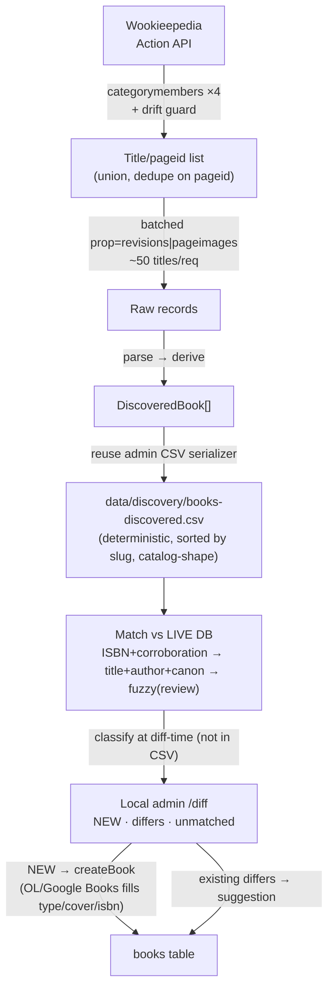

# ✨ Wookieepedia Catalog Discovery & Enrichment

## Enhancement Summary

**Deepened & reviewed:** 2026-07-01 (research fan-out + 4-reviewer pass: simplicity, TypeScript-taste, architecture, data-integrity).
**Scope reframed** per directive: crawl **all Star Wars novels** (canon + Legends, **excluding comics**) from Wookieepedia, emit a git-versioned **discovery CSV** mirroring the catalog schema — a staging artifact "we can build against for updating the database."

### Review-driven decisions (what changed after the reviewer pass)
- **v1 is discovery-only; enrichment is Part 2.** The satellite table + app-detail UI are split into a separate follow-up plan. v1 delivers the directive's core value: discover missing books → staging CSV → human-gated promotion. See [Part 2](#part-2-in-universe-enrichment-follow-up-plan).
- **No auto-apply upsert in v1.** Promotion is human-gated: NEW books insert via the existing admin `createBook`; wiki differences on *existing* books are shown as review suggestions, never bulk-upserted. This single decision removes the array-clobber bug (COALESCE replacing `isbn[]` and dropping curated ISBNs), the `primary_isbn` invariant break, and the per-cell provenance problem — all at once.
- **`type` for Legends resolved via OL/Google Books at promotion**, not fabricated by the crawler. The existing `searchForNewBook` (Open Library + Google Books) fills `type`/covers/extra ISBNs; the `NOT NULL CHECK` is only satisfied at insert, so it's not a crawl-time blocker. No migration.
- **Promotion is a local-only admin operation** — the hosted Vercel admin can't read `data/*.csv` (it silently returns "no drift"), so discovery review runs against the local admin only.
- **Dropped as over-built for ~180 rows / run-occasionally:** blocking, a formal quarantine framework, the field-authority config map, and `wiki-map.json` (deferred — the matcher works on ISBN + title/author; `pageid` survives only as the Part 2 satellite's `source_pageid`).
- **Dropped `merge_books()` coupling** — `ON DELETE CASCADE` handles a duplicate-merge; no satellite fold needed.
- **Added:** explicit type-contract seams, a category-count **drift guard**, ISBN-match **corroboration** (no lone-ISBN auto-merge), reuse of the admin CSV serializer for determinism, and slug-uniqueness checked against the **live DB** (not the frozen CSV).

---

## Overview

Build a **discovery pipeline** that enumerates every Star Wars novel on Wookieepedia via the MediaWiki **Action API**, derives our catalog fields, and writes a deterministic **discovery CSV** mirroring the `books` schema. An operator reviews it in the **local admin `/diff` UI**; NEW books are promoted via the existing `createBook` flow (which enriches from Open Library + Google Books), while differences on existing books surface as suggestions. Wookieepedia is the source for the *list + canon + facts*; OL/Google Books is the secondary source for gaps (`type`, covers, extra ISBNs). In-universe enrichment (characters, timeline detail) is a separate follow-up ([Part 2](#part-2-in-universe-enrichment-follow-up-plan)).

Original questions, still answered:
- **Columns vs. separate DB (for enrichment)?** → a **1:1 satellite table**, same DB (Part 2).
- **How to fetch?** → **Action API primary**, REST optional for metadata.

## Problem Statement / Motivation

The catalog (185 rows) was hand-seeded and is incomplete/uneven — missing Legends titles, gaps in series/timeline/publisher. Wookieepedia curates the authoritative novel list plus rich facts. We discover the full novel set, reconcile against what we have, and let an operator promote gaps and corrections.

Hard constraints:
- **Untrusted input** — a crawler never writes to the system of record; all promotion is human-gated.
- **Two data owners** — hand-curated fields must survive re-crawls; the human gate is the enforcement mechanism in v1 (nothing auto-applies).
- **Licensing** — facts are free; prose is CC BY-SA-encumbered (facts-first; see [Licensing](#licensing--legal)).

## Scope & non-goals

**In scope (v1):** discover Star Wars **novels** — Canon Adult, Canon YA, Canon Middle-Grade, Legends — build the staging CSV, reconcile, promote via local admin.

**Out of scope:** comics / graphic novels, reference books, short stories, audio dramas, young-reader **picture books**, novellas/eNovellas (all excluded by category selection). **In-universe enrichment** (satellite table + detail-screen cards) is deferred to Part 2.

## Architecture at a glance



## Data source & API

Live-verified against `starwars.fandom.com` (MediaWiki 1.43.8, 2026-07-01), compliant UA. **Server-side/batch only.**

### Action API vs. REST — decided
**Primary: Action API (`api.php`)** (only API with category listing; batched multi-title facts; section-level intro; `parsetree`). **REST (`rest.php`) optional** for the per-page `license`+`latest.id` object. Dead paths: legacy `/api/v1` (Nirvana, Cloudflare 403), Wikimedia `/api/rest_v1/summary` (403 on Fandom). `prop=extracts` not installed.

### Enumeration recipe (live-verified; revised 2026-10-20 to close the sub-category gap)

Per bucket, union the FLAT page members with the page members of each non-excluded
DIRECT sub-category (one level deep), dedupe on `pageid`; `cmtype=page&cmnamespace=0`
for pages, `cmtype=subcat&cmnamespace=14` to map a bucket's subcats. Across buckets,
first bucket in order claims a shared `pageid`.

| Bucket | flat | +subcats | union | `canon` | `type` (inherited by subcat members) |
| --- | --- | --- | --- | --- | --- |
| `Category:Canon adult novels` | 50 | THR adult | 58 | Canon | Adult Novel |
| `Category:Canon young-adult novels` | 18 | THR YA | 26 | Canon | YA Novel |
| `Category:Canon middle-grade novels` | 31 | THR junior, Join the Resistance, Servants of the Empire | 46 | Canon | Middle Grade Novel |
| `Category:Legends novels` | 84 | X-Wing, New Jedi Order, Legacy of the Force, Fate of the Jedi, Coruscant Nights, Old Republic, Clone Wars (+tie-in), Empire and Rebellion, Essential Legends Collection | 162 | Legends | *unset → resolved via OL/Google at promotion* |

Global union ≈ **292 pages → 283 rows** after the `{{Book}}` infobox filter (9 container/boxed-set/interview/dramatis-personae pages have no `{{Book}}` and are dropped).

**Why recursion is required:** many novels live ONLY in series sub-categories, never in the flat parent. Legends series subcats (X-Wing ×10, NJO ×24, LOTF, FOTJ, Coruscant Nights, Old Republic, …) and the Canon **High Republic** novels — which sit in `Star Wars: The High Republic {adult,young-adult,junior} novels`, *sub-categories of the three Canon tier buckets* — were all missing from the flat-only crawl (~88 catalog novels undiscovered). A classify run against prod exposed this; one-level recursion closes it (gap 88 → 13, the residual being title-form mismatches the operator reconciles in `/diff` plus correctly-excluded audio-drama/young-reader/short-story items).

**Exclude** (applied to top-level buckets AND to subcats during recursion): `Canon novels` (container), `*young-reader*` (picture books; catches `Legends young-reader novels`), `*novellas*`/`*eNovellas*`, `*graphic novels*` (comics), `*novel series*` (containers; catches `Legends novel series`), `*audiobooks*` (audio editions). The `{{Book}}` infobox filter is the final safety net for non-novel pages inside a kept subcat.

**Request plan (~25–30 requests, <15s):** per bucket, 1× `list=categorymembers&cmtype=page` + 1× `cmtype=subcat` + 1× `cmtype=page` for each kept subcat (all with defensive `cmcontinue`), then ~6× `action=query&prop=revisions|pageimages&rvprop=content|ids&rvslots=main&piprop=original&titles=…(≤50)…&formatversion=2&redirects=1`.

**Drift guard:** assert each bucket's FULL union count (flat ∪ kept-subcat members, pre-infobox) is within a committed band (adult 45–85, YA 18–45, MG 34–70, Legends 135–200, vs live 58/26/46/162); if a bucket collapses or an unexpected sibling appears, **fail loudly and do not overwrite the CSV**. `canon`/`type` derive from *which bucket*, so a silent taxonomy change would otherwise produce a clean-but-wrong CSV.

### Field-derivation rules
- **`canon`** ← crawl bucket (most reliable at scale). **`type`** ← Canon tier bucket. Under recursion a subcat member inherits its PARENT bucket's `canon` + `type`, because the subcat is a subcategory of that tier (membership is transitive — a THR-adult book IS a Canon-adult book), so no tier is guessed. Legends `type` stays unset (resolved via OL/Google at promotion). If a future source reaches a Canon book ONLY via a non-tier category, leave `type` unset — do not add such a category as a recursing bucket.
- **`author`, `publisher`, `date_published`, `isbn`, `timeline_order`** ← `{{Book}}` infobox (~100%). Clean `[[links]]`/`<ref>`/`{{templates}}` — including NESTED citation templates (`{{SW}}`, `{{Twitter}}`, `{{SWYouTube}}`, `{{Cite…}}`) inside a field value; the multi-value splitter strips citations BEFORE splitting so a citation's inner `#`/`;`/`&#124;` can't shatter a template into the author. Co-authors split on `<br>`/newline/`*`/`#`/`;`/` & `/` and `. **`date_published`** → ISO via the catalog's `parseDate`. **`timeline_order`** is separate: the sign comes only from BBY→`-`/ABY→`+`; thousands commas are kept (`25,793 BBY`→`-25793`); a range (`67-65 BBY`) takes the start (`-67`); and when tokens span BOTH eras the ancient BBY is treated as a flashback so the first ABY token wins (Crosscurrent `41`, Millennium Falcon `43`) — timeline is noisy and human-reviewed. Never feed a BBY string to `parseDate`.
- **`series`/`series_order`** ← infobox `series` (~33%) + `preceded/followed by`; leave null when absent (don't fabricate).
- **`cover_image`** ← `pageimages` URL as a **reference only** (publisher-copyright; keep the OpenLibrary cover pipeline as the real source).

### Secondary source: Open Library + Google Books
Reuse the admin's existing `searchForNewBook` (`admin/app/_actions/lookup.ts`) at promotion to fill fields Wookieepedia lacks — notably **`type`/audience for Legends**, covers, and additional ISBNs. Wookieepedia = list + canon + in-universe facts; OL/Google = bibliographic gaps.

## The discovery CSV

`data/discovery/books-discovered.csv` — a git-versioned staging file mirroring the catalog schema. **Separate from the frozen `data/books.csv`** (prod DB is canonical; a crawler is untrusted). Promotion is a human-gated operator action.

- **Catalog-shape only.** Same header + order as `data/books.csv`. **`match_class`/`match_reason` are NOT columns** — they'd churn when the *catalog* changes, breaking the "diffs mean the wiki changed" contract; classification is computed at `/diff` time (or a gitignored sidecar).
- **Deterministic:** sort rows by `slug` (C-locale); **reuse the admin export's row→CSV serializer** (not ad-hoc `join(';')`) so array/date/null formatting matches `books.csv`; **sort multi-value cells** (author/isbn/format) so wiki ordering doesn't churn diffs; NFKD-normalize. Volatile metadata (crawl timestamp, `revid`, rotating cover URLs) → gitignored `data/discovery/discovery-meta.json`.
- **Acceptance:** byte-identical on a no-change re-run.

## Identity resolution & dedup

Reconcile each discovered record against the **live DB** (canonical), not the frozen CSV. `canon` is always part of the identity key — never merge across Canon/Legends.

Cascade:
1. **ISBN-13 set match + corroboration** — normalize (strip hyphens; ISBN-10→13 recomputing the check digit; idempotent on already-13; reject invalid). `books.isbn` is an array → match on set intersection. **A shared ISBN alone is not decisive** (omnibus/box-set/reissue editions reuse ISBNs) → require corroborating title/author; otherwise downgrade to review. (Reuse any existing normalizer — check `scripts/source-isbns.ts` before writing a new one.)
2. **Normalized `title + full author-set + canon`** — reuse `slugify()`-style normalization; compare the *full* author surname set (not one surname); strip `(novel)`/`(novelization)` + series prefixes.
3. **Fuzzy title** (review-only, never auto) — token-sort ≥ ~90–95%, same canon; integer threshold + stable tie-break for determinism.

**Classification (at diff-time):** NEW (no match) · DIFFERS (matches; wiki fields differ — shown as suggestions) · UNMATCHED-FUZZY (operator picks). Unmatched rows get a short reason note (deterministically ordered) — no enterprise quarantine framework needed at this scale.

**Slug (NEW rows):** `slugify(title)` + `ensureUniqueSlug(base, live DB slugs)` (`lib/slug.ts`). Canon/Legends collision tiebreaker: pin to a **stable key** (lower `pageid` keeps the clean slug; twin gets `-legends`) so re-runs don't flip. **Re-check slug availability against the DB at promote-time** (TOCTOU between crawl and promote), so a NEW slug can't accidentally `ON CONFLICT`-update an unrelated prod row.

## Module & type design

`lib/wookieepedia/`:
- `client.ts` — Action-API client only (UA, ≤3 concurrent, 429 backoff, `cmcontinue`, ≤50-title batches). Types the nested `formatversion=2` response **once at this edge**; nothing downstream touches `response.query?.pages?.[0]?…`.
- `parse.ts` — the **only** place raw wikitext appears; `{{Book}}` → `InfoboxFields` (honest `Record<string,string>` of un-parsed fields). Sub-cleaners: `stripWikiMarkup`, `parseWikiDate`, `parseTimeline`, `normalizeIsbn`.
- `derive.ts` — `(fields: InfoboxFields, bucket: CategoryBucket) => DiscoveredBook`; assembles infobox facts + crawl-bucket (`canon`/`type`) into the typed record. (Different provenance than parse — keep the seam.)
- `match.ts` — the dedup cascade + slug tiebreaker.

Type flow: `RawPage → InfoboxFields → DiscoveredBook`, where **`DiscoveredBook = BookFields & { source_pageid }`** (reuse `BookFields` from `lib/catalog.ts` so CSV columns and any promotion payload share one type and fail compilation if the schema shifts). Pin `type BookType = 'Adult Novel' | 'YA Novel' | 'Middle Grade Novel'` to the exact DB CHECK strings.

**Pure-function test seams (Vitest):** `parseWikiDate('[[April 11]], [[2017]]')→'2017-04-11'`, `parseTimeline('c. [[15 BBY]]')→-15`, `normalizeIsbn` (13-idempotent / 10→13 / hyphenated / invalid-reject), `deriveBook`, `classifyMatch`, and the `-legends` slug tiebreaker. `client.ts` stays separate so parsing is DB-/network-free.

## Promotion (human-gated, local-only)

- Runs against the **local admin** only (hosted Vercel admin can't read `data/*.csv`). Document in Phase 3 + acceptance.
- Extend the local admin `/diff` to show the discovery classification; NEW rows promote via existing `createBook` (which runs OL/Google `searchForNewBook` to fill `type`/cover/ISBNs); DIFFERS rows show wiki suggestions the operator applies field-by-field via the existing edit path. **No bulk COALESCE upsert in v1.**
- After a session, run `npm run catalog:backup`.
- *(If auto-apply is ever added later: array columns must union via the existing `ordered_text_union`, never COALESCE-replace, and `isbn` must stay additive so `primary_isbn ∈ isbn[]` holds.)*

## Licensing & legal
CC BY-SA 3.0 (text only; **cover art is publisher-copyright — do not rehost**). **Facts are free** (author/ISBN/publisher/dates/series/timeline/canon) — the CSV payload. **Prose is encumbered** — deferred to Part 2 behind an attribution component. Fandom ToU permits light, attributed, documented-API use; our ~8–10-request volume is safe. Compliant UA, ≤3 concurrent, honor 429.

## Implementation Phases (v1)

### Phase 1 — Crawl & build the discovery CSV
`lib/wookieepedia/{client,parse,derive}.ts` + `categories` config (4 buckets, each recursing one level into non-excluded direct sub-categories; exclusions; per-bucket union drift-guard bands) + `scripts/discover-wookieepedia.ts` (`--dry-run` prints per-bucket flat/subcat/union counts; emits deterministic CSV + gitignored meta sidecar recording kept/skipped subcats). `client.ts` adds `fetchSubcategories` (`cmtype=subcat`).
**Acceptance:** ~283 rows across 4 buckets incl. one-level subcat recursion (X-Wing, NJO, LOTF, FOTJ, Coruscant Nights, Old Republic, Canon High Republic now covered); comics/picture-books/novellas/audiobooks/series-containers absent; byte-identical re-run; drift guard fails loudly on a collapsed bucket.
**Revision 2026-10-20:** closed the sub-category enumeration gap (flat-only crawl missed ~88 catalog novels) and fixed three infobox parse bugs the prod classify run surfaced — nested citation-template stripping, `&` co-author split, and `timeline_order` sign/comma/flashback handling. See the Enumeration recipe + Field-derivation rules above.

### Phase 2 — Match & classify against the live DB
`lib/wookieepedia/match.ts` — ISBN+corroboration → title+author-set+canon → fuzzy(review); classify NEW/DIFFERS/UNMATCHED at diff-time; slug via `slugify`+`ensureUniqueSlug` against live DB slugs.
**Acceptance:** existing books resolve as matches (no duplicate NEWs); Canon/Legends twins stay distinct; a shared-ISBN omnibus is NOT auto-merged; ISBN normalizer unit tests pass.

### Phase 3 — Human-gated promotion (local admin)
Extend local admin `/diff`; NEW → `createBook` (OL/Google fills type/cover/isbn); DIFFERS → suggestions; slug re-checked at promote-time; `catalog:backup` after.
**Acceptance:** operator promotes NEW inserts and applies/ignores suggestions; `data/books.csv` never crawler-overwritten; discovery review is local-only (not on the Vercel deploy); Legends rows get a valid `type` via lookup before insert (no CHECK violation).

## Part 2: In-universe enrichment (follow-up plan)

**Now its own plan:** [2026-07-01-feat-wookieepedia-enrichment-satellite-plan.md](2026-07-01-feat-wookieepedia-enrichment-satellite-plan.md). Summary retained here for continuity. Adds a **1:1 satellite `book_enrichment`** (PK=FK→`books.id` `ON DELETE CASCADE`) for characters/appearances/timeline detail + provenance (`source_pageid`, `source_url`, `license`, `attribution`, `fetched_at`, `content_hash`), surfaced on `app/book/[id].tsx` with a "View on Wookieepedia" attribution backlink.

```mermaid
erDiagram
    books ||--o| book_enrichment : "1:1 enriches"
    books ||--o{ user_books : shelves
    book_enrichment {
        uuid book_id PK_FK "→ books.id ON DELETE CASCADE"
        bigint source_pageid "stable anchor"
        text source_url
        text license "CC-BY-SA-3.0"
        timestamptz fetched_at
        text content_hash "gate; hash normalized fields, not raw wikitext"
        jsonb characters
        jsonb appearances
        text timeline_notes
    }
```

Part-2 notes captured from review (to honor when written):
- **Satellite over columns**, same DB — correct (independent RLS/provenance/cadence; no hot-row bloat).
- **RLS:** mirror the base table's **dual read policies** (`authenticated` *and* `anon`), or the anon PostgREST embed returns null enrichment; **no** client-role write policy.
- **Merge:** no `merge_books()` change needed — `ON DELETE CASCADE` drops the loser's enrichment; re-sync repopulates if the survivor lacked it.
- **Read:** embed `book_enrichment(*)` **only on the detail query**, not the shelf list (jsonb payload bloat); handle supabase-js one-to-one-as-array (`[0]` / view / `!left`).
- **Types:** narrow generated `Json` via a `parseEnrichment(row): Enrichment` boundary — app never indexes raw `Json`.
- **`pageid` lifecycle:** quarantine mapped pageids that go `missing` or resolve via `redirects` — never silently drop/re-point.
- **`content_hash`** covers normalized stored fields (not raw wikitext) so cosmetic wiki edits don't churn `fetched_at`.

## Edge cases
- **Legends `type`** → filled by OL/Google at promotion; CSV leaves it unset; DB CHECK satisfied only at insert.
- **Shared/reused ISBN** (omnibus/box-set/reissue) → not auto-merged; requires title/author corroboration.
- **ISBN-10↔13** → recompute check digit; idempotent on 13; invalid → reject (→ falls to title match).
- **Canon/Legends twins** → distinct; `canon` in key; stable-`pageid` slug tiebreaker.
- **Title/subtitle/punctuation variance** → normalize before comparing (biggest false-NEW source).
- **Series sparsity (~67%)** → leave null.
- **Disambiguation pages** → filtered by `cmtype=page&cmnamespace=0`; validate infobox presence.
- **Category taxonomy change** → drift guard fails loudly (no silent wrong CSV).
- **Slug TOCTOU** → re-check against DB at promote-time.

## Acceptance Criteria (v1)
- [ ] Deterministic `data/discovery/books-discovered.csv` (~180 novels; comics/picture-books excluded; catalog-shape, no `match_class` column; byte-identical re-run).
- [ ] `canon`/`type` from category (Legends `type` unset → filled at promotion); infobox facts cleaned; timeline vs date handled separately; volatile metadata in the gitignored sidecar.
- [ ] Drift guard aborts (no overwrite) if a category collapses / an unexpected sibling appears.
- [ ] Match cascade resolves existing books as matches (no dup NEWs); shared-ISBN not auto-merged; Canon/Legends twins distinct; ISBN normalizer + slug-tiebreaker unit-tested.
- [ ] Promotion is local-admin-only, human-gated: NEW → `createBook` (+OL/Google fill), DIFFERS → suggestions; no auto-upsert; `data/books.csv` never crawler-overwritten; slug re-checked at promote-time.
- [ ] Facts-only in v1 (no prose); enrichment satellite/app UI deferred to Part 2.

## Resolved decisions
1. **Legends `type`** → resolved via OL/Google Books lookup at promotion (user call); no default fabricated, no migration.
2. **Middle-Grade** kept a distinct `type` (category is clean).
3. **v1 = discovery; enrichment = Part 2** (per simplicity review + directive focus).
4. **Promotion path** = local admin only (per architecture P0).

## Risks
- **Fandom ToU / rate limits** — tiny volume, UA, documented API; serial+backoff, resumable.
- **Infobox parsing** — stable field names; `parsetree` fallback; human review + unit tests catch stragglers.
- **False merges** — ISBN+corroboration, canon-keyed, review-only fuzzy; nothing auto-applies.
- **Curated-data clobber** — eliminated in v1 by the human gate (no auto-upsert).

## References & Research

### Internal (file:line)
- Catalog transform / manual-wins overrides: [lib/catalog.ts](lib/catalog.ts) (`buildBookFields`, `BookFields`, `parseDate`, `splitMultiValue`)
- Slug utility: [lib/slug.ts](lib/slug.ts)
- CSV read (lossy round-trip source): [lib/csv/read.ts](lib/csv/read.ts); admin serializer to reuse: [admin/app/_actions/export.ts:178](admin/app/_actions/export.ts)
- Admin FS dependency / silent "no drift" on hosted: [admin/app/_actions/export.ts:16](admin/app/_actions/export.ts), [:125](admin/app/_actions/export.ts)
- Create + OL/Google lookup: [admin/app/_actions/books.ts:113](admin/app/_actions/books.ts) (`createBook`), `admin/app/_actions/lookup.ts` (`searchForNewBook`)
- Array-union precedent + `primary_isbn` invariant: [supabase/migrations/20260602000000_add_merge_books_function.sql:20](supabase/migrations/20260602000000_add_merge_books_function.sql) (`ordered_text_union`)
- Schema (`type` CHECK, dual read RLS): [supabase/migrations/20260410000000_create_books_and_user_books.sql:19](supabase/migrations/20260410000000_create_books_and_user_books.sql)
- Existing ISBN pipeline to reuse: `scripts/source-isbns.ts`, `data/isbn-manual-overrides.json`, `data/csv-isbn-rejected.json`
- New artifacts: `data/discovery/books-discovered.csv`, `lib/wookieepedia/{client,parse,derive,match}.ts`, `scripts/discover-wookieepedia.ts`

### External
- MediaWiki: [Action API](https://www.mediawiki.org/wiki/API:Action_API) · [Categorymembers](https://www.mediawiki.org/wiki/API:Categorymembers) · [Etiquette](https://www.mediawiki.org/wiki/API:Etiquette)
- Licensing/ToU: [Wookieepedia:Copyrights](https://starwars.fandom.com/wiki/Wookieepedia:Copyrights) · [Fandom Licensing](https://www.fandom.com/licensing) · [Fandom ToU](https://www.fandom.com/terms-of-use)
- ETL/reconciliation & entity resolution: [Datafold](https://www.datafold.com/blog/data-reconciliation-best-practices/) · [Towards Data Science — entity resolution](https://towardsdatascience.com/entity-resolution-identifying-real-world-entities-in-noisy-data-3e8c59f4f41c/)
- Upsert / arrays: [Prisma — INSERT ON CONFLICT](https://www.prisma.io/dataguide/postgresql/inserting-and-modifying-data/insert-on-conflict)
- Determinism: [reproducible-builds — stable output order](https://reproducible-builds.org/docs/stable-outputs/)

### AI-assisted
- Researched with Claude (live-verified Fandom API/enumeration 2026-07-01; repo pipeline map; ETL/entity-resolution). **Reviewed by 4 agents** (simplicity, TypeScript-taste, architecture, data-integrity); their findings are folded into the decisions above. Infobox parsing, match thresholds, and the OL/Google `type`-fill still warrant human verification during build.
